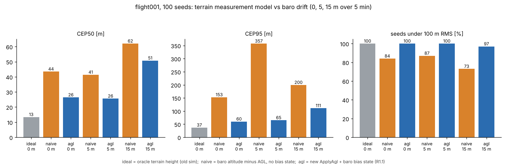

# TEST-017: real altimeter (AGL) measurement model (R1.1)

**Question.** The TRN simulator used to hand the filter terrain height directly. A real
aircraft can't measure that. It measures height above ground (rangefinder or radar)
and altitude (barometer, with a bias that drifts). Does GDN still navigate when it gets
what a real aircraft gets, and does a biased barometer still make it diverge?

**Pre-registered pass rule.** The MC with a 15 m baro drift no longer diverges: 95 or
more of 100 flight001 seeds stay under 100 m RMS. Also, the real model beats the naive
approach under every drift tested.

## What changed

- `Eskf::ApplyAgl(agl, map_query)`, with the model agl = (h0 - p_z) - h_map(n, e). The
  measurement Jacobian is H = [-dh/dn, -dh/de, -1]. Altitude error is now part of the
  prediction and gets estimated, instead of being assumed perfect.
- `SetAltitudeDatum(h0, sigma)` and `InitBaroBias(baro, sigma)`. These calibrate the
  altitude datum and the baro bias together at start-up, with a covariance consistent
  with b = baro - z. Without this, the filter believed the bias was only known to
  +-5 m, and on gentle slopes it traded that for 25 to 100 m of horizontal doubt.
- Gain rows for the mag-bias states are zeroed before the update. The Joseph form then
  keeps the covariance consistent with what was applied (the R1.4 approach, used here
  first).
- Tuning from a sweep (below): `r_agl` = 100 m^2, and `q_baro_bias` 0.001 to 0.05 m^2/s.
- Node: `trn_model:=agl` (default) subscribes to `/gdn/agl_meas`, and sets the datum
  and baro bias on the first reading after yaw alignment. It no longer takes the
  initial altitude from GNSS-derived `vehicle_local_position`, which removes one truth
  leak (part of R1.2). `trn_model:=ideal` keeps the old path.
- Simulator: `trn_sensor_sim.py` also publishes `/gdn/agl_meas`. The recorded flight
  was flown over flat ground, so the map is placed under it, at least 30 m below the
  highest point within 1500 m.
- MC: `--model=ideal|naive|agl`, `--baro-drift`, `--window`, `--q-baro`, `--r-agl`.
  "naive" is what a real system gets if it computes terrain as baro altitude minus
  AGL, with no bias state. The ideal mode reproduces the old random sequence exactly
  (parity checked: 13.4 m / 37.0 m / 100 of 100).

## Results: Monte Carlo

Baro drift means the bias grows linearly by that amount over the first 300 s after
TRN starts, on top of a constant 5 m offset that is calibrated out on the ground.

flight001, 100 seeds, scored from 60 to 300 s:

| Model | Baro drift | CEP50 | CEP95 | Seeds under 100 m | Altitude p95 |
|---|---|---|---|---|---|
| ideal (old oracle) | none | 13.4 m | 37.0 m | 100 | n/a |
| naive | 0 m | 43.5 m | 152.8 m | 84 | n/a |
| **agl** | 0 m | **26.4 m** | **60.1 m** | **100** | 2.9 m |
| naive | 5 m | 41.4 m | 357.4 m | 87 | n/a |
| **agl** | 5 m | **25.6 m** | **65.2 m** | **100** | 4.1 m |
| naive | 15 m | 62.0 m | 199.7 m | 73 | n/a |
| **agl** | 15 m | **50.8 m** | **111.2 m** | **97** | 9.9 m |

Zermatt SRTM, 24 seeds:

| Model | Baro drift | CEP50 | CEP95 | Seeds under 100 m | Altitude p95 |
|---|---|---|---|---|---|
| ideal | none | 14.2 m | 1265.5 m | 19 | n/a |
| naive | 0 m | 545.8 m | 3776.6 m | 6 | n/a |
| **agl** | 0 m | **17.9 m** | **909.4 m** | **17** | 6.5 m |
| naive | 15 m | 846.3 m | 4037.2 m | 4 | n/a |
| **agl** | 15 m | **71.4 m** | **928.7 m** | **11** | 13.7 m |

## Results: replay bench (flight001, ROS node, 60 to 300 s)

| Model | Baro | RMS | Max |
|---|---|---|---|
| ideal (TEST-016) | on | 31.5 m | 68.4 m |
| ideal (TEST-016) | off | 22.5 m | 47.8 m |
| **agl** | **on** | **21.3 m** | **35.6 m** |
| agl | off | 67.1 m | 145.1 m |

**AGL without a barometer is not a usable configuration.** Height above ground alone
is one equation in two unknowns, altitude and position. Nothing separates "I'm higher"
from "I'm over lower ground", and on gentle slopes the filter drifts along that
ambiguity. The old oracle hid this as well. The node now logs a warning when AGL
updates run without baro data.

The node set its datum at 817.2 m against a true 820.7 m, inside the 5 m it assumes.
After that, it tracked altitude within about 1 to 3 m through the climb to 100 m.

## Tuning sweep (flight001, 50 seeds)

| q_baro (m^2/s) | r_agl (m^2) | drift 0: CEP50 / CEP95 / pass | drift 15: CEP50 / CEP95 / pass |
|---|---|---|---|
| 0.001 | 400 | 38.5 / 104.6 / 49 | 92.4 / 235.8 / 24 |
| 0.001 | 100 | 28.6 / 63.3 / 50 | 62.6 / 132.8 / 48 |
| 0.05 | 100 | 26.3 / 60.4 / 50 | 53.1 / 117.7 / 48 |
| 0.05 | 64 | 27.2 / 66.6 / 50 | 51.0 / 108.5 / 49 |
| 0.2 | 64 | 27.2 / 78.8 / 48 | 42.3 / 115.3 / 48 |
| 0.5 | 64 | 28.6 / 76.0 / 50 | 41.2 / 117.5 / 46 |

We chose q_baro = 0.05 and r_agl = 100: best at zero drift, and close to the best
under drift. A looser bias model helps under fast drift, but costs accuracy the rest of
the time.

## What we learned

1. **Pass.** With 15 m of drift, 97 of 100 seeds stay under 100 m RMS (rule: 95 or
   more). The real model beats the naive one in every case, and the naive one collapses
   on Zermatt (CEP50 546 m).
2. **The oracle was hiding a lot.** On the gently sloped synthetic map, each metre of
   altitude error looks like several metres of horizontal error. The honest CEP50 is
   26 m, not 13 m. This is the number to improve from now on. Altitude accuracy and
   terrain slope set the floor for scalar TRN.
3. **Fast pressure changes still hurt.** 15 m in 5 minutes (a strong weather front) is
   faster than a random-walk bias can follow without hurting the zero-drift case.
   Altitude p95 is then 9.9 m, which fails REQ-NAV-010 (5 m). Options for later: a
   bias-rate state, or odometry and LIO vertical aiding (Phase 3).
4. **A barometer is required.** AGL without baro gives 67 m RMS on the bench, against
   21 m with it (see above).
5. **The zero-drift bench improved too.** With the datum and bias calibrated properly,
   the baro now helps (21.3 m) rather than hurting (31.5 m). That's the OI-002/OI-003
   coupling.

## Follow-ups

- Tilt correction of slant range belongs with the real rangefinder driver (R6.2).
- Score 5 and 10 minutes without GNSS on longer flights (R1.7).
- Test against map error, since world and database are still the same map (R1.3).
- The ZUPT and take-off latch still read GNSS-derived velocity (R1.2).
