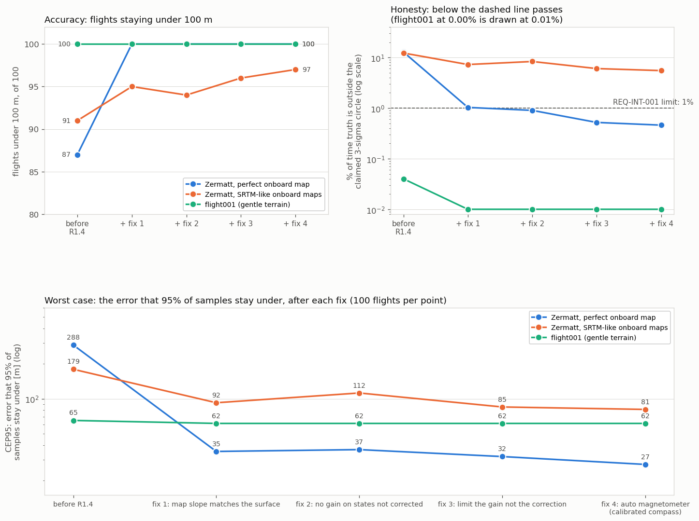
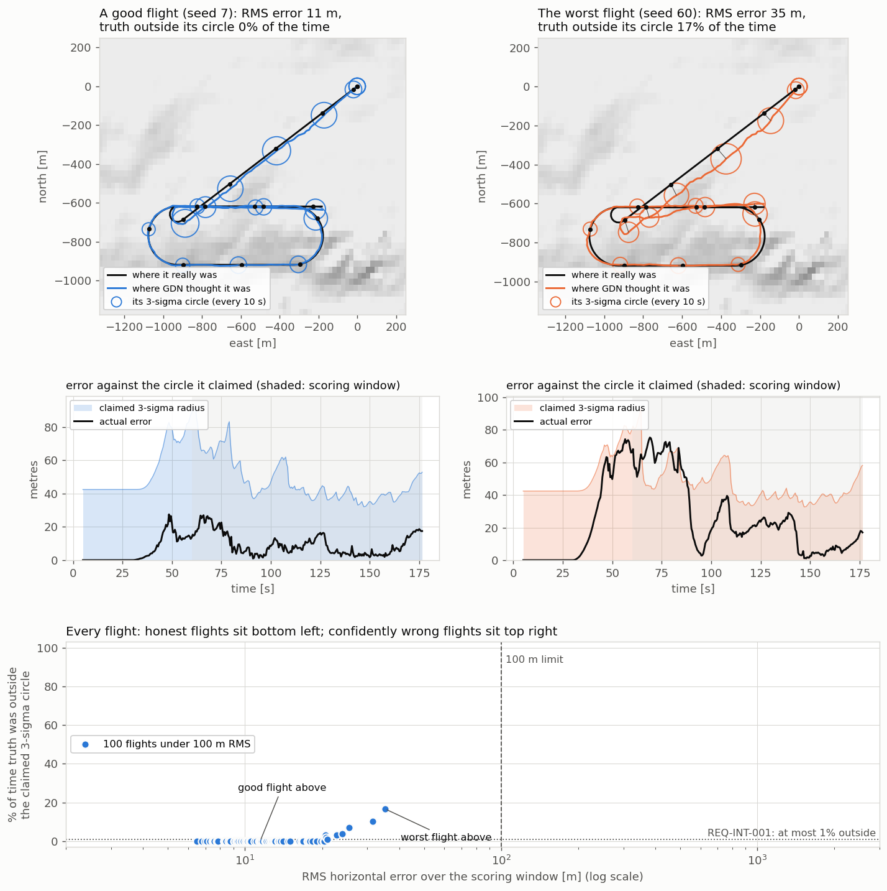
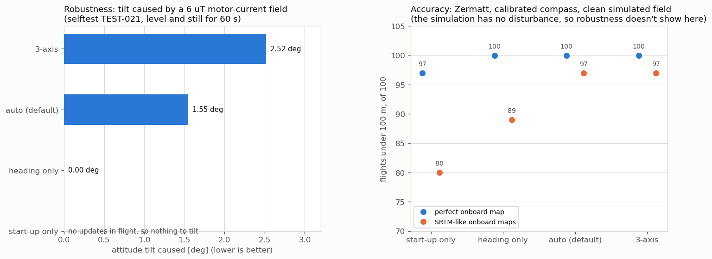

# TEST-021: covariance consistency fixes (R1.4)

**Question.** TEST-019 showed the failing Zermatt flights were confidently wrong: 90% of
their samples outside the 3-sigma circle GDN reported. R1.4 lists four ways the filter's
covariance stops matching what it actually does. Does fixing them make GDN honest
(REQ-INT-001: truth outside the 3-sigma circle in at most 1% of samples), and what does
each fix contribute?

**Pass rule.** Each fix first has a check that fails on the old filter. With all four in,
Zermatt through the node start-up path meets REQ-INT-001, so its CI step can become
blocking.

## The four problems and their fixes

1. **The map slope didn't match the map height.** `MapDb::Query` returned the height of
   the bilinear surface at the query point, but the slope from central differences at
   the cell corner: up to 0.033 m/m apart (about 2 degrees of slope) on Zermatt-like
   terrain. The filter's H didn't match its own prediction. Now the slope is the
   derivative of the same bilinear surface.
2. **Updates shrank the variance of states they didn't correct.** `ApplyTrn` and
   `ApplyBaro` threw away their corrections to the baro and mag biases after computing
   them, but updated the covariance with the full gain. Now those gain rows are zeroed
   before the update, so the Joseph form neither corrects nor shrinks them.
3. **Clamped corrections left an overconfident covariance.** Corrections to velocity,
   attitude and the IMU and mag biases are capped per update, but P shrank as if the
   whole correction had been applied: one capped ZUPT left 4.5 m/s of error behind a
   claimed sigma of 0.087 m/s (52 sigma). Now the gain rows of a block are scaled down
   until its correction fits the cap (`Eskf::LimitGain`), and P matches what was
   applied (8.0 m/s sigma for the same case). `clamps()` counts the events.
   `EskfConfig::clamp_dp` was never used by any update and still isn't.
4. **The 3-axis magnetometer update tilts the attitude when the field is disturbed
   (OI-012).** It explains any field error with attitude: a 6 uT motor-current field on
   body z tilted a level, still vehicle by 2.52 degrees. New:
   - `ApplyMagHeading`: the measured field is levelled with the current attitude and only
     its horizontal direction is used, with the attitude gain projected onto the body
     vertical. It can't tilt the attitude (0.00 degrees). A heading can't observe the
     hard-iron bias (it sees the field's direction, never its strength): left free, the
     bias estimate ran away to 120 uT with no bias at all. So this update assumes a
     calibrated compass, never changes the bias estimate, and counts the calibration's
     residual (`mag_heading_cal_sigma`, 0.5 uT) as noise.
   - `ApplyMagAuto` (**the new default**, `mag_fusion:=auto`, `--mag=auto`): the 3-axis
     update while the field's strength and dip, averaged over about 1 s, agree with the
     reference (within 2 uT and 2 degrees), heading only otherwise. The 3-axis update
     also observes tilt, which matters when the onboard map is imperfect (below).
     Optional hysteresis (`mag_auto_hold`) is off by default.

   The default was chosen by the project lead from the trade-off below.

**Simulation change.** Heading-only fusion relies on a calibrated compass, as a real
one is (PX4 applies its calibration before publishing). `mag_sim.py` and the MC now
simulate the residual after calibration, 0.15 x (2, -1, 1) uT (about 0.35 uT), instead of
the uncalibrated (2, -1, 1) uT. `GDN_MAG_HARDIRON=1` and `--hard-iron=1` restore the old
value as a stress test; results for it are below.

## Unit tests (selftest, -O2 and -O3)

TEST-021, 9 checks. Before the fixes 5 failed; the mag checks ran against a stub that
still did the 3-axis update.

| Check | Before | After |
|---|---|---|
| Map slope against the slope of the interpolated height | 0.033 off | 0.0000 |
| Variance change of states an update doesn't correct | 4.4e-2 | 0 |
| One clamped ZUPT: error against claimed sigma | 4.5 m/s vs 0.087 m/s (52 sigma) | 4.5 m/s vs 8.0 m/s |
| Tilt from a 6 uT body-z disturbance, heading only | 2.52 deg | 0.00 deg |
| Tilt from the same, auto | n/a | 1.55 deg (3-axis: 2.52) |
| Heading while turning, calibrated compass, 10 deg start error | 5.1 deg | 1.4 deg |
| Mag bias estimate with zero true bias, heading only | 120 uT | 0.00 uT |

Auto needs about 1 s of averaging to see a 6 uT step through 2 uT of per-sample noise,
and the 3-axis updates in that window tilt the attitude. It cuts the disturbance tilt
(by 40% here) rather than removing it; its check asks for at least 30% less than 3-axis
and no switching on a clean field.

## Results: Monte Carlo, fix by fix

100 flights per point. Zermatt: AGL model, node start-up. SRTM-like onboard maps: 5 map
error patterns x 20 flights (TEST-020 recipe). flight001: AGL model, 5 m baro drift,
truth start-up (the CI configuration).



| Step | Zermatt, perfect map | Zermatt, SRTM-like maps | flight001 |
|---|---|---|---|
| Before R1.4 | 10.8 / 288 m, 87, **12.8%** | 25.6 / 179 m, 91, 12.2% | 25.6 / 65.2 m, 100, 0.04% |
| + fix 1: map slope | 8.1 / 35.4 m, 100, 1.03% | 20.4 / 92.4 m, 95, 7.25% | 25.1 / 61.5 m, 100, 0.00% |
| + fix 2: gain rows | 7.9 / 36.7 m, 100, 0.90% | 20.4 / 112 m, 94, 8.32% | 25.1 / 61.5 m, 100, 0.00% |
| + fix 3: gain limit | 7.7 / 32.0 m, 100, 0.52% | 20.0 / 85.0 m, 96, 6.03% | 25.0 / 61.5 m, 100, 0.00% |
| + fix 4: auto mag, calibrated compass | **7.5 / 27.4 m, 100, 0.46%** | 20.0 / 81.0 m, 97, 5.50% | 25.0 / 61.5 m, 100, 0.00% |

Each cell: CEP50 / CEP95, flights under 100 m RMS, % of samples with error over
3 x published sigma (REQ-INT-001: at most 1%).



The R1.5 picture (TEST-019) redrawn after R1.4. Before, 13 Zermatt flights sat top right:
hundreds of metres off and outside their circle 80 to 100% of the time. Now every flight
is under 100 m and most are honest. The worst (seed 60, 35 m RMS) leaves its circle for
a stretch between 60 and 90 s, 17% of its samples.

## Results: the magnetometer trade-off

Zermatt, 100 flights, calibrated compass, all other fixes in.



| Mode | Tilt from 6 uT (selftest) | Perfect map | SRTM-like maps |
|---|---|---|---|
| 3-axis (`full`) | 2.52 deg | 7.5 / 27.0 m, 100, 0.39% | 19.9 / 81.5 m, 97, 5.55% |
| **auto (default)** | **1.55 deg** | **7.5 / 27.4 m, 100, 0.46%** | **20.0 / 81.0 m, 97, 5.50%** |
| heading only | 0.00 deg | 7.8 / 25.2 m, 100, 0.04% | 21.6 / 422 m, 89, 9.89% |
| start-up only (`align`) | n/a | 9.0 / 41.1 m, 97, 1.97% | 26.4 / 450 m, 80, 14.1% |

Uncalibrated compass (`--hard-iron=1`), perfect map: 3-axis 100/100 and 0.52%, heading
only 98/100 and 3.92%, start-up only 97/100 and 1.78%. Heading-only needs calibration.

## Results: ROS bench

Zermatt bag, `trn_model:=agl`, `mag_fusion:=auto` (default), calibrated `mag_sim.py`,
one run. Latch at t = 30.5 s; no rejected updates of any kind (an earlier run on the
pre-R1.4 node rejected 34 mag updates); mag bias estimate (0.4, -0.3, 0.2) uT against
the simulated residual (0.3, -0.15, 0.15).

| Node | RMS 60 to 300 s | MAX 60 to 300 s |
|---|---|---|
| Before R1.4 (TEST-018, two runs) | 11.3 m, 20.8 m | 23.8 m, 54.6 m |
| After R1.4 | 10.6 m | 18.3 m |

## Findings

1. **The map slope was most of the problem.** Fix 1 alone took Zermatt from 87 to 100
   flights and from 12.8% to 1.03% outside 3 sigma, and its CEP95 from 288 m to 35 m. The
   filter was steering by a slope that disagreed with its own height prediction, and on
   rough terrain that pulled it onto the wrong ridge (the false locks of OI-009 and audit
   A-02). flight001's map is already smooth, so it hardly changes.
2. **Fixes 2 and 3 make the covariance tell the truth** about what was applied. Their
   Monte Carlo effect is smaller but all in one direction for the perfect map (1.03% to
   0.52%).
3. **Zermatt through the node start-up path now meets REQ-INT-001** (0.46% on 100
   flights, 0.00% on the 24 CI flights). That CI step is now blocking.
4. **With an imperfect onboard map the filter is still overconfident** (5.5% on
   SRTM-like maps). Its model has no term for correlated map error (TEST-020); that's
   the next gap, together with integrity monitoring (R4.4).
5. **Heading-only magnetometer fusion is robust but gives up tilt information.** The
   simulated field is clean, so the Monte Carlo can't show what a disturbance costs the
   3-axis update; the unit test does (2.52 degrees). Auto keeps the 3-axis accuracy and
   cuts the disturbance tilt by 40%. Tuning its tolerances needs real or SITL
   multirotor data (OI-012 stays open for that). Camera and lidar odometry (Phase 3) are
   the lasting source of tilt information.

## Limits

- Auto detects a disturbance after about 1 s, so short or slowly growing disturbances
  still reach the attitude.
- The simulated magnetometer has no disturbances at all, and assumes level flight along
  the velocity vector (TEST-018); a banked or crabbing vehicle needs attitude truth.
- `ApplyMag` (3-axis) is unchanged apart from fix 3 and is still what `full` and the
  clean branch of `auto` run.

## Reproduce

```bash
tools/run_selftest.sh
tools/mc_run.sh 100 data/flight_zermatt_csv data/maps/zermatt.bin --model=agl --startup=node
tools/mc_run.sh 100 data/flight_zermatt_csv data/maps/zermatt.bin --model=agl --startup=node --mag=heading
python3 tools/mc_map_ensemble.py --world data/maps/zermatt.bin --csv data/flight_zermatt_csv \
    --recipe "--coarsen 3 --noise 6 --corr 200 --bias 3" --maps 5 --per-map 20 -- --model=agl --startup=node
tools/mc_run.sh 100 data/flight_zermatt_csv data/maps/zermatt.bin --model=agl --startup=node --trace=trace.csv
python3 tools/plot_consistency.py --trace trace.csv --out docs/test_reports/test021_consistency.png
python3 tools/plot_covariance_fixes.py      # test021_fixes.png and test021_mag.png from test021_data/
```
