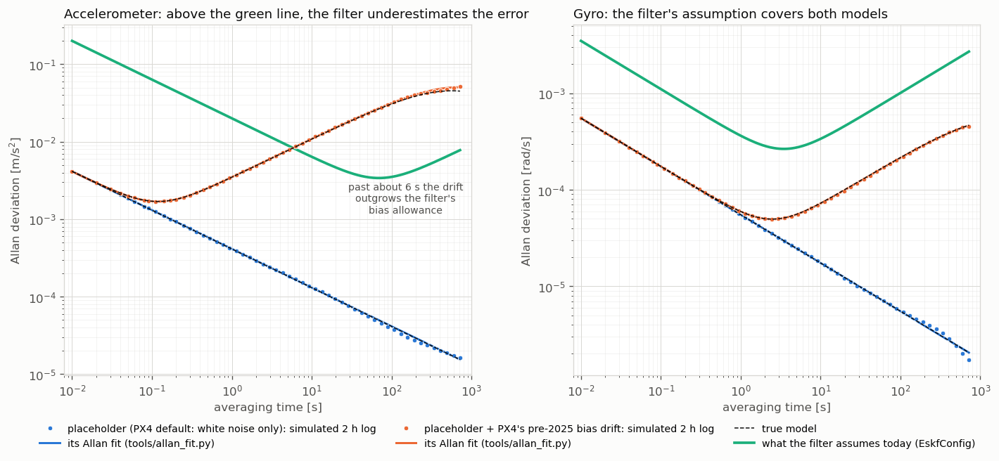
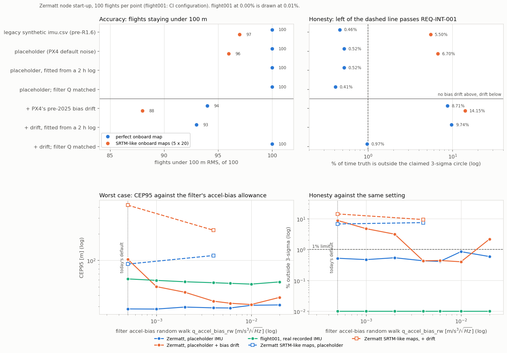

# TEST-022: IMU error model and the generic MEMS placeholder (R1.6, first part)

**Question.** Until the H30WP, Mid-360S and OAK-D Lite IMUs have been logged, the
simulation needs a stated IMU model, and every result should say which one it used.
Before R1.6 the Monte Carlo replayed `imu.csv` and added one constant offset per flight.
The IMU errors had no source, and nothing could take in a real sensor's numbers. What
does the placeholder change, and how sensitive is GDN to the part of the IMU we don't
know yet?

**Scope.** This is the part that doesn't need hardware: the model, the placeholder, the
labels, and the tools that will turn a 2 hour static log into a model file. The log
itself waits for the H30WP. R1.6 stays open for that.

## What was added

- **`gdn/imu_model.hpp`.** `ImuNoiseModel` holds white noise per axis, bias drift
  (first-order Gauss-Markov) and turn-on bias. `ImuErrorSim` applies the model to
  error-free samples, using the same recursion as PX4's Gazebo IMU plugin.
  `LoadImuModel` reads a model file and refuses missing or unknown keys.
- **`config/imu/placeholder_px4_default.yaml`, the generic MEMS placeholder.** This is
  PX4 v1.16's default simulated IMU (the Gazebo x500, "noise modeled after IIM42653"):
  white noise only, 0.0032 deg/s/√Hz (gyro) and 41 µg/√Hz (accel). PX4 removed its
  bias drift in February 2025. The turn-on bias (0.05 m/s², 0.02 deg/s) is not PX4's;
  it is the per-flight offset the MC has always drawn.
- **`config/imu/sensitivity_bias_drift.yaml`, a stress case.** The placeholder plus the
  bias drift PX4's Gazebo IMU had before 2025. The drift settles at 0.073 m/s² (accel)
  and 0.05 deg/s (gyro).
- **The Zermatt generator now also writes `imu_truth.csv`**, the error-free IMU.
  `imu.csv` is byte-identical (checksum unchanged), so the bag, the bench and older
  results are unaffected.
- **`mc_campaign --imu=auto|recorded|placeholder|FILE`.** The default `auto` uses the
  placeholder when the flight has an `imu_truth.csv` (synthetic flights), and the
  recorded IMU otherwise. A real log such as flight001 already carries its real sensor's
  errors, and `--imu=placeholder` on it is refused. Every report starts with an `imu:`
  line, and so does `mc_map_ensemble.py`. `ci_check_mc.py --expect-imu NAME` fails a CI
  step whose label differs. `--q-imu=match` sets the filter's process noise from the
  model, and `--q-ba` / `--q-bg` are there for sweeps.
- **`EskfConfig` IMU process noise** (`q_accel_nd`, `q_gyro_nd`, `q_accel_bias_rw`,
  `q_gyro_bias_rw`): these were constants in the constructor and are now settings.
  Same values, same results.
- **`tools/allan_fit.py`.** Overlapping Allan deviation of a static log (CSV, or a bag
  of `sensor_msgs/Imu` or PX4 `SensorCombined`). It fits white noise per axis and the
  Gauss-Markov drift, prints the bias instability, and writes the model file.
  `--selfcheck` recovers known parameters (in CI). `imu_sim` writes a simulated static
  log from a model file, using the MC's own code.
- **`config/imu/README.md`**: how to record and fit the H30WP, Mid-360S and OAK-D Lite.

## Unit tests (selftest, -O2 and -O3)

TEST-022, 6 checks. Before the model was written, the simulator stub did what the
pre-R1.6 MC did (one constant offset), and 3 of them failed.

| Check | Stub (pre-R1.6 behaviour) | After |
|---|---|---|
| White noise density, worst axis | 100% off (none) | 1.0% off |
| Bias drift after 600 s, 300 power-ups | 0.00 x model | 1.02 x (accel), 1.01 x (gyro) |
| Allan deviation of a 2 h log at 1, 10, 100, 600 s | 0.00 x model | 0.91 to 1.35 x (long times have few clusters) |
| Turn-on bias spread, 3000 power-ups | pass | pass |
| Placeholder file = `ImuPlaceholder()` | pass | pass |
| Missing and unknown keys refused | pass | pass |

## The Allan fit recovers known models

The C++ simulator wrote 2 hour static logs at 100 Hz for both models. `allan_fit.py`
fitted them, and the fitted files went back into the Monte Carlo.



| | True | Fitted from 2 h |
|---|---|---|
| Placeholder accel white noise, x / y / z | 4.03e-4 / 4.03e-4 / 4.34e-4 | 4.06e-4 / 4.03e-4 / 4.34e-4 |
| Placeholder gyro white noise, x / y / z | 5.52e-5 each | 5.50e-5 / 5.50e-5 / 5.54e-5 |
| Placeholder drift | none | none found |
| Drift case, accel: K, tau | 0.0060, 300 s | 0.0060, 369 s |
| Drift case, gyro: K, tau | 3.88e-5, 1000 s | 3.85e-5, 1000 s |
| MC with the fitted file (Zermatt, 100 flights) | 100, 0.52% / 94, 8.71% | 100, 0.52% / 93, 9.74% |

The green line is what the filter assumes today. The gyro's assumption sits above both
models everywhere. The accelerometer's doesn't: past about 6 s the drift case rises
above the filter's bias allowance, and the filter thinks its accel bias is steadier
than it is. The Monte Carlo below shows what that costs.

## Results: Monte Carlo per IMU model

Zermatt, node start-up, AGL model, 100 flights. SRTM-like onboard maps: 5 map error
patterns × 20 flights (TEST-020 recipe). Filter settings unchanged unless stated.



| IMU | Perfect map | SRTM-like maps |
|---|---|---|
| Legacy synthetic `imu.csv` (before R1.6) | 7.5 / 27.4 m, 100, 0.46% | 20.0 / 81.0 m, 97, 5.50% |
| **Placeholder (new default)** | **7.3 / 28.1 m, 100, 0.52%** | **20.3 / 90.6 m, 96, 6.70%** |
| Placeholder, filter Q matched to it | 7.3 / 27.1 m, 100, 0.41% | |
| + bias drift | 13.9 / 102 m, **94, 8.71%** | 25.5 / 422 m, 88, 14.2% |
| + bias drift, filter Q matched to it | 8.7 / 31.4 m, 100, 0.97% | |

Each cell: CEP50 / CEP95, flights under 100 m RMS, % of samples with error over
3 × published sigma (REQ-INT-001: at most 1%).

**Sweep of the filter's accel-bias random walk** (`q_accel_bias_rw`, default 5e-4):

| q_accel_bias_rw | Placeholder | + bias drift | flight001 (real IMU) | SRTM-like, placeholder |
|---|---|---|---|---|
| 5e-4 (default) | 28.1 m, 0.52% | 102 m, 94, 8.71% | 61.5 m, 0.00% | 90.6 m, 96, 6.70% |
| 1e-3 | 28.0 m, 0.47% | 50.3 m, 96, 4.71% | 59.2 m, 0.00% | |
| 2e-3 | 29.5 m, 0.54% | 43.4 m, 98, 3.13% | 57.1 m, 0.00% | |
| 4e-3 | 28.9 m, 0.43% | 34.4 m, 100, 0.43% | 55.7 m, 0.00% | 113 m, 94, 7.41% |
| 6e-3 | 28.8 m, 0.41% | 32.6 m, 100, 0.44% | 54.8 m, 0.00% | |
| 1e-2 | 30.9 m, 0.85% | 31.5 m, 100, 0.40% | 53.7 m, 0.00% | |
| 2e-2 | 31.2 m, 0.59% | 38.0 m, 98, 2.16% | 56.9 m, 0.00% | |

Cells: CEP95, flights under 100 m where below 100, % over 3 sigma.

## Findings

1. **The placeholder changes little.** PX4's default IMU is a quiet one, and white
   noise is not what limits GDN: the map is. Zermatt stays at 100/100 and 0.52%. The
   legacy `imu.csv` was 25 times noisier in accel and had no drift either, so the old
   results weren't optimistic about white noise.
2. **Bias drift is what matters, and the filter isn't ready for much of it.** With
   PX4's old drift model the tuned filter breaks: 94/100 flights, 8.7% outside 3 sigma,
   and 88/100 on SRTM-like maps. The cause is one setting, the accel-bias random walk.
   At 5e-4 it is 12 times below that drift. Matching it (or raising it to 4e-3 or more)
   brings the drift case back to 100/100 and under 1%.
3. **No single setting is best everywhere yet, so the default stays.** Raising
   `q_accel_bias_rw` to 4e-3 also helps the real flight001 IMU (CEP95 61.5 to 55.7 m)
   and fixes the drift case. On SRTM-like maps, though, it costs a little (96 to 94
   flights, CEP95 91 to 113 m): the extra freedom lets map error leak into the accel
   bias. The right value depends on how much the real IMU drifts. That is what the
   H30WP log will say, so the setting is left for the fit (OI-013).
4. **The pipeline for the real sensors works end to end.** Static log, Allan fit,
   model file, Monte Carlo: on simulated logs the fit recovers the white noise within
   1% and the level the drift settles at within 11%, and the fitted file gives the same MC verdict
   as the true one.

## Limits

- The H30WP, Mid-360S and OAK-D Lite logs don't exist yet. Every MC result that uses
  the placeholder says so (`imu: placeholder-px4-default`).
- The model has no scale-factor, misalignment, g-sensitivity, vibration or temperature
  terms. A static Allan log can't measure them either; flight data can (Phase 2).
- Gazebo: `sim/models/x500_gdn` includes PX4's x500, so the SITL IMU already has the
  placeholder's white noise, but not its turn-on bias. Model files for Gazebo arrive
  with R2.4.
- flight001 is a real log and keeps its recorded IMU; the ROS bench still replays the
  legacy `imu.csv` through the Zermatt bag.

## Reproduce

```bash
tools/run_selftest.sh
python3 tools/allan_fit.py --selfcheck
tools/make_data.sh                                    # writes imu_truth.csv
B="data/flight_zermatt_csv data/maps/zermatt.bin --model=agl --startup=node"
tools/mc_run.sh 100 $B                                # placeholder (auto)
tools/mc_run.sh 100 $B --imu=recorded                 # the pre-R1.6 IMU
tools/mc_run.sh 100 $B --imu=config/imu/sensitivity_bias_drift.yaml [--q-imu=match | --q-ba=4e-3]
tools/mc_run.sh 100 data/flight001_csv data/maps/terrain_db_sigma4.bin --model=agl --baro-drift=5 --q-ba=4e-3
python3 tools/mc_map_ensemble.py --world data/maps/zermatt.bin --csv data/flight_zermatt_csv \
    --recipe "--coarsen 3 --noise 6 --corr 200 --bias 3" --maps 5 --per-map 20 -- --model=agl --startup=node [--imu=...]
install/gdn_fusion/lib/gdn_fusion/imu_sim config/imu/sensitivity_bias_drift.yaml 2 100 static.csv 2
python3 tools/allan_fit.py --csv static.csv --name fitted-bias-drift --out fitted.yaml --adev-csv allan.csv
python3 tools/plot_imu_model.py      # test022_allan.png and test022_mc.png from test022_data/
```
