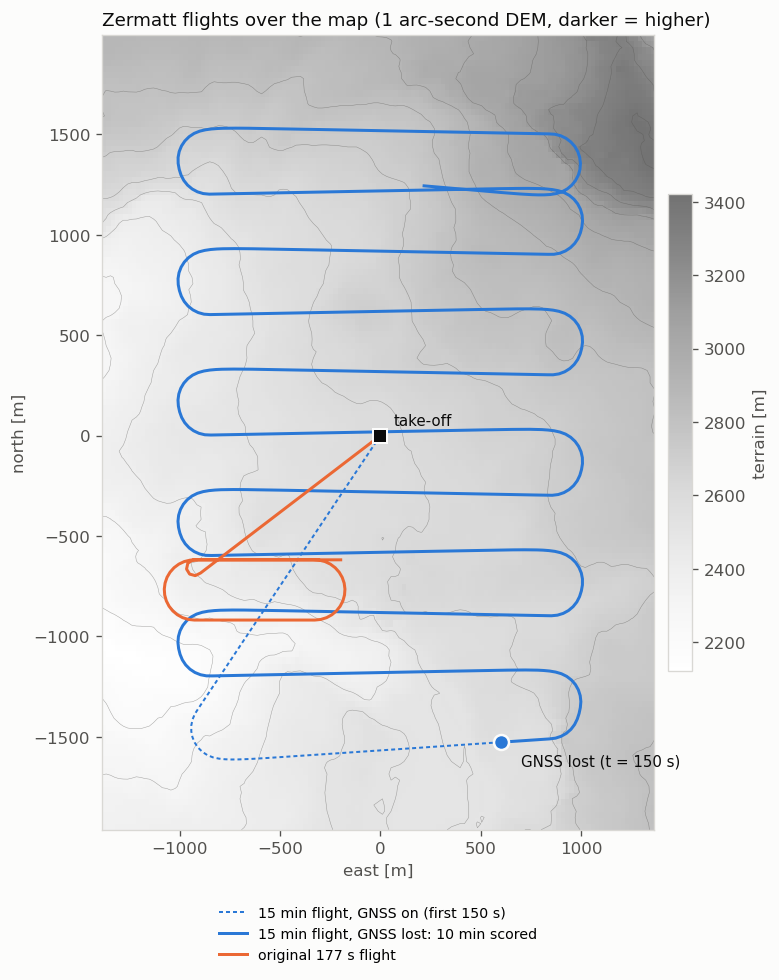
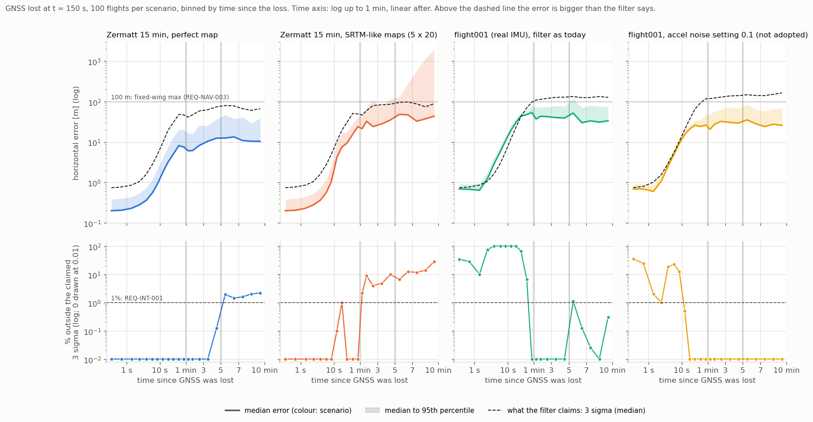
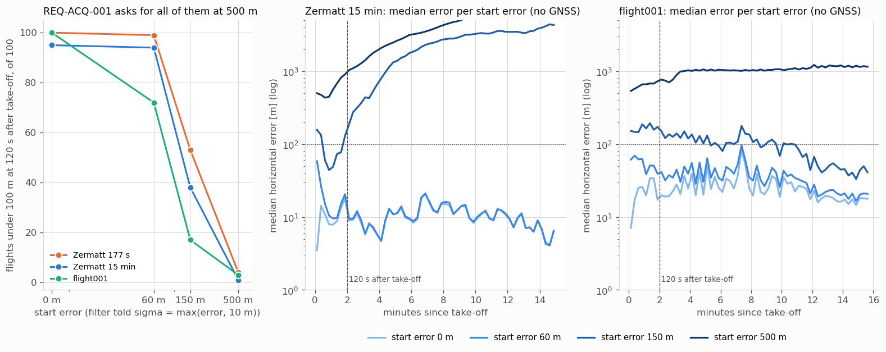

# TEST-023: GNSS loss with a covariance handover, and start errors (R1.7)

**Question.** The requirements measure GDN in two ways that the Monte Carlo couldn't
test before R1.7:

1. **"Time since GNSS was lost, starting from a converged filter"**: 5 and 10 minutes
   (REQ-NAV-001 to 003). GNSS is cut mid-flight, and the filter carries on with the
   covariance it had at that moment.
2. **Acquisition from a start error of up to 500 m within 120 s** (REQ-ACQ-001).

Before R1.7 every MC run started at the true position with no GNSS at all, and scored a
fixed 60 to 300 s window of a 177 s flight. How do GDN's numbers look when it's scored
the way the requirements are written?

## What was added

- **`Eskf::ApplyGnss`**: GNSS horizontal position and velocity update. Baro and mag
  biases get zero gain rows, as in R1.4. There's no innovation gate: while GNSS is
  trusted, it is the reference. Judging GNSS is the integrity monitor's job (R4.4).
- **`Eskf::SetHorizontalPosition`**: sets a position and its stated 1-sigma. The
  position is decorrelated from every other state, and nothing else changes.
- **`mc_campaign --gnss-loss=T`**: simulated GNSS until log time T, then none.
  - The simulated GNSS: 5 Hz, 1.5 m and 0.1 m/s per axis, white noise, its own random
    stream.
  - At T the filter simply keeps its state and covariance. That is the handover.
  - `--gnss-free=300,600` (the default) reports CEP50, CEP95, max, the 3-sigma check
    and the flights that never passed 100 m, pooled from the loss up to 5 and up to
    10 minutes, as `docs/requirements.md` defines them. The main window starts at T too.
- **`mc_campaign --start-error=M`**: the filter starts M metres from the truth, in a
  random direction per flight, and is told sigma max(M, 10) m per axis.
  - Applied when heading is aligned: parked for the node start-up, at the take-off roll
    for truth start-up.
  - Reports REQ-ACQ-001: flights under 100 m at 120 s after take-off, and how many then
    stayed under 100 m to the end. 100 m is the fixed-wing max of REQ-NAV-003.
- **Every report states its scenario** on a `scenario:` line.
- **A 15 minute Zermatt flight**: `gen_zermatt_flight.py --minutes 15` writes
  `data/flight_zermatt_long_csv`, built by `make_data.sh`, with checksums in
  `data/SHA256SUMS`.
  - It's the same fixed-wing as before: level, 30 m/s, 30 s parked.
  - It flies a lawnmower over most of the map, with 2 km lines 300 m apart, steering to
    waypoints with a 150 m turn radius.
  - It has an error-free IMU only, so the MC applies the R1.6 placeholder.
  - The original 177 s flight is byte-identical.
  - flight001 is already 16 minutes long, so it needed no new flight.
- **Truth resets are detected.** flight001's recorded truth jumps about 440 m at
  t = 967.7 s, where PX4 reset its local position just before landing. The MC now
  stops scoring a flight at such a jump and says so. This didn't affect any earlier
  result: they all scored 60 to 300 s.
- **More CI checks:**
  - `ci_check_mc.py` gains `--gnss-free-max-cep95`, `--gnss-free-max-over-3sigma`,
    `--gnss-free-min-never-over-100` and `--min-acquired`.
  - `mc_map_ensemble.py` scores from the loss and pools the GNSS-free lines.
  - `--q-an` / `--q-gn` set the filter's IMU white-noise settings, for sweeps.
- **Three new CI steps:**
  - Zermatt 15 min with GNSS loss. REQ-INT-001 is blocking on the 5 minute window.
  - Zermatt with a 60 m start error.
  - flight001 with GNSS loss, as a regression guard: it fails REQ-INT-001 today (see
    below).



## Unit tests (selftest, -O2 and -O3)

TEST-023, 4 checks. Against stubs (the two `Eskf` functions doing nothing), 3 of them
failed.

| Check | Stub | After |
|---|---|---|
| GNSS update converges and is honest: 100 flights, NEES mean (honest: 2) | NEES 0.00, sigma 146 m | NEES 2.14, sigma 0.25 m |
| Covariance handed over at loss: no reset, grows, not overconfident | fail (never converged) | pass |
| GNSS update leaves the baro and mag biases alone | pass | pass |
| Start error sets the position and its stated uncertainty, and nothing else | fail | pass |

After the loss, this unit test's NEES falls to 0.3, meaning the filter is cautious. The
test vehicle is parked with a perfect IMU, and when nothing accelerates, tilt and accel
bias errors cancel. So the check only asks for "not overconfident". The Monte Carlo below
is where honesty after the loss is really measured, with the IMU model and real flights.

## Results: GNSS lost at 150 s (about 2 minutes after take-off)

100 flights per scenario. The AGL measurement model is used throughout.
- **Zermatt:** node start-up and the placeholder IMU.
- **flight001:** its real recorded IMU and the CI configuration (5 m baro drift).

Requirement (fixed-wing, REQ-NAV-003): CEP95 at most 50 m at 5 minutes and at most 75 m
at 10 minutes, with max at most 100 m. REQ-INT-001: at most 1% of samples outside 3 sigma.



| Scenario | 5 min: CEP95 / max / outside 3 sigma / flights never over 100 m | 10 min: same |
|---|---|---|
| Zermatt 15 min, perfect map | **25.9 m** / 125 m / **0.03%** / 99 | **32.0 m** / 1468 m / **0.93%** / 93 |
| Zermatt 15 min, SRTM-like maps (5 x 20) | 86.3 m / 1315 m / 4.81% / 34 | 201.5 m / 7452 m / 9.65% / 8 |
| flight001, real IMU, filter as today | 73.0 m / 132 m / 8.59% / 80 | 78.8 m / 270 m / 4.45% / 37 |
| flight001, accel noise setting 0.1 (not adopted) | 62.4 m / 162 m / **0.51%** / 84 | **65.7 m** / 179 m / **0.26%** / 61 |

Bold: meets the requirement. **No scenario meets every part.** The max limit fails
everywhere, because one false lock in 100 flights is enough to break it.

At the moment of loss the filter claims sigma 0.25 m. The true error is 0.20 m on
Zermatt, but 0.69 m on flight001.

**Why flight001 is overconfident after the loss.** For the first minute, 70 to 100% of
samples are outside the claimed 3 sigma (third panel, bottom).

- To find the cause, I switched terrain matching off (`--r-agl=1e8`, 20 flights). The
  filter then drifts 27 m in 30 s while claiming under 3 m. On Zermatt the same run stays
  honest (0% outside).
- So the cause is the real IMU, not the map. During the GNSS phase the filter trusts
  this IMU more than it should, and after the loss the IMU drifts faster than the filter
  allows.
- Scored from take-off (the R1.5 and CI way), this was hidden: the uncertainty sits at
  the terrain-matching level, about 40 m, which covers it. A handover from GNSS starts
  the filter at 0.25 m, so the mismatch shows at once.
- Sweeping the filter's IMU settings on flight001 (GNSS loss, 5 minutes) shows what
  matters:

| Filter setting changed | outside 3 sigma, first 30 s | outside 3 sigma, 5 min | CEP95 5 min |
|---|---|---|---|
| none (`q_accel_nd` 0.02, `q_accel_bias_rw` 5e-4) | 82.7% | 8.59% | 73.0 m |
| `q_accel_bias_rw` 4e-3 / 1e-2 / 2e-2 | | 5.87% / 4.61% / 3.10% | 67.3 / 66.8 / 68.1 m |
| `q_accel_nd` 0.05 | 47.5% | 4.75% | 65.0 m |
| `q_accel_nd` 0.1 | 5.1% | **0.51%** | 62.4 m |
| `q_accel_nd` 0.2 | 0.85% | **0.09%** | 58.3 m |
| `q_accel_nd` 0.1 and `q_accel_bias_rw` 1e-2 | 2.6% | **0.26%** | 60.6 m |

The white-noise setting is the one that matters, and raising it also makes flight001
more accurate. On Zermatt, `q_accel_nd` 0.1 changes almost nothing: 10 min CEP95 32.8 m,
0.97%. Scored from take-off (the CI step), it gives CEP95 57.0 m instead of 61.5, but
1.00% outside 3 sigma instead of 0.00%, and 99/100 flights instead of 100/100.

It's a tuning decision for the real IMU, so it goes with the H30WP fit (OI-013), not
into R1.7.

## Results: start errors, no GNSS

REQ-ACQ-001 asks for every flight to be under the limits within 120 s, from a start
error of up to 500 m. Cells: flights under 100 m at 120 s after take-off, then (in
brackets) flights that stayed under 100 m to the end of the flight. 100 flights per cell.



| Flight | 0 m | 60 m | 150 m | 500 m |
|---|---|---|---|---|
| Zermatt 177 s (most observable patch) | 100 (100) | 99 (99) | 53 (53) | 4 (3) |
| Zermatt 15 min (whole map) | 95 (83) | 94 (80) | 38 (22) | 1 (1) |
| flight001 (gentle terrain, real IMU) | 100 (39) | 72 (28) | 17 (4) | 3 (0) |

- **500 m fails everywhere, as the roadmap expected.** The point-gradient filter can't
  find its way back from further than the terrain's correlation length, and its 40 m
  innovation gate rejects most measurements. That's R4.1's job (acquisition).
- **60 m is about the limit today**, which matches the README's statement. 150 m fails
  half the flights or more.
- **Long flights add false locks after acquisition.**
  - Zermatt 15 min with no start error: 95 flights are under 100 m at 120 s, but only 83
    stay there.
  - flight001: all 100 are under at 120 s, but only 39 stay under 100 m for the whole
    16 minutes, mostly briefly, around 7 to 8 minutes after take-off (right panel).
  - The CI windows (60 to 300 s) never looked that far.

## Findings

1. **The scenarios work, and the numbers now line up with the requirements.** On a
   perfect map, Zermatt meets REQ-NAV-003's CEP95 at 5 and 10 minutes (25.9 and 32.0 m,
   against 50 and 75 m) and REQ-INT-001 (0.03% and 0.93%). It fails the max, through
   occasional false locks (OI-009).
2. **Map error is the largest gap.** With SRTM-like onboard maps, CEP95 at 10 minutes is
   202 m and 9.7% of samples are outside 3 sigma, getting worse with time. Correlated
   map error isn't in the filter's model (TEST-020). This is the main thing between GDN
   and REQ-NAV-003 on real maps.
3. **A GNSS handover exposes IMU tuning that scoring from take-off hid.** On flight001's
   real IMU the filter is overconfident for the first minute after the loss. Raising
   `q_accel_nd` from 0.02 to 0.1 or 0.2 fixes it and improves accuracy. The decision is
   left to the H30WP fit (OI-013, updated).
4. **Acquisition:** 60 m works, and 150 m and 500 m don't. R4.1 is needed for
   REQ-ACQ-001, as planned.

## Limits

- **The simulated GNSS is white noise.** Real GNSS errors are correlated over tens of
  seconds, so a real handover would start with a slightly larger true error than the
  covariance says. PX4's GNSS in SITL (Phase 2) has that.
- **Level flight at 30 m/s and constant altitude** over terrain from 2155 to 3284 m
  means 30 m to about 1.1 km above ground. The MC's AGL noise doesn't depend on height,
  and a real rangefinder or radar altimeter has a range limit.
- **flight001's truth is PX4's own GNSS-aided estimate.** It's scored up to the reset
  at 967.7 s.
- **The node has no GNSS input.** The handover is in the core and the MC. Wiring it to
  PX4 in the node belongs with the Phase 2 SITL scenarios (R2.8 scenario matrix).
- **The start error is a fixed distance in a random direction,** and the filter is told
  a sigma equal to it. A larger stated sigma would let more measurements through the
  sigma gate, but not the 40 m absolute gate.

## Reproduce

```bash
tools/run_selftest.sh                                  # TEST-023
tools/make_data.sh                                     # writes data/flight_zermatt_long_csv
B=install/gdn_fusion/lib/gdn_fusion/mc_campaign; D=$SCRATCH   # any directory
Z="data/flight_zermatt_long_csv data/maps/zermatt.bin --model=agl --startup=node"
F="data/flight001_csv data/maps/terrain_db_sigma4.bin --model=agl --baro-drift=5"
$B 100 $Z --gnss-loss=150 --trace=$D/zl_gnss.trace > $D/zl_gnss.out
$B 100 $F --gnss-loss=150 --trace=$D/f1_gnss.trace > $D/f1_gnss.out
$B 100 $F --gnss-loss=150 --q-an=0.1 --trace=$D/f1_gnss_qan0.1.trace > $D/f1_gnss_qan0.1.out
for s in 0 60 150 500; do
  $B 100 $Z --start-error=$s --trace=$D/zl_s$s.trace > $D/zl_s$s.out
  $B 100 $F --start-error=$s --trace=$D/f1_s$s.trace > $D/f1_s$s.out
  $B 100 data/flight_zermatt_csv data/maps/zermatt.bin --model=agl --startup=node --start-error=$s > $D/zs_s$s.out
done
python3 tools/mc_map_ensemble.py --world data/maps/zermatt.bin --csv data/flight_zermatt_long_csv \
    --recipe "--coarsen 3 --noise 6 --corr 200 --bias 3" --maps 5 --per-map 20 --tag r17_srtm \
    -- --model=agl --startup=node --gnss-loss=150 > $D/zl_gnss_srtm.out
# sweeps: $B 100 $F --gnss-loss=150 --gnss-free=10,30,300,600 --q-an=0.05|0.1|0.2 [--q-ba=1e-2]
#         $B 100 $F --gnss-loss=150 --q-ba=2e-3|4e-3|1e-2|2e-2   (outputs named f1_gnss_q*.out)
python3 tools/plot_gnss_loss.py --aggregate $D         # test023_data/ and the three figures
```
