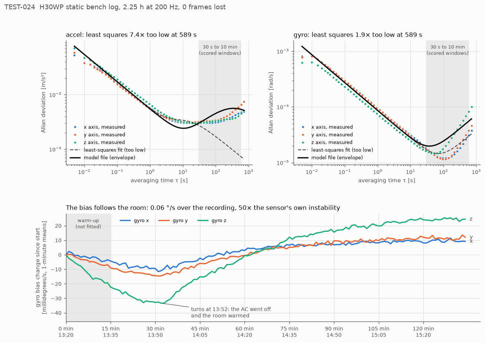
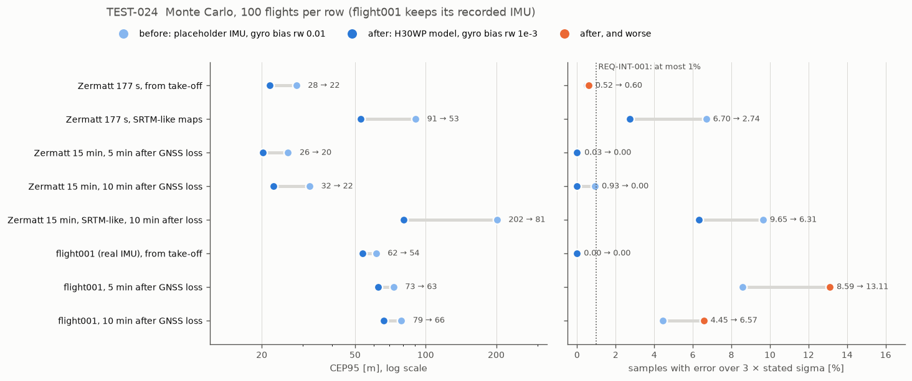

# TEST-024: the H30WP's Allan fit, and the filter tuned to it (R1.6, hardware)

**Question.** R1.6 built the IMU error model and ran the Monte Carlo with a generic
placeholder (TEST-022), and left the filter's IMU process noise open until a real IMU
was measured (OI-013). Now the H30WP has been logged on the bench for 2.25 hours. What
are its numbers, does the filter's process noise cover them, and what changes when the
Monte Carlo simulates this IMU instead of the placeholder?

**Answer, short.**
- The white noise is 1.3x (accel) and 1.6x (gyro) the placeholder's. The drift over
  1 to 10 minutes, which matters for the GNSS-free windows, is dominated by temperature:
  the room warmed after the air conditioner went off.
- The fitter's single drift term couldn't follow that and was 7.4x too optimistic at
  10 minutes. It now fits an upper envelope over 30 s to 10 min instead.
- The filter's gyro-bias random walk was 44x the H30WP's. Bringing it down to 4.4x
  (0.01 to 0.001 deg/s/sqrt(s)) is the change that matters. For example, Zermatt
  10 minutes after GNSS loss: CEP95 32 to 22 m, max 1468 to 77 m, 93 to 100 flights,
  0.93% to 0.00% over 3 sigma.
- The cost: flight001's real IMU gets more accurate after a GNSS loss, but less honest
  (8.6% to 13.1% over 3 sigma in the first 5 minutes). Both values fail the 1% limit.
  The setting that fixes it is the in-flight white noise, which needs H30WP flight data
  (OI-013, still open for that part).

## The bench log

- WHEELTEC H30WP (Yesense protocol), USB to TTL converter on `/dev/ttyACM0`, 460800 baud,
  factory output: acceleration, angular rate, Euler angles, quaternion, 200 Hz. No
  temperature and no sample timestamp in this output.
- Recorded on 9 November 2026, 13:20 to 15:35, with `tools/h30wp_log.py`. The IMU sat on
  a bench, untouched. 1,620,010 frames, 0 lost, 1 checksum failure (the partial frame at
  start-up). The first 15 minutes are dropped as warm-up, which leaves 2.00 h.
- **Timing.** Without a sample timestamp the time of frame n is n / rate, from the IMU's
  frame numbers. The rate (200.0040 Hz) is fitted to host time over the whole log. Host
  time drifts up to 141 ms from that line over 2 h: the two clocks differ by a few
  parts per million. There are no gaps (largest host gap 22 ms). This is why the
  recording uses its own serial logger rather than `ros2 bag record` of
  `tools/h30wp_node.py`, which stamps on arrival and would put USB jitter into the curve.
- **One knock** at 67.9 min (14:28): 35 ms, |a| between 9.0 and 10.9 m/s². The
  attitude changed by 0.007 deg, and the fit with those 2 s patched out agrees with the
  full fit to 3 significant figures. `allan_fit.py` now reports short knocks separately,
  so one knock no longer marks the whole log "not static".
- **Temperature.** The air conditioner went off during the recording. The gyro bias
  falls for the first 30 minutes, turns at 13:52, and then rises until about 15:05, by
  0.06 deg/s in all. That's about 50x the sensor's own bias instability (bottom panel
  below). The IMU doesn't report temperature in this output, so the turn can't be
  matched to a reading.
- The log (raw.csv 154 MB, allan.csv 125 MB) is not in git. Checksums are in
  `test024_data/log_sha256.txt`.



## The fit

| | Accel | Gyro |
|---|---|---|
| White noise x / y / z | 5.32e-4 / 5.04e-4 / 6.03e-4 m/s²/√Hz | 9.40e-5 / 9.22e-5 / 7.25e-5 rad/s/√Hz |
| Placeholder, for comparison | 4.03e-4 / 4.03e-4 / 4.34e-4 | 5.52e-5 each |
| Bias instability | 4.6e-4 m/s² (47 µg) at 19 s | 2.0e-5 rad/s (4.2 deg/h) at 64 s |
| Drift, least squares | K 2.68e-4, tau 6.3 s: **7.4x too low at 589 s** | K 2.12e-6, tau 1e5 s: 1.9x too low at 589 s |
| Drift, envelope (the model file) | K 9.45e-5 m/s³/√Hz, tau 185 s | K 3.95e-6 rad/s²/√Hz, tau 1e5 s |

**Why the least-squares fit failed.** The model has one drift term, a first-order
Gauss-Markov process. The accel curve is flat from 10 to 100 s and then rises, which is
the temperature. One term can match the flat part or the rise, but not both. Least
squares weights the many short averaging times, so it matched the flat part, and its
model falls away exactly where the GNSS-free windows are scored. A filter or simulator
using it would believe the IMU is 7x better at 10 minutes than it was on this bench.

**The fix.** `allan_fit.py` checks the fitted model against the measured curve over
30 s to 10 min (`MISSION_BAND`). If it's more than 25% below anywhere there, it refits
the drift as the smallest one that stays at or above the measured curve over that band
(`envelope_drift`), and says so in its output, in the model file (`fit_accel_drift:`)
and on the plot. Below 30 s the envelope can sit under the curve (accel near 10 s),
which isn't scored. The 25% threshold is the scatter of a 2 h log's Allan deviation near
10 minutes, so a correct but unlucky fit doesn't trigger it.

A new self-check case covers it: a simulated IMU with a short drift plus a slow random
walk, like this log. Before the fix the model was 0.18x the truth at worst; after,
0.91 to 1.62x. The four existing cases don't trigger the envelope and give the same
results as before.

The model file is `config/imu/h30wp.yaml`. The turn-on bias is still the placeholder's
(one log is one power-up).

## The filter's process noise against the H30WP

| `EskfConfig` | Value | H30WP fit | Ratio |
|---|---|---|---|
| `q_accel_nd` | 0.02 m/s²/√Hz | 6.03e-4 (worst axis) | 33x |
| `q_gyro_nd` | 0.02 deg/s/√Hz | 9.40e-5 rad/s/√Hz | 3.7x |
| `q_accel_bias_rw` | 5e-4 m/s³/√Hz | 9.45e-5 | 5.3x |
| `q_gyro_bias_rw`, before | 0.01 deg/s/√s | 3.95e-6 rad/s²/√Hz | **44x** |
| `q_gyro_bias_rw`, now | 0.001 deg/s/√s | | 4.4x |

None is below the sensor, so the filter doesn't assume a better IMU than this one. The
gyro-bias random walk was far looser than needed. A loose gyro bias lets heading and
attitude uncertainty grow fast between terrain fixes, so the filter accepts fixes that
pull it onto a parallel contour: the Zermatt false locks (OI-009).

**Sweep.** H30WP model, 100 flights each, one setting changed at a time and then
together (`test024_data/process_noise_sweep.csv`):

| Setting | Zermatt 177 s: CEP95, over 3σ | Zermatt, 10 min after GNSS loss: CEP95, max, flights, over 3σ | flight001 after GNSS loss, 5 min: CEP95, over 3σ |
|---|---|---|---|
| Defaults before | 29.1 m, 0.46% | 31.5 m, 1471 m, 93, 0.74% | 73.0 m, 8.59% |
| All four matched to the H30WP (`--q-imu=match`) | 23.6 m, **1.08%** | 20.8 m, 45 m, 100, 0.01% | (recorded IMU) |
| Gyro white noise matched | 28.9 m, 0.51% | 31.2 m, 1226 m, 94, 0.77% | |
| Accel bias rw 1e-4 / 2e-3 | 29.2 / 30.2 m | 31.2 / 32.3 m, 93 to 94 flights | |
| Accel white noise 0.005 / 0.1 | | 30.7 / 32.8 m, 92 to 95 flights | |
| Gyro bias rw 3e-3 | 24.0 m, 0.51% | 25.5 m, 118 m, 99, 0.09% | 74.8 m, 12.0% |
| **Gyro bias rw 1e-3 (adopted)** | **21.6 m, 0.60%** | **22.5 m, 77 m, 100, 0.00%** | **62.9 m, 13.1%** |
| Gyro bias rw 2.26e-4 (the fit itself) | 21.5 m, 0.65% | 21.8 m, 82 m, 100, 0.02% | 58.4 m, 13.3% |
| Gyro 1e-3 + accel white 0.1 | 26.5 m, 0.26% | 24.0 m, 110 m, 99, 0.04% | 53.8 m, 3.95% |
| Gyro 1e-3 + accel white 0.2 | 37.8 m, **2.35%**, 98 flights | 24.9 m, 113 m, 99, 0.04% | 60.5 m, 0.09% |

- The gyro-bias random walk is the only setting that moves the results. Matching all
  four does slightly better on the long flight but goes over 1% on the short one.
- 1e-3 is nearly as good as the fit's own value and keeps a 4.4x margin for what a bench
  log can't show: vibration, faster temperature changes in flight, other units.
- Raising the accel white noise fixes flight001's handover (TEST-023) but costs
  Zermatt: at 0.2 it fails REQ-INT-001 there. That trade needs H30WP flight data, so
  `q_accel_nd` stays 0.02 for now.

## Results: before and after

Before: the placeholder IMU (main until now). After: the H30WP model with gyro bias rw
1e-3, the new defaults. 100 flights per row. flight001 keeps its recorded IMU in both, so
only the filter change acts there. SRTM-like maps: 5 map error patterns x 20 flights
(TEST-020 recipe).



| | CEP95 | Max | Flights under 100 m* | Over 3σ |
|---|---|---|---|---|
| Zermatt 177 s, from take-off | 28.1 → **21.6 m** | 87 → 77 m | 100 → 100 | 0.52 → 0.60% |
| Zermatt 177 s, SRTM-like maps | 90.6 → **52.7 m** | | 96 → **100** | 6.70 → **2.74%** |
| Zermatt 15 min, 5 min after GNSS loss | 25.9 → **20.2 m** | 125 → **63 m** | 99 → 100 | 0.03 → 0.00% |
| Zermatt 15 min, 10 min after GNSS loss | 32.0 → **22.5 m** | 1468 → **77 m** | 93 → **100** | 0.93 → 0.00% |
| Zermatt 15 min, SRTM-like, 10 min after loss | 202 → **81 m** | 7452 → 243 m | 8 → 37 | 9.65 → 6.31% |
| flight001 (real IMU), from take-off | 61.5 → **53.8 m** | 136 → 151 m | 100 → 100 | 0.00 → 0.00% |
| flight001, 5 min after GNSS loss | 73.0 → **62.9 m** | 132 → 107 m | 80 → **96** | 8.59 → **13.11%** |
| flight001, 10 min after GNSS loss | 78.8 → **66.1 m** | 270 → 131 m | 37 → **87** | 4.45 → **6.57%** |

\* From take-off: per-flight RMS under 100 m. After GNSS loss: never over 100 m in the window.

**Acquisition from a start error** (REQ-ACQ-001, flights under 100 m at 120 s after
take-off, of 100; TEST-023 in brackets):

| Start error | 0 m | 60 m | 150 m | 500 m |
|---|---|---|---|---|
| Zermatt 177 s | 100 (100) | 100 (99) | 71 (53) | 7 (4) |
| Zermatt 15 min | 100 (95) | 99 (94) | 55 (38) | 3 (1) |
| flight001 | 100 (100) | 73 (72) | 18 (17) | 3 (3) |

The IMU model alone changes little. With the old filter settings the H30WP model gives
29.1 m (placeholder 28.1 m) on Zermatt and 31.5 m (32.0 m) 10 minutes after GNSS loss.
The improvement comes from the filter setting the fit pointed to.

## Unit tests (selftest, -O2 and -O3)

| Check | Before | After |
|---|---|---|
| H30WP model loads, with white noise and drift from the fit | pass | pass |
| Default process noise not below the H30WP's | pass | pass |
| Default bias random walks within 10x of the H30WP's | **fail** (gyro 44x) | pass (4.4x) |
| `allan_fit.py --selfcheck`: two-drift case within 0.75 to 2.5x over 30 s to 10 min | **fail** (0.18x) | pass (0.91 to 1.62x) |

The magnetometer tilt checks (OI-012) now pin their gyro-bias random walk to the old
0.01. They need a loose attitude to show the 3-axis tilt (2.5 deg; 0.12 deg at the new
default), and heading-only must hold even then. Everything else passes unchanged.
`colcon test` passes.

## CI

- `--expect-imu` on the Zermatt steps is now `h30wp`.
- Every step passes its existing thresholds with the new defaults, except the
  flight001 GNSS-loss guard: 13.09% over 3 sigma in the first 5 minutes on its 24
  flights, against a 12% guard. The guard is now 15%, recorded in OI-013. The step was
  already a regression guard on a known failure.
- Zermatt 15 min with GNSS loss, 24 flights: 10 minute CEP95 20.4 m, 0.00% over 3 sigma
  (was 1.17%).

## Findings

1. **The H30WP is a little noisier than PX4's default IMU, and that hardly matters.**
   Swapping the placeholder for the H30WP model moves CEP95 by about 1 m. White noise
   isn't what limits GDN (as TEST-022 found).
2. **Over minutes, temperature drives the bias drift, and the fitter has to be
   conservative about it.** A single-drift least-squares fit would have told the filter
   and the simulator the IMU was 7x better at 10 minutes than it was. The envelope fit
   keeps the model at or above the measured curve where it counts.
3. **The gyro-bias random walk was the loose setting.** At 44x the sensor it let
   attitude wander enough for false locks after GNSS loss. At 4.4x, Zermatt has no false
   locks 10 minutes after GNSS loss (max 77 m), and SRTM-like maps improve the most
   (CEP95 202 to 81 m at 10 minutes).
4. **flight001's real IMU is now more accurate but less honest after a handover.** This
   is the OI-013 white-noise question from TEST-023. The tighter gyro setting makes it
   more visible. Its fix (`q_accel_nd` 0.1 to 0.2) costs Zermatt, so it waits for H30WP
   flight data.

## Limits

- **One bench log, at a changing room temperature.** The drift above about 5 minutes is
  mostly the room. That makes the model conservative for a steady room, and a fair guess
  for flight, where temperature also changes. A second log at a steady temperature, with
  the temperature output on, would separate the two. It's optional: it would make the
  drift model less conservative, and the filter's gyro setting already sits 4.4x above
  this one.
- **Turn-on bias** is not measured: one log is one power-up. The placeholder's 0.05
  m/s² and 0.02 deg/s stay until several short power-up logs exist (optional).
- **No vibration, scale factor or misalignment.** A static log can't show them. Flight
  data can (Phase 6).
- **Axes.** The H30WP reports front-left-up (the lid). GDN uses front-right-down, so y
  and z flip where it's mounted. The static fit is per axis and doesn't depend on that.
- **Mid-360S and OAK-D Lite** IMUs aren't logged yet. **Gazebo** IMU models are R2.4.

## Reproduce

```bash
python3 tools/h30wp_check.py                           # the IMU is sending
systemd-inhibit --what=sleep:idle python3 tools/h30wp_log.py --hours 2.25 --out log/h30wp_static
python3 tools/allan_fit.py --selfcheck
python3 tools/allan_fit.py --csv log/h30wp_static/allan.csv --skip 900 --name h30wp \
    --source "WHEELTEC H30WP (Yesense), 2.25 h bench log 2026-11-09 by tools/h30wp_log.py, first 15 min dropped; the room warmed after the AC went off (TEST-024)" \
    --out config/imu/h30wp.yaml --plot log/h30wp_static/allan.png --adev-csv log/h30wp_static/adev.csv
tools/run_selftest.sh                                  # TEST-024
B=install/gdn_fusion/lib/gdn_fusion/mc_campaign; D=$SCRATCH   # any directory
H=--imu=config/imu/h30wp.yaml; OLD=--q-bg=0.01          # OLD: the gyro default before this PR
Z="data/flight_zermatt_csv data/maps/zermatt.bin --model=agl --startup=node"
ZL="data/flight_zermatt_long_csv data/maps/zermatt.bin --model=agl --startup=node --gnss-loss=150"
F="data/flight001_csv data/maps/terrain_db_sigma4.bin --model=agl --baro-drift=5"
E="python3 tools/mc_map_ensemble.py --world data/maps/zermatt.bin --recipe '--coarsen 3 --noise 6 --corr 200 --bias 3' --maps 5 --per-map 20"
# before (main):  z_ph, zl_ph, f1_def, f1g_def
$B 100 $Z --imu=placeholder $OLD > $D/z_ph.out;   $B 100 $ZL --imu=placeholder $OLD > $D/zl_ph.out
$B 100 $F $OLD > $D/f1_def.out;                   $B 100 $F --gnss-loss=150 $OLD > $D/f1g_def.out
# H30WP model with the old filter, and the sweep (names as in process_noise_sweep.csv):
$B 100 $Z $H $OLD > $D/z_h.out;  $B 100 $ZL $H $OLD > $D/zl_h.out
#   z_hm / zl_hm: $H $OLD --q-imu=match;  *_qgn: --q-gn=5.4e-3;  *_qba1e-4|2e-3: --q-ba=...;
#   zl_h_qan0.005|0.1: --q-an=...;  *_qbg3e-3|1e-3|2.26e-4: --q-bg=... (z_h, zl_h, f1, f1g);
#   *_bg1e-3_an0.1|0.2: --q-bg=1e-3 --q-an=... (z_h, zl_h, f1, f1g)
# after (this PR's defaults):
$B 100 $Z > $D/fin_z.out;   $B 100 $ZL > $D/fin_zl.out
$B 100 $F > $D/fin_f1.out;  $B 100 $F --gnss-loss=150 > $D/fin_f1g.out
eval "$E --csv data/flight_zermatt_csv -- --model=agl --startup=node" > $D/fin_srtm.out
eval "$E --csv data/flight_zermatt_long_csv -- --model=agl --startup=node --gnss-loss=150" > $D/fin_srtml.out
for s in 0 60 150 500; do
  $B 100 $Z --start-error=$s > $D/fin_zs_s$s.out
  $B 100 ${ZL% --gnss-loss=150} --start-error=$s > $D/fin_zls_s$s.out
  $B 100 $F --start-error=$s > $D/fin_f1s_s$s.out
done
python3 tools/plot_h30wp.py --aggregate log/h30wp_static $D   # test024_data/ and both figures
```

The sweep runs above were made before the default changed, with `--q-bg=1e-3` on the
old binary. The new defaults reproduce them exactly (`fin_*` against `*_qbg1e-3`).
