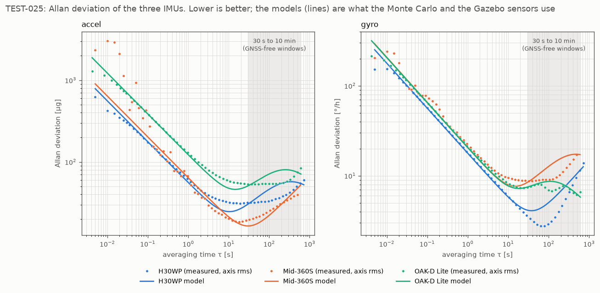
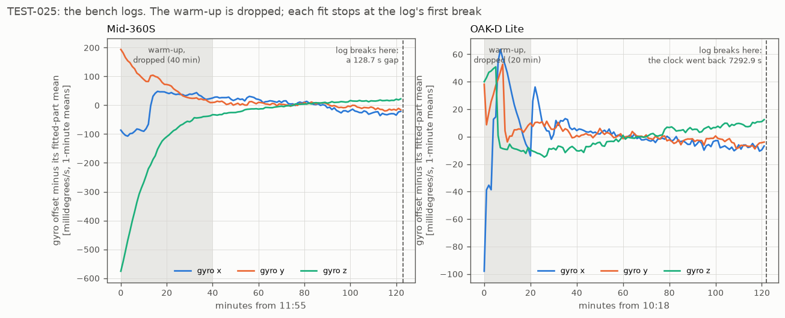

# TEST-025: the Mid-360S and OAK-D Lite IMU fits (R1.6, hardware)

**Question.** R1.6 asks for an Allan fit of each IMU in the kit. The H30WP was done in
TEST-024. The Livox Mid-360S and the OAK-D Lite each have an IMU too, which LIO (R6.4)
and VIO (R3.5) will use, and the Gazebo sensor models (R2.4) need. What are their
numbers, can the fitter handle how these two deliver their data, and how would GDN
navigate on either instead of the H30WP?

**Answer, short.**
- Both were logged for 2 hours on the bench: the Mid-360S with its lidar running, the
  OAK-D Lite with all three cameras running. Their models are `config/imu/mid360s.yaml`
  and `config/imu/oakd_lite.yaml`.
- The fitter assumed evenly spaced samples, and neither sensor delivers them: the
  Mid-360S's timestamps jitter, and 40% of the OAK-D Lite's gyro ticks don't come
  through. Both logs also ended in a break (a power trip, and a camera restart). The fitter
  now handles uneven timing and stops at the first break. Both were tests first: four
  new selfcheck cases, all failing before.
- No single IMU is best everywhere. The H30WP has the best gyro over 30 s to 1 min, the
  Mid-360S the best accel, and the OAK-D Lite the flattest gyro drift over 5 to 10
  minutes.
- Navigating on each in the Monte Carlo (Zermatt, 10 minutes after GNSS loss), the three
  are within 1 m CEP95 on a perfect map. On SRTM-like maps the H30WP is best (80.8 m),
  the OAK-D Lite close (83.3 m), and the Mid-360S has one flight that runs away to
  2.7 km. **The H30WP stays the navigation IMU.**
- The filter's default process noise isn't below either new IMU (1.4x to 29x above), so
  nothing in the filter changes.
- The ROS driver for the OAK-D Lite crashes our unit (below). It was recorded through
  DepthAI 3.12 with a new logger, `tools/oak_imu_log.py`.



## The bench logs



| | Mid-360S | OAK-D Lite |
|---|---|---|
| Recorded | 2026-11-10, 11:55 to 13:58 | 2026-11-11, 10:18 to 12:20 |
| How | `ros2 bag record /livox/imu`, livox_ros_driver2 1.2.8, lidar running | `tools/oak_imu_log.py`, DepthAI 3.12, colour 1280x720 and both mono 640x400 at 30 fps |
| Where | lying flat on a desk | standing upright on a desk |
| Rate | 200 Hz mean; spacing spread 15% (median 4.89 ms) | 239 Hz mean: the gyro ticks every 2.53 ms (394.5 Hz), 65% of the steps skip one tick, so 60% of the ticks come through (spacing spread 29%) |
| Lost | none | 0 reports (sequence numbers checked) |
| Ended by | a mains power trip at 13:58. The lidar came back at 14:00:08 and 51 s more were recorded. | the camera restarting at 12:19:45 (clock and counter back to zero), then the PC going down at about 12:22 |
| Warm-up dropped | 40 min: gyro z moved 0.58 °/s while the lidar warmed | 20 min |
| Fitted | 1.38 h | 1.69 h |
| Knocks in the fitted part | one, 15 ms, 1.4 °/s | none (11 in the dropped warm-up, from handling) |
| \|a\| | 9.65 m/s² (0.984 g) | 9.91 m/s² |

The magnitude of gravity is off by about 1.3% in both, in opposite directions (the
H30WP read 9.76). That is accelerometer scale and bias error. An Allan fit can't see it
and doesn't need to; LIO and VIO calibrate it (R6.4).

The Mid-360S's own motor shows in its IMU. Below 0.1 s the accel's Allan deviation has
a hump up to 3x the white-noise line, and gyro z (the spin axis) has one up to a few
seconds. The model's white noise is fitted from 0.05 s up, per axis, so gyro z gets
its own higher value (1.4e-4 against 0.7 to 0.9e-4 rad/s/√Hz). In flight the motor runs
too, so this is the right condition to measure in.

**The OAK-D Lite's ROS driver.** The apt driver (depthai-ros 3.2.1, DepthAI 3.10)
crashed the camera a few seconds after start, then every 12 s, with every setting tried
(default, low-bandwidth images, stereo only, with point cloud) and on USB 2 and USB 3.
All 72 crash dumps say `Start Source: Invalid config steps`, a camera sensor failing
to start. One low-bandwidth run did last 3 hours on 10 November, but that log was
disturbed and isn't used. `tools/oak_check.py --stream` on DepthAI 3.12 ran the cameras
cleanly every time. So the log was recorded with a new logger on DepthAI 3.12:
`tools/oak_imu_log.py`. It runs the three cameras as they would be in use, so the IMU
warms up the same way, and writes the IMU with the camera's own timestamps. `--ros`
publishes a 10 Hz preview, since only one program can open the camera. The setup guide
says this now.

## The fitter: uneven timing and breaks

**Uneven timing.** `allan_fit.py` took the sample rate from the typical spacing (the
median) and treated the samples as evenly spaced. On the OAK-D Lite that is wrong
twice: the typical step is a skipped tick (5.06 ms, so 197 Hz), while the stream really
averages 239 Hz. Each sample is still one 2.53 ms reading, so when GDN integrates the
stream (each sample held until the next) it gets more angle noise than an evenly spaced
stream would:

N_stream² = N² × E[dt²] / (E[dt] × dt0)

That's 1.34x the chip's own noise for this log's skip pattern. The fit should describe the
stream GDN receives. It now does what the filter does: it holds each sample until the
next, integrates, and resamples that integral evenly at the mean rate (`even_samples`).
The time-weighted mean comes off first, so timestamp jitter times a large mean (gravity,
a gyro offset) doesn't show up as noise. An evenly timed log passes through unchanged:
refitting the H30WP log gives `h30wp.yaml` to 4 significant figures (the 5th changes,
because the last sample has no hold time and is dropped).

**Breaks.** A gap or a clock going backwards means the sensor powered up again, with a
new bias and a new warm-up. The fitter treated the Mid-360S's 128 s gap as part of the
log, and the OAK-D Lite's clock reset made the time span come out as 0.2 h. It now cuts
the log at its first break (a gap over 1 s, or time going back) and says so in its
output and in the model file (`first_segment`). The CSV loader also skips unreadable
lines, like the half-written last line from the PC going down.

**Tests, written first** (`allan_fit.py --selfcheck`, which CI runs):

| Case | Before (main's fitter) | After |
|---|---|---|
| Uneven times, accel / gyro: N against the stream's | 6.5% off: FAIL | 1.9% off: PASS |
| Gap of 128 s, then a 0.02 rad/s bias step | fits 2.24 h; model 4.0x to 71x the truth over 30 s to 10 min: FAIL | fits 2.00 h; 1.00x: PASS |
| Clock reset to 3 s, then a bias step | fits 0.20 h; model 4.1x to 70x: FAIL | fits 2.00 h; 1.00x to 1.19x: PASS |

The pass mark for these is N within 5% and the model within 25% of the truth over 30 s
to 10 min (the GNSS-free windows). Pure white noise sometimes gets a small spurious drift
from the fitter's drift test, 1 draw in 8 in a check of 8 seeds. That was already so
before this change. It's harmless where it stays inside that 25%, so the new cases check
the band rather than "no drift at all". The earlier cases are unchanged and still pass.

## The fits

| | H30WP (TEST-024) | Mid-360S | OAK-D Lite |
|---|---|---|---|
| Accel white noise (m/s²/√Hz) | 5.0 to 6.0e-4 | 5.8 to 7.0e-4 | 1.1 to 1.2e-3 |
| Gyro white noise (rad/s/√Hz) | 7.2 to 9.4e-5 | 7.0e-5, 8.8e-5, **1.4e-4 (z)** | 9.9e-5 to 1.0e-4 |
| Accel drift | envelope | least squares (K 3.6e-5, τ 86 000 s) | envelope (K 1.5e-4, τ 136 s) |
| Gyro drift | envelope | envelope over 30 to 496 s (K 1.2e-5, τ 251 s) | envelope (K 1.2e-5, τ 63 s) |
| Accel bias instability | 47 µg at 19 s | 28 µg at 18 s | 80 µg at 44 s |
| Gyro bias instability | 4.2 °/h at 64 s | 13 °/h at 39 s | 9.3 °/h at 498 s |

Allan deviation of the models, which is what the Monte Carlo simulates (lower is better):

| | Accel at 30 s / 5 min / 10 min (µg) | Gyro at 30 s / 5 min / 10 min (°/h) |
|---|---|---|
| H30WP | 30 / 57 / 55 | **4.2** / 8.2 / 11.5 |
| Mid-360S | **16 / 37 / 52** | 8.5 / 16.8 / 17.2 |
| OAK-D Lite | 51 / 80 / 71 | 7.5 / **7.5 / 5.8** |

- The OAK-D Lite's white noise is the stream's, 1.34x the BMI270's own. The chip alone
  is then about 0.9e-3 m/s²/√Hz and 7.4e-5 rad/s/√Hz.
- The H30WP's 5 and 10 minute figures include the room warming during its log
  (TEST-024), so that column isn't like for like. Both new logs were made in a steady
  room.
- The Mid-360S's log is 1.38 h after the warm-up and the power trip, under the 2 h
  R1.6 asks for, so the fitter caps its band at 496 s and warns that the drift is less
  certain. Its gyro drift is the upper envelope over that band.
- **The OAK-D Lite's warm-up cut is on the safe side.** Its gyro x is still settling
  between minutes 20 and 35. Dropping 35 minutes instead leaves the white noise as it
  is and lowers the gyro drift model by 20 to 35% over 30 s to 10 min. 20 minutes is
  kept: more data, and a model that claims a slightly worse IMU, not a better one.

## Navigating on each IMU (Monte Carlo)

Zermatt 15 min, GNSS lost at 150 s with a covariance handover, scored from the loss;
100 flights each; the filter at its defaults; only `--imu` changes. The H30WP rows
reproduce TEST-024 exactly.

| 10 min after the loss | CEP95 | Max | Over 3σ | Flights never over 100 m |
|---|---|---|---|---|
| H30WP, perfect map | 22.5 m | 77.3 m | 0.00% | 100 |
| Mid-360S, perfect map | 23.5 m | 96.8 m | 0.02% | 100 |
| OAK-D Lite, perfect map | 23.2 m | 107.8 m | 0.05% | 99 |
| H30WP, SRTM-like maps | **80.8 m** | **243 m** | **6.31%** | 37 |
| Mid-360S, SRTM-like maps | 89.8 m | **2657 m** | 7.55% | 37 |
| OAK-D Lite, SRTM-like maps | 83.3 m | 473 m | 6.80% | 39 |

5 minutes after the loss: all in `test025_data/mc_imu_compare.csv` (perfect map: CEP95
20.2, 21.2 and 20.7 m; SRTM-like: 62.4, 62.9 and 63.0 m).

On a perfect map TRN holds all three. On SRTM-like maps, where TRN is weaker and the
IMU carries more, the order follows the gyro drift over 5 to 10 minutes and the
Mid-360S's noisy spin axis. One Mid-360S flight runs away to 2.7 km, the kind of false
lock TEST-024 removed for the H30WP. The SRTM-like maps fail REQ-INT-001 with any of the
three (6 to 8% over 3σ, against 1%); that is OI-009 and the maps, not the IMU.

## The filter's process noise against the new IMUs

`EskfConfig`'s defaults divided by each model's (largest axis for white noise):

| | Accel white | Gyro white | Accel bias rw | Gyro bias rw |
|---|---|---|---|---|
| H30WP (TEST-024) | 33x | 3.7x | 5.3x | 4.4x |
| Mid-360S | 29x | 2.5x | 14x | 1.4x |
| OAK-D Lite | 16x | 3.5x | 3.2x | 1.5x |

None is below 1x, so the filter wouldn't be overconfident on either IMU. Which IMU LIO
feeds the filter with is still open (R6.4), so the selftest now checks this for both.

## Unit tests (selftest)

TEST-025 adds four checks:
- `imu: TEST-025 mid360s model loads, with white noise and drift from the fit`
- `eskf: TEST-025 default process noise is not below the mid360s's`
- the same two for `oakd_lite`

The model checks fail without the files (checked by moving `oakd_lite.yaml` away:
`cannot open ... FAIL`). They go through the same strict loader as the Monte Carlo, so a
missing key or a typo in a model file fails here. All selftests pass at -O2 and -O3.

## Findings

1. **The H30WP stays the navigation IMU.** It has the best short-term gyro and the best
   SRTM-like result, and neither new IMU beats it where it counts.
2. **The OAK-D Lite's IMU is a credible second.** Its gyro drift is the flattest over 5
   to 10 minutes (in a steady room), and it navigates within 3 m CEP95 of the H30WP. That
   is good for VIO (R3.5).
3. **The Mid-360S's IMU is the weakest for navigation.** Its accel is the best, but its
   gyro drifts most at 5 to 10 minutes and its spin axis carries motor vibration. For LIO
   (R6.4) that argues for feeding the H30WP rather than the lidar's own IMU, which is
   the open question in the Mid-360S setup guide.
4. **Real sensors don't deliver evenly spaced samples, and logs break.** The fitter now
   handles both, so later logs (PX4, flight data) don't need cleaning by hand.

## Limits

- One power-up per sensor: the turn-on bias stays at the placeholder's value in both
  files (as for the H30WP).
- The Mid-360S's fit is 1.38 h, under 2 h. Its drift over 5 to 10 minutes is the least
  certain number here.
- Both logs are on a desk in an office, at room temperature. Flight brings vibration and
  temperature change that a bench log can't show.
- The OAK-D Lite was logged through DepthAI 3.12, not the ROS driver GDN will use. The
  IMU settings match the driver's (400 Hz, raw accel and gyro), but the delivered rate
  through the driver may differ (the driver gave about 248 Hz with the same skip pattern
  on 10 November).
- The Monte Carlo simulates each IMU's white noise evenly at the flight's IMU rate, which
  is how the model is defined. It doesn't reproduce the OAK-D Lite's uneven spacing
  itself; the larger white noise stands in for it.

## Reproduce

```bash
# logs (not in git; checksums in test025_data/log_sha256.txt):
#   log/mid360s_static        docs/hardware/MID360S_SETUP.md, "Recording a static IMU log"
#   log/oakd_lite_static5     docs/hardware/OAK_D_LITE_SETUP.md, same section
python3 tools/allan_fit.py --selfcheck
python3 tools/allan_fit.py --bag log/mid360s_static --topic /livox/imu --accel-unit g --skip 2400 \
    --name mid360s --out config/imu/mid360s.yaml        # plus --source "..." as in the file
python3 tools/allan_fit.py --csv log/oakd_lite_static5/imu.csv --skip 1200 \
    --name oakd_lite --out config/imu/oakd_lite.yaml
tools/run_selftest.sh                                   # TEST-025
D=$SCRATCH                                              # any directory
for m in h30wp mid360s oakd_lite; do
  tools/mc_run.sh 100 data/flight_zermatt_long_csv data/maps/zermatt.bin --model=agl --startup=node \
      --gnss-loss=150 --imu=config/imu/$m.yaml > $D/mc_loss_$m.txt
  python3 tools/mc_map_ensemble.py --world data/maps/zermatt.bin \
      --recipe '--coarsen 3 --noise 6 --corr 200 --bias 3' --maps 5 --per-map 20 --tag t025_$m \
      --csv data/flight_zermatt_long_csv -- --model=agl --startup=node --gnss-loss=150 \
      --imu=config/imu/$m.yaml > $D/mc_srtml_$m.txt
done
python3 tools/plot_test025.py --aggregate $D            # test025_data/ and both figures
```
