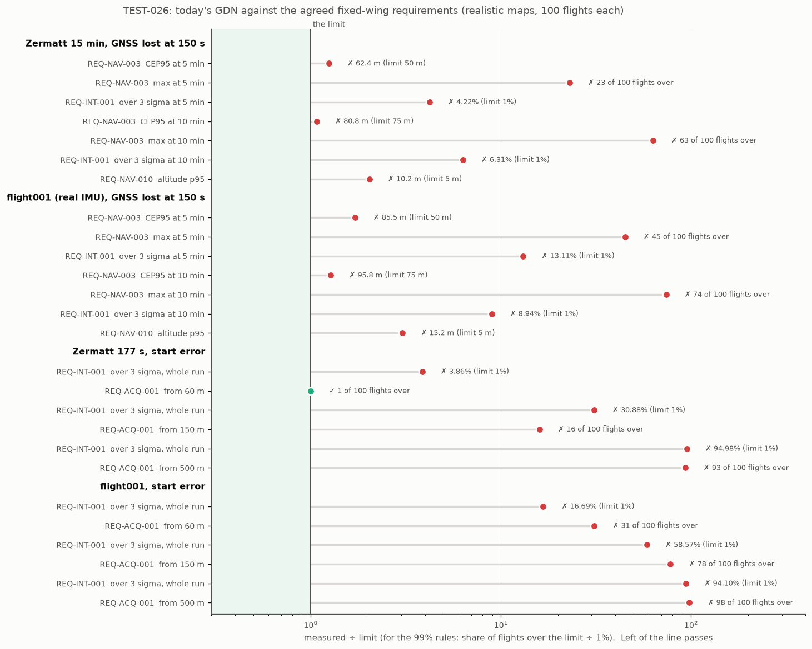

# TEST-026: the agreed requirements, and today's GDN scored against them (R1.8)

**Question.** R1.8 asks us to agree the error limits in `docs/requirements.md`, so every
later "done when" has a fixed target. What did we agree, can a Monte Carlo run be scored
against it automatically, and where does GDN stand today?

**Answer, short.**
- **Agreed:**
  - The fixed-wing limits are kept as drafted: CEP95 50 m at 5 minutes and 75 m at 10,
    max 100 m.
  - "Max" now means **at least 99% of flights never go over it**. The single worst
    sample grew harder to pass with every extra flight run.
  - Accuracy is **scored on realistic map error** (REQ-DB-002). Perfect-map runs are
    regression checks only.
  - The multirotor and quadplane limits stay, marked **provisional** until SITL and
    the odometry layer can measure them.
- **`tools/score_requirements.py`** reads the limits from `requirements.md` itself and
  scores MC outputs: PASS, FAIL or NOT SCORED with the reason. It was tested first: 14
  self-checks, which CI now runs.
- **Today, fixed-wing, realistic maps, 100 flights each: 1 pass, 25 fails.** The only pass
  is acquisition from 60 m on Zermatt (99 of 100 flights).
  - The GNSS-loss cases fail every line, though CEP95 is close: 62 m against 50, and
    81 m against 75, on Zermatt.
  - The failures that matter most are integrity (4 to 13% over 3σ, against 1%), the
    flights that run away (23 to 74 in 100 go over 100 m), and acquisition from 150 m
    and 500 m.
  - New: **altitude fails on realistic maps** (p95 10 to 15 m, against 5 m). It had only
    been measured on perfect maps, where it is 1.5 m.
- This is the Phase 1 baseline. The roadmap expected the large start errors to fail
  until Phase 4; this shows the GNSS-loss cases on realistic maps fail too, and by how
  much.



## What was agreed

Decided with the project lead on 12 November 2026, and written into
`docs/requirements.md`:

| Question | Decision | Why |
|---|---|---|
| Fixed-wing limits (REQ-NAV-003) | Keep 50 / 75 m CEP95, max 100 m | They are the target. Today's realistic-map CEP95 is 1.1 to 1.25x over, which Phase 4 (acquisition, integrity) is meant to close. |
| How "max" is stated | At least 99% of flights never over it, at any moment in the window | The worst sample over all flights depends on how many flights were run: one bad flight in 100 fails it, and with 1,000 flights almost anything would. The MC already counts flights never over 100 m. |
| Which map the limits are scored on | Realistic map error: an onboard map from a coarser, different source (SRTM-like now, a second DEM from R2.2) | REQ-DB-002 already required it. Map error is the main real-world cause of TRN failure, and a perfect map hides it. |
| Multirotor and quadplane | Keep the numbers, marked provisional | They can't be measured until the closed-loop SITL (R2.7) and VIO/LIO (Phase 3). The multirotor's 25 m in 10 minutes at 15 m/s is 0.3% of the distance flown, tighter than visual odometry alone (0.5 to 2%). |

REQ-ACQ-001 ("reach the REQ-NAV limits within 120 s") is scored with the same 99% rule:
at least 99% of flights, from each start error up to 500 m, under the class's max limit
120 s after take-off.

`requirements.md` also had a mistake: "Where we stand today" said flight001's CEP95 of
63 m at 5 minutes passes, but the 5-minute limit is 50 m. That section now shows this
report's scorecard instead.

For scale: the fixed-wing flight in the MC covers 9 km in 5 minutes and 18 km in 10 (30
m/s), so 75 m is 0.4% of the distance flown. flight001 flies at 15 m/s (4.7 and 9.2 km).

## The scorer

`tools/score_requirements.py --class CLASS MC_OUTPUTS...` reads the limits from
`docs/requirements.md`, so that file stays the only place they are set. It scores what
`mc_campaign` prints:

| Requirement | Scored from | Rule |
|---|---|---|
| REQ-NAV-001 to 003 | the `GNSS-free 300 s` and `600 s` lines | CEP95 at most the limit; at least 99% of flights never over the max |
| REQ-NAV-010 | the `vertical` line | altitude error p95 at most 5 m |
| REQ-INT-001 | `over 3 sigma` on each GNSS-free line, or the whole run where there are none | at most 1%, in every scenario set |
| REQ-ACQ-001 | the `acquisition` line, each start error up to 500 m | at least 99% of flights under the max limit at 120 s |

Anything it can't score yet it marks NOT SCORED, with the reason:
- a perfect-map run;
- a max limit other than 100 m. The MC counts flights against 100 m, which is the
  fixed-wing limit; the multirotor's 30 and 50 m need SITL scoring (R2.7).

**Tests, written first** (`--selfcheck`, 14 checks, in CI). The scorer was a stub when
they were written and they failed; they pass now. They check that it:
- reads every scored limit from the real `requirements.md`;
- passes and fails on CEP95 either side of the limit;
- passes at 99 of 100 flights and fails at 98;
- fails integrity over 1% and altitude over 5 m;
- scores each start error up to 500 m, and not above;
- marks a 30 m max NOT SCORED while still scoring CEP95;
- doesn't score perfect-map runs;
- scores integrity on start-error runs. This case was added after the first baseline
  run showed those runs weren't scored; it failed until fixed.

**`tools/mc_map_ensemble.py`** now also prints the lines the scorer needs from a
realistic-map run:
- the acquisition counts, summed over the maps (exact);
- the altitude error, as the largest per-map value. The trace has no altitude, so a
  pooled figure isn't available; the largest is on the safe side.

## The baseline

Fixed-wing (REQ-NAV-003). SRTM-like onboard maps: 5 maps (`--coarsen 3 --noise 6 --corr
200 --bias 3`, the TEST-020 to TEST-025 recipe) x 20 flights = 100 flights per run. H30WP
IMU model on Zermatt; flight001 keeps its recorded IMU. Filter at its defaults (main
after R1.6).

| Scenario | Line | Measured | Limit | |
|---|---|---|---|---|
| Zermatt 15 min, GNSS lost at 150 s | CEP95 at 5 / 10 min | 62.4 / 80.8 m | 50 / 75 m | FAIL |
| | flights never over 100 m, 5 / 10 min | 77 / 37 of 100 | 99 | FAIL |
| | over 3σ, 5 / 10 min | 4.22 / 6.31% | 1% | FAIL |
| | altitude p95 | 10.2 m | 5 m | FAIL |
| flight001 (real IMU), GNSS lost at 150 s | CEP95 at 5 / 10 min | 85.5 / 95.8 m | 50 / 75 m | FAIL |
| | flights never over 100 m, 5 / 10 min | 55 / 26 of 100 | 99 | FAIL |
| | over 3σ, 5 / 10 min | 13.11 / 8.94% | 1% | FAIL |
| | altitude p95 | 15.2 m | 5 m | FAIL |
| Zermatt 177 s, start error | under 100 m at 120 s from 60 / 150 / 500 m | **99** / 84 / 7 of 100 | 99 | **PASS** / FAIL / FAIL |
| | over 3σ, whole run, from 60 / 150 / 500 m | 3.86 / 30.9 / 95.0% | 1% | FAIL |
| flight001, start error | under 100 m at 120 s from 60 / 150 / 500 m | 69 / 22 / 2 of 100 | 99 | FAIL |
| | over 3σ, whole run, from 60 / 150 / 500 m | 16.7 / 58.6 / 94.1% | 1% | FAIL |

**Regression check, perfect map** (not scored): Zermatt 15 min, GNSS lost at 150 s
gives CEP95 20.2 / 22.5 m, 100 of 100 flights never over 100 m, 0.00% over 3σ and
altitude p95 1.5 m. All of that would pass, and it reproduces TEST-024 and TEST-025
exactly.

**What the failures are:**
1. **Accuracy is near the limit; runaways aren't.** CEP95 is 1.1 to 1.9x the limits, but
   23 to 74 flights in 100 go over 100 m. Those are false locks on the wrong terrain
   contour (OI-009). Removing them, rather than making the typical flight more accurate,
   is the work that would pass REQ-NAV-003.
2. **Integrity fails everywhere with map error.** Even the one acquisition pass is 3.9%
   over 3σ. The filter is told the truth at the start (its start uncertainty equals the
   start error), so the overconfidence comes from TRN updates that lock onto the wrong
   place and shrink the covariance. It needs integrity monitoring and map-error-aware
   TRN (R4.1, R4.4).
3. **Altitude follows the map.** With the `agl` model, height comes from the radar
   altimeter plus the map's terrain height, so the map's error (3 m bias plus
   correlated noise in the recipe) goes straight into altitude. On a perfect map p95 is
   1.5 m. This was hidden until now, because altitude was only measured on perfect maps.
   Likely fixes: weigh the barometer more against TRN height where the map is
   uncertain, or estimate a map height bias. Recorded as OI-014, for Phase 4.
4. **Acquisition** works from 60 m on Zermatt, and not reliably from 150 m or at all from
   500 m, as expected until R4.1. flight001 is worse throughout (69 of 100 from 60 m):
   its terrain has less relief, and it flies at 15 m/s.

## Checks run

- `python3 tools/score_requirements.py --selfcheck`: 14 pass. CI step added.
- `tools/run_selftest.sh` and `colcon test`: unchanged C++, both pass.
- The perfect-map run reproduces TEST-025's H30WP row exactly.

## Limits

- Fixed-wing only. Multirotor and quadplane scoring needs SITL (R2.7), and a max limit
  other than 100 m needs the MC or SITL to count flights against it.
- SRTM-like maps are synthetic map error (TEST-020's recipe). A real second DEM comes
  with R2.2.
- The realistic-map altitude figure is the largest of 5 per-map p95 values, so it is on
  the safe side.
- REQ-INT-002 to 005, REQ-ACQ-002, REQ-NAV-011 and REQ-SYS are not scored: they need
  integrity monitoring (R4.4), SITL (Phase 2) or the companion computer (R3.4).

## Reproduce

```bash
python3 tools/score_requirements.py --selfcheck
D=$SCRATCH; E="python3 tools/mc_map_ensemble.py --recipe '--coarsen 3 --noise 6 --corr 200 --bias 3' --maps 5 --per-map 20"
ZW="--world data/maps/zermatt.bin"; FW="--world data/maps/terrain_db_sigma4.bin"
eval "$E $ZW --tag t026_zl --csv data/flight_zermatt_long_csv -- --model=agl --startup=node --gnss-loss=150" > $D/z_loss.txt
eval "$E $FW --tag t026_fl --csv data/flight001_csv -- --model=agl --baro-drift=5 --gnss-loss=150" > $D/f1_loss.txt
for s in 60 150 500; do
  eval "$E $ZW --tag t026_za$s --csv data/flight_zermatt_csv -- --model=agl --startup=node --start-error=$s" > $D/z_acq$s.txt
  eval "$E $FW --tag t026_fa$s --csv data/flight001_csv -- --model=agl --baro-drift=5 --start-error=$s" > $D/f1_acq$s.txt
done
tools/mc_run.sh 100 data/flight_zermatt_long_csv data/maps/zermatt.bin --model=agl --startup=node \
    --gnss-loss=150 > $D/z_loss_perfect.txt
S="python3 tools/score_requirements.py --class fixed-wing --csv docs/test_reports/test026_data/scorecard.csv"
$S --label "Zermatt 15 min, GNSS lost at 150 s" $D/z_loss.txt
$S --label "flight001 (real IMU), GNSS lost at 150 s" $D/f1_loss.txt
$S --label "Zermatt 177 s, start error" $D/z_acq60.txt $D/z_acq150.txt $D/z_acq500.txt
$S --label "flight001, start error" $D/f1_acq60.txt $D/f1_acq150.txt $D/f1_acq500.txt
python3 tools/plot_test026.py
```

The MC outputs behind the tables are in `test026_data/`.
