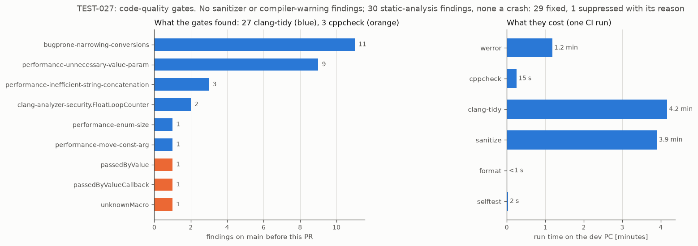

# TEST-027: code-quality gates in CI (R1.9)

**Question.** R1.9 asks for clang-tidy, cppcheck, ASan/UBSan builds of the selftest and
the MC, and clang-format in CI, with warnings failing the build for the core. What do
these tools find in today's code, and can they run on every PR without blocking work for
style churn?

**Answer, short.**
- **The code was already in good shape.**
  - Compiler warnings (`-Wall -Wextra -Wpedantic`, g++ and clang++): none.
  - ASan and UBSan, over the selftest and MC runs through each code path: no memory or
    undefined-behaviour errors.
- **Static analysis found 30 small things, none a crash or a wrong result.**
  - clang-tidy: 27. Mostly implicit integer-to-`double` conversions and copies that
    should be references.
  - cppcheck: 3.
  - 29 are fixed and one is suppressed with its reason. The MC results are identical
    before and after.
  - One fix is worth knowing about: in the ROS node, a timestamp going backwards gave
    an unsigned wrap to about 1.8e13 s, not a negative `dt`. The sample was still
    dropped, but by the wrong check. It's now a signed difference.
- **Decided with the project lead:**
  - clang-tidy fails the build on its bug-finding and performance checks; style checks
    are off.
  - clang-format checks only the lines a PR changes. The code is hand-aligned, and any
    standard style would reformat about 40% of it (1,259 of 3,211 lines).
- **`tools/quality.sh`** runs every gate locally exactly as CI does. Its `selftest`
  first plants a defect for each gate and checks the gate fails on it (12 of 12). A gate
  that can't fail would pass silently.
- **Cost:** about 12 minutes more per CI run (clang-tidy about 4, sanitizers about 4), so
  the CI time limit goes from 45 to 60 minutes.



## The gates

| Gate | Command | What fails it |
|---|---|---|
| Warnings | `tools/quality.sh werror`; `tools/run_selftest.sh`; colcon with `-DGDN_WERROR=ON` | any warning from `-Wall -Wextra -Wpedantic`, under g++ and clang++ (ROS-free core), and in the colcon build of the whole package (ROS nodes too) |
| cppcheck | `tools/quality.sh cppcheck` | a `warning`, `performance` or `portability` finding |
| clang-tidy | `tools/quality.sh tidy` (`.clang-tidy`) | any `bugprone-*`, `clang-analyzer-*`, `performance-*` or `portability-*` finding, in the core and both ROS nodes |
| Sanitizers | `tools/quality.sh sanitize` | an ASan or UBSan error in the selftest or in short MC runs over 4 code paths |
| Formatting | `tools/quality.sh format origin/main` (PRs only) | a changed C++ line that `.clang-format` would change |

**Choices inside the gates:**
- **The style.** `.clang-format` is Google style with 4-space indents and 120 columns,
  short one-liners allowed, and include order left alone. Of the styles tried it changes
  the fewest existing lines (1,259); the alternatives were all between 1,259 and 1,572.
- **`bugprone-easily-swappable-parameters` is off.** It flags every `(double, double)`
  signature in the maths; that's a naming rule, not a bug.
- **`-Werror` is a CMake option (`GDN_WERROR`), on in CI and off by default.** A newer
  compiler's new warnings shouldn't stop someone's local build; they stop the PR instead.
- **Sanitizer MC runs** are 1 or 2 flights each, through these code paths:
  - the node start-up;
  - GNSS loss with a model IMU (the OAK-D Lite file);
  - a start error;
  - flight001's recorded IMU.

  Leak checking is off, because LeakSanitizer needs ptrace, which CI containers don't
  allow.
- **The ROS nodes** are checked by clang-tidy with the compile flags colcon exports
  (`-DCMAKE_EXPORT_COMPILE_COMMANDS=ON`). Unknown gcc-only flags are ignored.

## Tests, written first

`tools/quality.sh selftest` (the first R1.9 step in CI) writes small files with a planted
defect and checks each gate fails on its own, and passes clean code:

| Gate | Planted defect | Result |
|---|---|---|
| werror | an unused variable | fails, as it should |
| sanitize | a heap read past the end of a vector (ASan) | fails |
| sanitize | signed integer overflow (UBSan) | fails |
| cppcheck | an array index out of bounds | fails |
| tidy | use of a string after `std::move` | fails |
| format | a badly formatted new line | fails |
| format | an old badly formatted line left unchanged, plus a good new line | passes: only changed lines count |
| every gate | clean code | passes |

The UBSan case failed the first time: the planted overflow passed. The compiler had
removed the addition, because its result was only compared with zero. Printing the
result fixed the test; the gate itself was right.

The gates found their own first defects in this PR. The format gate failed on three of
the PR's own edits (fixed with `git clang-format`), and the tidy gate failed the ROS nodes when its
own path handling was wrong (fixed by resolving file paths).

## What was found and fixed

| Check | Count | Where | Fix |
|---|---|---|---|
| bugprone-narrowing-conversions | 11 | `consistency.hpp` (5), `mc_campaign.cpp` (2), `eskf_node.cpp` (2), `map_db.hpp`, `imu_sim.cpp` | explicit `static_cast`; a signed timestamp difference in the IMU callback |
| performance-unnecessary-value-param | 9 | `eskf_node.cpp` (7 callbacks), `map_viz_node.cpp`, `imu_model.hpp` | callbacks take `ConstSharedPtr&` or `const Msg&` |
| performance-inefficient-string-concatenation | 3 | `imu_model.hpp` (error messages) | build the message with `+=` |
| clang-analyzer-security.FloatLoopCounter | 2 | `selftest.cpp` | integer loop counters |
| performance-enum-size | 1 | `eskf.hpp` | `UpdResult : std::uint8_t` |
| performance-move-const-arg | 1 | `eskf.hpp` | `Eskf(const EskfConfig&)`; the `std::move` did nothing |
| cppcheck passedByValue, passedByValueCallback | 2 | `imu_model.hpp`, `ground_monitor.hpp` | `const` references |
| cppcheck unknownMacro | 1 | `eskf_node.cpp` | suppressed at the line: `RCLCPP_COMPONENTS_REGISTER_NODE` comes from rclcpp_components, which cppcheck doesn't read |

**The timestamp fix.** `ImuCb` computed `dt = (t - last_t_) * 1e-6` on unsigned
timestamps. If PX4's timestamp ever went backwards, that wrapped to about 1.8e13 s, not
a negative number. The sample was still dropped, but by the `dt > 0.25` stall check,
not by the `dt <= 0` check that was meant for it. It now takes the difference signed,
so a backward step is negative, as the code intends. The effect is the same (the sample
is dropped), but the reason is now the right one.

Two findings looked like they might be real and weren't:
- `map_db.hpp`'s `At()` converts `double` to `float`. The map is stored in `float`, so
  nothing is lost; the conversion is now explicit.
- The selftest's `double` loop counters stepped through whole numbers, so they were
  exact. Integer counters satisfy the check at no cost.

**The callback reformat.** Changing the seven ROS callback signatures made the
"changed lines" rule reformat those seven functions in `eskf_node.cpp`. Their bodies were
at column 0 inside the class, and are now indented, with one statement per line. That's
164 lines added and 142 removed, nearly all layout. `git diff -w` shows only the intended
changes plus line splits and rewrapped calls. Expect the same on any function whose
first line a later PR touches.

## Results are unchanged

Every fix is behaviour-preserving, and the MC agrees:
- Zermatt 15 min, GNSS lost at 150 s, 24 flights: CEP95 19.0 and 20.4 m at 5 and 10
  minutes, max 77.3 m, 0.00% over 3σ. That's exactly the CI guard's figures.
- The same on 100 flights: 22.5 m, as in TEST-024 to TEST-026.
- Selftest at -O2 and -O3 (now with `-Werror`): all pass.
- `colcon test`: pass. The colcon build with `-DGDN_WERROR=ON`: no warnings.

## Cost

Local run times (CI's runners may be slower):

| Gate | Time |
|---|---|
| werror (g++ and clang++, three files) | 1.2 min |
| cppcheck | 15 s |
| clang-tidy (the ROS node is most of it: ROS headers) | 4.2 min |
| sanitize (most of it is building the two sanitized programs) | 3.9 min |
| format | under 1 s |
| selftest | 2 s |

About 10 minutes on this PC, probably 12 to 15 on CI. The CI time limit goes from 45 to
60 minutes.

## Limits

- **The 40% of code formatted differently from the style stays as it is** until someone
  edits it. That's the agreed trade: no mass reformat, no merge conflicts.
- **Style checks are off:** `const` correctness and modern idioms, about 60 sites. They
  can be turned on later, one check at a time.
- **`-Wshadow` and `-Wconversion` aren't in the warning set.** They would add 7 to 14
  warnings per file, mostly Eigen arithmetic and test-local names. Candidates for later.
- **The Python tools aren't covered** by these gates.
- **Sanitizers cover the ROS-free core**, not the ROS nodes. The nodes' logic is the
  core's (`gdn/eskf.hpp`), but their ROS plumbing isn't sanitized.

## Reproduce

```bash
sudo apt install clang clang-tidy clang-format cppcheck
source env.sh
colcon build --packages-select gdn_fusion --cmake-args -DCMAKE_EXPORT_COMPILE_COMMANDS=ON -DGDN_WERROR=ON
tools/quality.sh selftest
tools/quality.sh all            # werror, cppcheck, tidy, sanitize, format (against origin/main)
tools/run_selftest.sh
python3 tools/plot_test027.py   # the figure, from test027_data/
```
