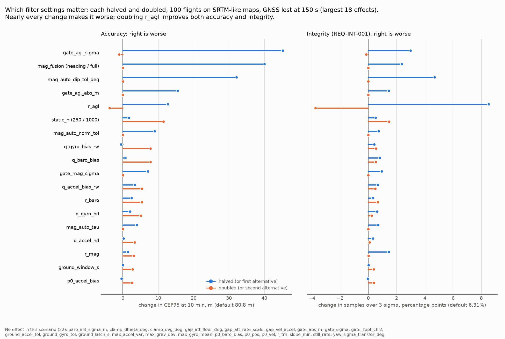

# TEST-028: configuration files (R1.10)

**Question.** R1.10 asks for the filter tuning to move out of code defaults into versioned
YAML, loaded by the node and the MC, so a result can always be traced to the exact
configuration. Can that be done without changing any result, and what does it show
about the tuning?

**Answer, short.**
- **One file holds every setting:** `config/filter/default.yaml`, 57 settings with what
  each is for and where its value came from. The C++ holds none: the config structs
  start out unset (NaN), so a filter built without a loaded file goes visibly wrong.
  The node, the MC and the selftest all load the same file.
- **Nothing changed.** All 43 values from the old C++ defaults are in the file bit for
  bit. The MC outputs of all the CI scenarios, and of three runs through the override
  options, are byte-identical to main's, apart from the new `filter:` line.
- **Every result names its configuration.** The node's log and every MC report carry a
  `filter:` line: the name, the file, a 12-digit fingerprint of the values, and any
  overrides. Same fingerprint, same numbers. CI checks each MC run used the default file
  with no overrides; the requirements scorer refuses to mix configurations on one
  scorecard.
- **Decided with the project lead:**
  - The numbers live in the YAML only, not also in the C++.
  - The node and the MC disagreed on one value: the altitude datum's uncertainty, 5.0 m
    in the node and 5.4 m in the MC. Both now use 5.4 m (the MC's value, so its results
    don't move).
- **Found on the way:**
  - One setting did nothing at all (`clamp_dp`); it's removed.
  - Nine values were literals inside the filter's functions: the ZUPT noise and gate,
    the starting covariance, and the heading uncertainty after alignment. They're now
    settings.
  - `-p r_agl:=50` crashed the node on main ("setting it to {integer} is not allowed"),
    so the example in `tools/sim_replay.sh` never worked. Whole numbers are now accepted
    for decimal settings.
- **Which settings matter** (the figure): each setting halved and doubled, on the R1.8
  scoring scenario. Nearly every change makes accuracy or integrity worse, so today's
  tuning sits near a local optimum. The one clear exception is `r_agl`: doubling it
  (10 to 14 m sigma) improves both, CEP95 80.8 to 77.1 m and samples over 3 sigma 6.3%
  to 2.6%. That's not applied here (R1.10 moves the values, it doesn't retune), but
  it's the first thing to try for OI-009 and REQ-INT-001.



## How it works

`gdn/filter_config.hpp` (ROS-free) reads the file through a small `key: value` reader
(`gdn/kv_file.hpp`), which the IMU model loader now shares.

- **Strict.** Every key is required. An unknown key, a key given twice, a value that
  isn't a number (or isn't a whole number where one is needed), an out-of-range value
  (a negative variance, an unknown `mag_fusion` mode) or another schema version is an
  error naming the file, line and key. A typo can't fall back to a value nobody chose.
- **One table.** Loader, validation, overrides, dump, fingerprint and the node's
  parameters all go through one list of settings (`ConfigFields`), so a new setting is
  added in one place and can't be missed by any of them.
- **Fingerprint.** A 64-bit FNV-1a hash of every value, in the shortest text that reads
  back as the same double, shown as 12 hex digits. Comments, key order and the file's
  name don't enter it; any change of any value does (checked down to 1 ulp).
- **Overrides** for experiments:
  - MC: `--set=KEY=VALUE`, and the older `--r-agl`, `--q-baro`, `--q-*`, `--mag`
    shorthands.
  - Node: `-p KEY:=VALUE`. Every key is a node parameter defaulting to the file's value.
  - Either way the `filter:` line lists the overrides, and the fingerprint changes.
- **Reproducing a run.** `mc_campaign --dump-config=FILE` writes the values a run used
  (after overrides) as a config file. `--config=FILE` reads it back bit for bit: a run
  with three overrides, rerun from its dump, gave identical results and the same
  fingerprint.

What a report looks like now:

```
imu: h30wp (WHEELTEC H30WP (Yesense), ...) on imu_truth.csv
filter: default (config/filter/default.yaml), fingerprint 9025345f59ba
```

and with overrides:

```
filter: default (config/filter/default.yaml), fingerprint 5b7ae4d53c18; overrides r_agl=50, mag_fusion=heading, mag_ref_down=45
```

**What's in the file.** Grouped as:
- TRN (`r_trn`, gates);
- altimeter (`r_agl`, gates, `datum_sigma_m`);
- barometer;
- IMU process noise;
- static alignment;
- starting uncertainty (`p0_*`, `yaw_sigma_*`);
- on-ground detection and ZUPT (`ground_*`, `zupt_sigma_v`, `gate_zupt_chi2`);
- magnetometer (`mag_fusion`, noise, the `mag_auto_*` checks, the reference field
  `mag_ref_*`);
- gain limits (`clamp_*`);
- IMU holes (`gap_*`, node only).

Units are the code's (SI, radians unless the key ends in `_deg`). The two gyro noise
values are written to 17 digits so they are exactly the old `0.02 * M_PI / 180.0` and
`0.001 * M_PI / 180.0`; the comment beside them gives them in degrees.

Not in the file, on purpose:
- **Numerical guards:** the 0.01 s integration step, the 1e-9 floors.
- **Physics:** yaw unknown (180 degrees) before alignment, the 1 uT minimum horizontal
  field for a heading.
- **Which measurement topic the node listens to** (`trn_model`).
- **The MC's scenario options** (`--model`, `--gnss-loss`, ...), which describe the
  simulated flight, not the filter.

## Tests, written first

TEST-028 in the selftest. The checks were written against a stub loader first, and all
13 failed. With the loader, all pass:

| Check | Result |
|---|---|
| `default.yaml` loads, with every setting given (57) | pass |
| the code holds no tuning: a config not read from a file is refused | pass |
| a missing key is an error that names it | pass |
| a misspelt key (`r_alg`) is an error, not a silent default | pass |
| a key given twice is an error | pass |
| a value that isn't a number (`1OO`), or isn't whole (`static_n: 500.5`), is an error | pass |
| an out-of-range value (`r_agl: -100`, `mag_fusion: magic`) is an error | pass |
| a file of another schema version is refused | pass |
| a dumped config loads back bit for bit | pass |
| the fingerprint changes when any one setting changes by 1 ulp (57 of 57) | pass |
| the fingerprint ignores comments, key order and the name | pass |
| an override changes one setting and is listed; a misspelt one is refused | pass |
| every file in `config/filter/` loads | pass |

Every other selftest check now starts from the file too, as the node and the MC do.

The R1.9 gates caught three problems in this PR's own code; all are fixed:
- **An exception could escape the selftest's `main`.** The new test is now wrapped and
  reports a failure instead.
- **The round-trip check compared doubles with `memcmp`.** It now compares their bit
  patterns explicitly.
- **An error message was built with a needless temporary string.**

Elsewhere:
- **The scorer** (`tools/score_requirements.py --selfcheck`) has a 15th check: reports
  from one configuration score together, two configurations are refused.
- **`tools/ci_check_mc.py --expect-filter default`** fails a report from another file
  or with overrides. CI passes it on all nine MC checks. Tried on a report with
  overrides and on a pre-R1.10 report: both fail, as they should.
- **`tools/mc_map_ensemble.py`** carries the `filter:` line into its pooled report, and
  stops if it changes between maps.

## Nothing changed

- **Values.** The old C++ defaults (all 43, dumped with `%.17g` from main's code) equal
  the file's, bit for bit. Differences:
  - `clamp_dp` is gone (nothing read it).
  - `datum_sigma_m` is 5.4 in the node now, as agreed.
  - Nine function-body literals are now settings, with the same values.
- **MC.** Ten runs, built from main and from this branch the same way (g++ -O3) and
  compared byte for byte, are identical except for the new `filter:` line:
  - the seven CI scenarios (Zermatt ideal, AGL, node start-up, GNSS loss, 60 m start
    error; flight001 AGL and GNSS loss);
  - a run with four overrides;
  - `--q-imu=match` with the OAK-D model;
  - a degraded onboard map.

  Zermatt GNSS loss: CEP95 19.0 and 20.4 m at 5 and 10 minutes, as before.
- **Node.** It starts with the same fingerprint as the MC (`9025345f59ba`). With
  `-p r_agl:=50 -p mag_fusion:=heading -p mag_ref_down:=45` it lists those three. With
  `r_agl:=-1`, `static_n:=1.5` or a missing file it stops at start-up with the reason.

## Which settings matter

`tools/config_sensitivity.py` runs every setting at half and twice its value through
`--set`. Whole-number settings and switches get alternatives instead:
- `static_n`: 250 and 1000;
- `mag_auto_hold`: 10 and 30;
- `mag_fusion`: heading and full.

The `mag_ref_*` field values describe the site, not the tuning, and are left out.

The scenario is R1.8's: GNSS lost at 150 s on the 15 minute Zermatt flight, node
start-up, 5 SRTM-like onboard maps x 20 flights, scored over the 10 GNSS-free minutes.
Each variant runs on the same maps and flight seeds as the default, so a difference
comes from the setting, not from different noise draws. 109 variants, 545 runs, about
25 minutes on this PC (data: `test028_data/sensitivity.csv`).

The default gives CEP95 80.8 m, 6.31% of samples over 3 sigma, and 37 of 100 flights
never over 100 m. That matches the R1.8 baseline (TEST-026: 81 m).

**The largest effects:**

| Setting | Change | CEP95 | over 3 sigma | never over 100 m |
|---|---|---|---|---|
| (default) | | 80.8 m | 6.31% | 37/100 |
| `gate_agl_sigma` | 3 to 1.5 | 126.1 m | 9.29% | 30 |
| `mag_fusion` | auto to heading | 120.9 m | 8.68% | 13 |
| `mag_auto_dip_tol_deg` | 2 to 1 | 113.0 m | 11.01% | 29 |
| `gate_agl_abs_m` | 40 to 20 | 96.3 m | 7.76% | 35 |
| `r_agl` | 100 to 50 | 93.6 m | 14.84% | 26 |
| `r_agl` | **100 to 200** | **77.1 m** | **2.57%** | **47** |
| `static_n` | 500 to 1000 | 92.3 m | 7.78% | 35 |
| `mag_auto_norm_tol` | 2 to 1 | 89.8 m | 7.03% | 36 |

What it says:
- **The altimeter update matters most.** Its gates and its noise `r_agl` are the top
  of the list. Tighter gates throw away good updates over rough ground. A smaller
  `r_agl` trusts the map more than an SRTM-like map deserves: integrity more than
  doubles (14.8% over 3 sigma).
- **`r_agl` is set too low for SRTM-like maps.** Doubling it (14 m sigma) improves
  every number: CEP95 down 3.7 m, samples over 3 sigma from 6.3% to 2.6%, flights
  never over 100 m from 37 to 47. `r_agl` = 100 was chosen on flight001 with a perfect
  map (TEST-017); on SRTM-like maps the map error is larger. This is a lead for OI-009
  and REQ-INT-001. It isn't applied here, because R1.10 moves values without retuning
  them, and a tuning change needs its own sweep on the perfect-map regressions too.
- **The magnetometer's "auto" checks are close to their edge.** Tighter dip or strength
  tolerances, or heading-only fusion, cost 9 to 40 m: on these flights the 3-axis
  update carries tilt information the filter needs. Looser ones change nothing.
- **Nearly everything else makes it slightly worse in both directions.** Most IMU and
  baro noise values, the starting covariance, ZUPT noise and gain limits each move
  CEP95 by up to about 8 m. The tuning sits near a local optimum for this scenario.
  Effects of 1 to 3 m can come from a single flight ending the other side of 100 m,
  and aren't worth reading into.

**22 settings had no effect here**, each for a reason; none is dead code (unlike
`clamp_dp`, which was):
- **Used by another measurement model:** `r_trn`, `slope_min`, `gate_sigma`,
  `gate_abs_m` (the "ideal" TRN model; this scenario uses the altimeter).
- **Used by another start-up:** `yaw_sigma_transfer_deg` (the MC's "truth" start-up).
- **Node only:** `gap_att_rate_scale`, `gap_att_floor_deg`, `gap_vel_accel` (the MC
  has no IMU holes).
- **Overwritten by 150 s of GNSS before the loss:** `p0_pos`, `p0_vel`,
  `p0_baro_bias`, `baro_init_sigma_m`.
- **Thresholds never reached by this clean simulated start-up:** `still_rate`,
  `max_gyro_mean`, `max_grav_dev`, `max_accel_var` (static alignment);
  `ground_accel_tol`, `ground_gyro_tol`, `ground_latch_s` (the take-off is clear
  either way); `gate_zupt_chi2` (no ZUPT is refused); `clamp_dtheta_deg`,
  `clamp_dvg_deg` (the limits aren't reached).

These need other scenarios to test: real start-ups (bench and SITL, Phase 2) and the
node's IMU holes (SITL over DDS).

## Limits

- **One scenario.** The ranking is for GNSS loss on SRTM-like maps on the synthetic
  Zermatt flight. Acquisition from a start error, flight001's real IMU and the
  multirotor would rank the settings differently. The tool takes any MC options, so the
  ranking can be repeated there.
- **One setting at a time.** The sweep doesn't show interactions (for example `r_agl`
  together with the AGL gates).
- **The fingerprint covers the filter config only.** The IMU model and scenario are on
  the report's `imu:` and `scenario:` lines, and the code version is the git commit.
  A result is traced by all of these together. R1.11 will put them in each run's log.
- **There's one config file today.** Vehicle and site files (`mag_ref_*` for another
  area) go next to it; the selftest loads every file in `config/filter/`.

## Reproduce

```bash
source env.sh
colcon build --packages-select gdn_fusion --cmake-args -DCMAKE_BUILD_TYPE=Release
tools/run_selftest.sh                                  # TEST-028 checks
tools/mc_run.sh 24 data/flight_zermatt_long_csv data/maps/zermatt.bin --model=agl \
    --startup=node --gnss-loss=150 --set=r_agl=200 --dump-config=/tmp/run.yaml
python3 tools/config_sensitivity.py --out docs/test_reports/test028_data/sensitivity.csv   # about 12-25 min
python3 tools/plot_test028.py                          # the figure, from test028_data/
```
