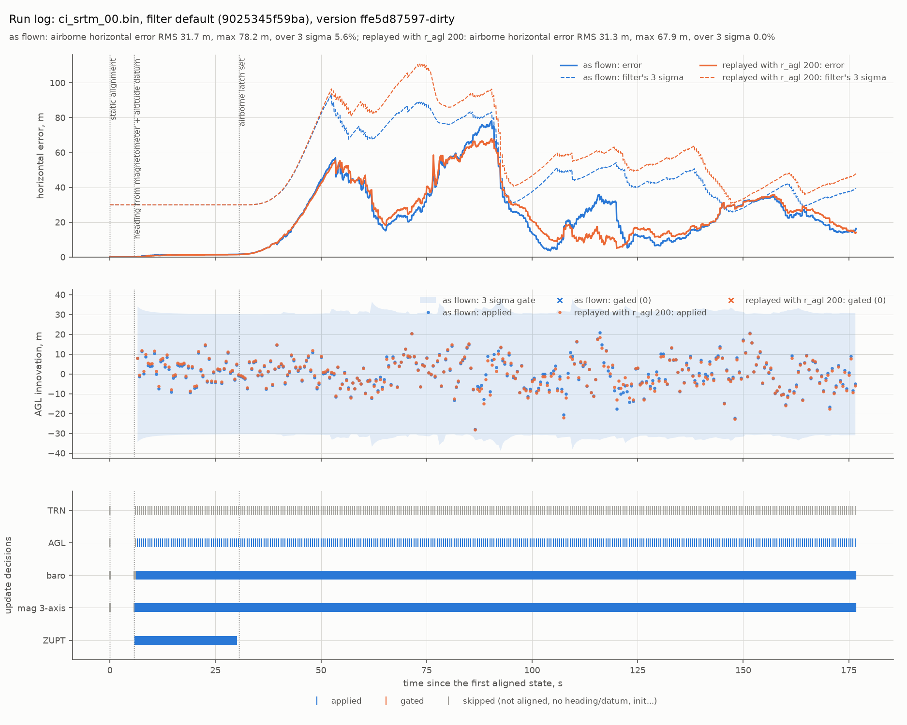

# TEST-029: the run log (R1.11)

**Question.** R1.11 asks the node to log every input, innovation, gate decision and state
to MCAP, so any run, simulated or real, can be replayed and diagnosed offline. Can a run
be replayed exactly, and what does the log show that the console didn't?

**Answer, short.**
- **Every node run writes one MCAP file** (`log/gdn_runs/gdn_<UTC time>/`):
  - every input as received;
  - every update with its decision (applied, gated, or skipped and why), innovation,
    predicted variance and NIS;
  - the state after every input;
  - start-up events;
  - a header with the config, map and software version.

  The 3 minute Zermatt bench run is 7.7 MB (about 160 MB per hour). Logging costs the
  node about 0.7% of one CPU core and 3 MB of memory.
- **A run replays bit for bit.**
  - `gdn_replay LOG` feeds the logged inputs through the same code as the node. On the
    bench run it reproduced all 21,840 states, 4,471 update records and 4 events
    exactly, in 0.2 s.
  - CI checks this on every PR. CI also checks the replay can fail: a copy of the log
    with one position changed by 1 ulp is reported, and the wrong map is refused.
- **Decided with the project lead:**
  - The node writes the log itself, always on.
  - "Replayed" means bit for bit.
  - The Phase 1 report comes in its own PR after this one.
- **To make bit-for-bit replay possible,** the node's decisions moved out of its ROS
  callbacks into a ROS-free class, `gdn::NavCore`, which the node and the replay both
  run:
  - the decisions: when to align, when to ZUPT, when to set the altitude datum, which
    magnetometer update to run, what to do with a dropped or missing IMU sample;
  - main's node, driven with the same logged inputs, gives the same states as the new
    one on all 21,755 states of a run;
  - the MC outputs are byte-identical to main's.
- **What the log shows** (the figure), on the bench with an SRTM-like onboard map:
  - no altimeter reading was gated, yet the position error was over the filter's own
    3 sigma 5.6% of the time: the filter trusted a map worse than it assumed;
  - replayed from the same log with `r_agl` doubled, the same inputs give 0.0% over
    3 sigma and a 68 m maximum instead of 78 m;
  - that agrees with the R1.10 sweep, from a different direction: one logged run instead
    of 100 simulated ones.



## What's logged

| Topic | Type | What |
|---|---|---|
| `/gdn/log/run_info` | `gdn_msgs/RunInfo` | first message: the config's values, name, fingerprint and overrides; map path and fingerprint; origin; `trn_model`; the build's `git describe` |
| inputs | as received | `/fmu/out/sensor_combined`, `/gdn/mag_meas`, `/gdn/agl_meas`, `/gdn/baro_meas`, `/gdn/trn_meas`, and PX4's local position and attitude (reference only, never fed to the filter) |
| `/gdn/log/state` | `gdn_msgs/NavState` | after every input: position, velocity, attitude, the five biases, covariance diagonal, north-east covariance, flags (aligned, heading, datum, airborne) |
| `/gdn/log/update` | `gdn_msgs/NavUpdate` | every measurement and ZUPT: sensor, decision, innovation, predicted variance, NIS, whether a gain limit acted |
| `/gdn/log/event` | `gdn_msgs/NavEvent` | static alignment, heading, altitude datum, airborne latch, IMU holes, dropped samples (every one; the console still thins repeats) |

Messages are written in the order the node processed them: log times are strictly
increasing, and each record carries the number of the input that caused it. The
`gdn_msgs` package is new; its constants match the C++ enums, checked at compile time.

**The decisions.** Before R1.11 an update returned "applied", "slope gate" or
"innovation gate", and "slope gate" also meant "not aligned yet", "off the map" and
more. `Eskf::last_update()` now records the exact reason. The return values didn't
change, so the MC can't move:

| Reason | Meaning |
|---|---|
| applied | the update was applied |
| not aligned / no heading / no datum | the filter isn't ready for it yet |
| off map | the map has no height under the estimate |
| flat | terrain flatter than `slope_min` (TRN) |
| weak field | horizontal magnetic field under 1 uT |
| gated | innovation outside the gate |
| numeric | innovation variance not positive, or NaN |
| init | used to initialise: heading, altitude datum, baro bias |
| not used | an input this configuration doesn't use (TRN in "agl" mode) |

**Version.** The build's `git describe` is generated at every build
(`cmake/gdn_version.cmake`), so a log always names the commit it came from, with
"-dirty" when the working tree had changes.

## Tools

- **`gdn_replay LOG`.** Rebuilds the filter from the log: the config from its text
  (checked against its fingerprint), and the map (checked against its fingerprint; a
  different file is refused). It then feeds the logged inputs in order and compares
  every state, update record and event, bit for bit. Exit codes: 0 identical, 1
  different (naming the first difference), 2 error.
- **`gdn_replay LOG --set=KEY=VALUE --out=DIR`** (or `--config=FILE`). What if: the same
  inputs with other settings, written as a new run log.
- **`tools/plot_run_log.py LOG [LOG2]`.** Draws a run or two runs: the error against
  PX4's position with the filter's 3 sigma, the altimeter innovations against the
  gate, and every update decision per sensor. It also prints the decision counts, and
  `--export DIR` writes small CSVs.
- **`tools/log_check.sh`.** The CI check, below.

## Tests, written first

TEST-029 in the selftest (ROS-free). It was written against stubs (an empty
`last_update()` and an empty `NavCore`), and all 7 checks failed. All pass now:

| Check | Result |
|---|---|
| a skipped update says why: not aligned, no heading, no datum, off map, flat, weak field | pass |
| an applied update logs its innovation, variance and NIS (NIS = y^2/S) | pass |
| a gated update logs how far outside the gate it was | pass |
| the magnetometer record names the update "auto" chose (3-axis or heading) | pass |
| the same inputs through NavCore give the same states bit for bit, and a 1e-6 change on one input shows | pass |
| every input leaves a state, and every measurement and ZUPT an update record: 3,036 inputs, 736 measurements plus 28 ZUPTs = 764 records | pass |
| start-up steps, IMU holes and dropped samples are events | pass |

The synthetic run behind the last three checks has:
- a parked start, then a take-off south over a sloping map;
- one IMU hole and one repeated timestamp;
- one wild altimeter reading (gated);
- TRN inputs the "agl" mode doesn't use (46, all "not used").

One check failed for a reason worth knowing: it first changed one accelerometer sample
by 1 ulp, and the states came out identical. A 1-ulp change (4e-16 m/s^2) vanishes in
the rounding of the next additions, so the check now uses 1e-6 m/s^2.

**End to end** (`tools/log_check.sh`, in CI on every PR, about 2 minutes):

| Check | Result |
|---|---|
| the bench flies the Zermatt bag through the node (2x speed), which writes its log | pass, 7.7 MB |
| `gdn_replay` reproduces every state, update and event | pass: identical |
| a copy of the log with one north position changed by 1 ulp | found: "state after input 4999 (t=40.300 s): pn logged -56.060307887000455, replayed -56.060307887000462" |
| the wrong map | refused: fingerprint differs |
| a what-if replay (`r_agl` 200) writes a log that itself replays identically | pass |

**A killed node.** With the node killed (kill -9) about 45 s into a bench run, the MCAP
has no index, and `gdn_replay` says so and how to fix it. After
`ros2 bag reindex DIR -s mcap`, the log replays identically up to what had been
written: 37.6 s, 4,643 states. The writer buffers, so the last seconds before a crash
are lost.

## Nothing changed

- **Main's node against the new one.** A scratch harness compiled main's
  `eskf_node.cpp` unchanged and called its callbacks with the inputs of a logged bench
  run, in log order. After every input it compared main's filter state with the state
  the new node logged: 21,755 of 21,755 states identical, every one of the 42 values bit
  for bit. So `NavCore` makes the same decisions the callbacks did.
- **MC.** Ten runs built from main and from this branch the same way are
  byte-identical:
  - the seven CI scenarios;
  - runs with overrides, with `--q-imu=match`, and with a degraded map.
- **Bench.** Zermatt with a perfect map: horizontal RMS 9.2 m over 60 to 300 s. Bench
  runs vary with playback timing, so the harness above is the exact check, not this.

The node's console changed a little, on purpose; no tool parses it (checked):
- The start-up messages use the event wording ("static alignment", "heading from
  magnetometer", "altitude datum", "airborne latch set").
- The first altimeter and TRN updates print in a shorter format.
- Dropped IMU samples are now events in the log. Before, they were only counted in the
  DBG line.

## What the log showed

The bench ran the Zermatt bag with the onboard map degraded the R1.8 way: SRTM-like
(`ci_srtm_00`, coarsened, noise, a 3 m bias). The world the simulated sensors measured
was the true map. Data: `test029_data/run` (as flown) and
`test029_data/whatif_r_agl200`, exported by `plot_run_log.py`.

| | as flown (`r_agl` 100) | replayed with `r_agl` 200 |
|---|---|---|
| airborne horizontal error RMS | 31.7 m | 31.3 m |
| max | 78.2 m | 67.9 m |
| samples over the filter's 3 sigma | 5.6% | 0.0% |
| altimeter updates gated | 0 of 341 | 0 of 341 |

Decision counts: altimeter 341 applied, 12 before alignment, 1 used for the datum; baro
1,707 applied; magnetometer 1,710 applied (all 3-axis: the field never looked
disturbed); ZUPT 241 while parked; TRN 354 not used (agl mode).

What the console couldn't show:
- **Nothing was rejected,** so the gates aren't what's wrong. The filter accepts every
  reading, and its uncertainty shrinks as if the map were as good as `r_agl` = 100
  says.
- **Between 145 and 150 s the error rises above the 3 sigma line**: the filter is
  overconfident there, which is REQ-INT-001's failure mode on SRTM-like maps (TEST-026).
- **The replay isolates the cause.** With the same inputs and only `r_agl` doubled,
  the filter stays honest and the worst error drops by 10 m.

That's one run, so it's an illustration, not a result. The R1.10 sweep (100 flights)
says the same, and OI-009 holds the lead.

## Limits

- **The replay reproduces what the node did with the inputs it received.** It can't
  show what a change would have done to the flight itself. Once PX4 flies on GDN
  (R5.1), a different estimate changes the inputs; that needs SITL.
- **Inputs the node never received aren't in the log.** Messages lost in DDS, for
  example. The log shows their effect: IMU holes and drops are events.
- **Size.** About 160 MB per hour. Nothing deletes old logs yet: `log/gdn_runs/` grows
  until cleaned. Fine for development; a vehicle needs rotation (R9.1, real-time core).
- **The MC doesn't write run logs.** It uses the filter directly, has its own `--trace`,
  and its start-up logic is still separate from `NavCore`. Moving the MC onto `NavCore`
  would remove that duplication; it's a candidate for Phase 2.
- **A crash loses the last few seconds,** whatever was still in the writer's buffer.

## Reproduce

```bash
source env.sh
colcon build --base-paths src --cmake-args -DCMAKE_BUILD_TYPE=Release
tools/run_selftest.sh                       # TEST-029 checks
python3 tools/make_zermatt_bag.py && tools/log_check.sh
# The figure's run: the bench with an SRTM-like onboard map, then the what-if replay
GDN_BAG=data/flight_zermatt GDN_MAP=$PWD/data/maps/zermatt.bin \
  GDN_DB_MAP=$PWD/data/maps/ensemble/ci_srtm_00.bin tools/bench.sh
ros2 run gdn_fusion gdn_replay log/gdn_runs/gdn_<time>                # IDENTICAL
ros2 run gdn_fusion gdn_replay log/gdn_runs/gdn_<time> --set=r_agl=200 --out=/tmp/whatif
python3 tools/plot_run_log.py docs/test_reports/test029_data/run docs/test_reports/test029_data/whatif_r_agl200 \
  --label "as flown" --label "replayed with r_agl 200" --out docs/test_reports/test029_run_log.png
```
