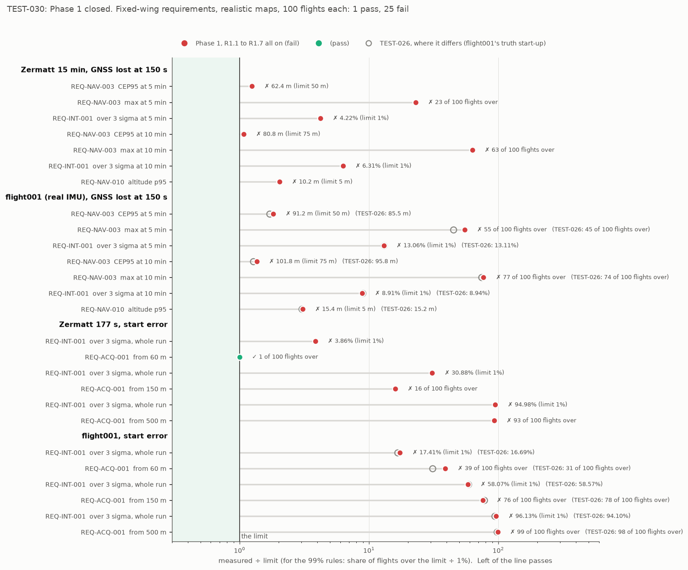

# TEST-030: the Phase 1 report (R1.1 to R1.7 all on, scored against R1.8)

**Question.** Phase 1 is done when "MC results with R1.1 to R1.7 all switched on are
written up as a new test report, scored against R1.8". With everything Phase 1 built
switched on, where does GDN stand against the agreed requirements, and what is left for
later phases?

**Answer, short.**
- **Fixed-wing, realistic (SRTM-like) maps, 100 flights per scenario: 1 pass, 25 fails.**
  The same count as the TEST-026 baseline.
  - The one pass is acquisition from a 60 m start error on Zermatt (99 of 100 flights).
  - The 150 m and 500 m start errors fail, as the roadmap expected until Phase 4 (R4.1).
  - The GNSS-loss cases fail too. Typical accuracy is close to the limits (CEP95 62 m
    against 50 m, and 81 m against 75 m, on Zermatt). The failures are the flights that
    run away to the wrong terrain contour (OI-009), integrity (4 to 13% over 3σ, against
    1%), and altitude following the map's error (OI-014).
- **"All switched on" is now checked, not claimed.**
  - `score_requirements.py --phase1` reads, from each MC output, what the MC says it ran,
    and refuses a report with any of R1.1 to R1.7 off, naming what was off.
  - 11 new self-checks, written first against a stub: all failed then, and all pass now.
  - TEST-026's own outputs are refused. They predate the lines that say how the MC ran,
    and its flight001 runs used the truth start-up, which R1.2 replaced.
- **What changed since TEST-026:**
  - Zermatt: all five outputs are byte-identical, so R1.9 to R1.11 changed no result.
  - flight001: now on the node's start-up (R1.2), as "all on" requires. That costs it
    6 m of CEP95 at both durations and 8 to 10 flights at 60 m acquisition, because the
    truth start-up it had was a truth leak. TEST-026's flight001 numbers still reproduce
    exactly with that start-up, so the start-up is the whole difference.
- **Phase 1 is complete.** Everything it set out to build is in, and this scorecard is
  the starting point Phase 2 onward is measured against.



## What "R1.1 to R1.7 all on" means

Each item, and how the scored runs have it on. The check reads every one of these from
the MC's output, not from the options given:

| Item | On in the scored runs | What the check reads |
|---|---|---|
| R1.1 altimeter measurement model | `--model=agl` (the node's default) | `model agl` |
| R1.2 no truth leaks | `--startup=node`: magnetometer heading while parked, ZUPT and the airborne latch from the IMU ground monitor | `startup node (IMU ground` |
| R1.3 separate world and onboard maps | SRTM-like onboard maps, 5 error patterns x 20 flights | not "same map: no map error" |
| R1.4 covariance consistency | always in the filter; magnetometer `auto` (the default) | `mag auto` (see the exception below) |
| R1.5 consistency metrics | the 3-sigma check on every run | the `consistency: error > 3 x published sigma` line |
| R1.6 IMU error model | the H30WP fit on Zermatt; flight001 keeps its real recorded IMU | `imu: h30wp` or `imu: recorded`; not the placeholder, nor process noise matched to the model |
| R1.7 scenarios | GNSS lost at 150 s, or a start error of 60, 150 or 500 m | `scenario:` says "then lost" or "start error" |
| (R1.10) | the default filter configuration, no overrides | `filter: default (...)` with no overrides |

**The one exception: flight001's magnetometer.** flight001 is a real recording. Its
CSVs have no attitude truth, so the MC can't simulate a 3-axis magnetometer for it, and
with 3-axis updates every flight diverges (TEST-018: a simulation artefact, not a filter
result). Its runs use `--mag=align`: the node's start-up takes its heading from the
compass while parked, with no compass updates after that. The check allows this on a
recorded IMU only. It is the reason flight001's `filter:` line shows
`overrides mag_fusion=align` and a different fingerprint, so flight001 is scored as its
own configuration.

To make the check possible, `mc_map_ensemble.py` now prints an `mc setup:` line: the
MC's own description of what ran (model, start-up, magnetometer, baro drift). It stops
if two maps of one ensemble ran differently.

## The check, written first

`tools/score_requirements.py --selfcheck`, 11 new checks (26 in all, in CI already).
Against a stub that returned a dummy answer, all 11 failed
(`test030_data/selfcheck_stub.txt`). All pass now (`selfcheck_after.txt`):

| Check | Result |
|---|---|
| a report with R1.1 to R1.7 all on passes | pass |
| the naive TRN model is refused (R1.1) | pass |
| truth start-up, and the old GNSS-speed ground rule, are refused (R1.2) | pass |
| a perfect onboard map is refused (R1.3) | pass |
| 3-axis-only magnetometer is refused (R1.4) | pass |
| heading-only start is allowed on a recorded flight only | pass |
| a report without the 3-sigma check is refused (R1.5) | pass |
| the placeholder IMU is refused (R1.6) | pass |
| a run with neither GNSS loss nor start error is refused (R1.7) | pass |
| a tuned configuration is refused: Phase 1 is scored at the defaults | pass |
| a report that doesn't say how the MC ran is refused, not assumed | pass |

On real outputs, `--phase1`:
- accepts all eight scored runs;
- refuses the perfect-map regression run ("R1.3: no onboard map error");
- refuses a flight001 run with the truth start-up ("R1.2: start-up isn't the node's with
  the IMU ground monitor");
- refuses TEST-026's outputs: they don't say which model and start-up ran, or which
  configuration.

## The scorecard

Fixed-wing (REQ-NAV-003), SRTM-like onboard maps (`--coarsen 3 --noise 6 --corr 200
--bias 3`), 5 maps x 20 flights = 100 flights per run. Main after R1.11 (598fcad).

| Scenario | Line | Measured | Limit | |
|---|---|---|---|---|
| Zermatt 15 min, GNSS lost at 150 s | CEP95 at 5 / 10 min | 62.4 / 80.8 m | 50 / 75 m | FAIL |
| | flights never over 100 m, 5 / 10 min | 77 / 37 of 100 | 99 | FAIL |
| | over 3σ, 5 / 10 min | 4.22 / 6.31% | 1% | FAIL |
| | altitude p95 | 10.2 m | 5 m | FAIL |
| flight001 (real IMU), GNSS lost at 150 s | CEP95 at 5 / 10 min | 91.2 / 101.8 m | 50 / 75 m | FAIL |
| | flights never over 100 m, 5 / 10 min | 45 / 23 of 100 | 99 | FAIL |
| | over 3σ, 5 / 10 min | 13.06 / 8.91% | 1% | FAIL |
| | altitude p95 | 15.4 m | 5 m | FAIL |
| Zermatt 177 s, start error | under 100 m at 120 s from 60 / 150 / 500 m | **99** / 84 / 7 of 100 | 99 | **PASS** / FAIL / FAIL |
| | over 3σ, whole run, from 60 / 150 / 500 m | 3.86 / 30.9 / 95.0% | 1% | FAIL |
| flight001, start error | under 100 m at 120 s from 60 / 150 / 500 m | 61 / 24 / 1 of 100 | 99 | FAIL |
| | over 3σ, whole run, from 60 / 150 / 500 m | 17.4 / 58.1 / 96.1% | 1% | FAIL |

**Regression check, perfect map** (not scored): Zermatt 15 min, GNSS lost at 150 s,
CEP95 20.2 / 22.5 m, 100 of 100 flights never over 100 m, 0.00% over 3σ, altitude p95
1.5 m. Identical to TEST-026.

## What changed since TEST-026

**Zermatt: nothing.** All five Zermatt outputs are byte-identical to TEST-026's, apart
from the two header lines added since (`filter:` from R1.10, `mc setup:` from this PR).
So the quality gates (R1.9), the configuration files (R1.10) and the run log (R1.11)
changed no result.

**flight001: the node start-up.** TEST-026 ran flight001 on the MC's old default start-up,
which takes heading from truth GNSS velocity at take-off. That's the kind of truth leak
R1.2 removed from the node. Rerun that way today, all four flight001 outputs reproduce
TEST-026 exactly. So the difference below is the start-up alone:

| flight001 | truth start-up (TEST-026) | node start-up (this report) |
|---|---|---|
| CEP95 at 5 / 10 min | 85.5 / 95.8 m | 91.2 / 101.8 m |
| flights never over 100 m, 5 / 10 min | 55 / 26 | 45 / 23 |
| over 3σ, 5 / 10 min | 13.11 / 8.94% | 13.06 / 8.91% |
| altitude p95 | 15.2 m | 15.4 m |
| under 100 m at 120 s from 60 / 150 / 500 m | 69 / 22 / 2 | 61 / 24 / 1 |

The honest start-up is a little worse on flight001: its heading comes from a simulated
compass while parked, not from the true track at take-off. Integrity and altitude barely
move. On Zermatt, where the MC can simulate the compass in flight, the node start-up was
already the scored path.

## What Phase 1 built

| Item | Report | What it changed |
|---|---|---|
| R1.1 altimeter model | TEST-017 | TRN from baro minus measured AGL, with a baro-bias state: a 15 m baro bias no longer diverges |
| R1.2 no truth leaks | TEST-018 | IMU-only ZUPT and airborne latch; through the node's start-up, Zermatt went from 46.0 m CEP50 and 59/100 flights to 10.8 m and 87/100 |
| R1.3 world and onboard maps | TEST-020 | map error can be simulated; it costs steadily, and the filter turns overconfident |
| R1.4 covariance consistency | TEST-021 | map slope, gain rows, gain limits, magnetometer `auto`: Zermatt 87 to 100 passing, CEP95 288 to 27 m, over 3σ 12.8% to 0.46% |
| R1.5 consistency metrics | TEST-019 | NEES, NIS and over-3σ in every MC run, gated in CI |
| R1.6 IMU error model | TEST-022, 024, 025 | the H30WP's Allan fit drives the MC's IMU; the gyro-bias setting fixed from it (SRTM-like CEP95 at 10 min 202 to 81 m) |
| R1.7 start error and GNSS loss | TEST-023 | the scenarios the requirements are scored on |
| R1.8 requirements | TEST-026 | the agreed limits and the scorer |
| R1.9 quality gates | TEST-027 | clang-tidy, cppcheck, sanitizers, format and warnings in CI |
| R1.10 configuration files | TEST-028 | every setting in versioned YAML, a fingerprint on every result |
| R1.11 run log | TEST-029 | every node run logged and replayable bit for bit |

## What fails, and what is meant to fix it

| Failure | Cause | Planned fix |
|---|---|---|
| 23 to 77 flights in 100 go over 100 m after GNSS loss | false locks on the wrong terrain contour (OI-009) | R4.1 acquisition (a multi-hypothesis search), R4.4 integrity monitor, R4.5 lost-lock recovery; the `r_agl` lead (TEST-028, TEST-029) is a smaller step |
| over 3σ 4 to 13% after GNSS loss, 3.9 to 96% from a start error | TRN accepts readings from a map worse than it assumes, and locks onto the wrong place | R4.4; map-error-aware TRN |
| start errors of 150 and 500 m | a single Gaussian can't search 500 m of terrain | R4.1 (its test: "the R1.7 start-error cases now pass") |
| altitude p95 10 to 15 m | height comes from the altimeter plus the map's terrain height, so the map's error goes into altitude (OI-014) | Phase 4: weigh the barometer more where the map is uncertain, or estimate a map height bias |
| CEP95 1.1 to 2x the limits | mostly the runaways above; also flight001's low relief and 15 m/s | the same, plus odometry between fixes (Phase 3) |

Phase 2 (simulation) comes first in the roadmap: it builds the closed-loop SITL these
fixes will also be scored in, and the multirotor and quadplane limits can only be
measured there.

## Also in this PR

- **`plot_run_log.py` says what's wrong with a log path.** A missing directory, a
  directory with no `.mcap` file, and a log with no index (a killed node) used to end in
  rosbag2's "No storage could be initialized". It now names the problem and the fix: run
  the what-if replay first, or `ros2 bag reindex DIR -s mcap`.

## Checks run

- `python3 tools/score_requirements.py --selfcheck`: 26 pass (11 new).
- `--phase1` on the real outputs: all eight scored runs accepted; the perfect-map run, a
  truth start-up run and TEST-026's outputs refused, each with its reason.
- The CI ensemble step and its `ci_check_mc.py` check pass with the new `mc setup:` line.
- No C++ changed, so the selftest, MC and node results can't move. The byte-identical
  Zermatt outputs confirm it.
- `plot_run_log.py`: each error case gives its message; a good log still plots.

## Limits

- Fixed-wing only. Multirotor and quadplane scoring needs SITL (R2.7), and a max limit
  other than 100 m needs the MC or SITL to count against it.
- Map error is synthetic (TEST-020's SRTM-like recipe); a real second DEM comes with R2.2.
- flight001 has no compass after take-off in the MC (no attitude truth), so its numbers
  are for a start-up heading only.
- REQ-INT-002 to 005, REQ-ACQ-002, REQ-NAV-011 and REQ-SYS are not scored yet: they need
  the integrity monitor (R4.4), SITL (Phase 2) or the companion computer (R3.4).
- The `--phase1` check trusts what the MC prints. It catches a feature switched off by
  an option or a default, not a bug inside a feature.

## Reproduce

```bash
source env.sh
colcon build --base-paths src --cmake-args -DCMAKE_BUILD_TYPE=Release
python3 tools/score_requirements.py --selfcheck
D=docs/test_reports/test030_data
E="python3 tools/mc_map_ensemble.py --recipe '--coarsen 3 --noise 6 --corr 200 --bias 3' --maps 5 --per-map 20"
ZW="--world data/maps/zermatt.bin"; FW="--world data/maps/terrain_db_sigma4.bin"
F1="--model=agl --baro-drift=5 --startup=node --mag=align"
eval "$E $ZW --tag t030_zl --csv data/flight_zermatt_long_csv -- --model=agl --startup=node --gnss-loss=150" > $D/z_loss.txt
eval "$E $FW --tag t030_fl --csv data/flight001_csv -- $F1 --gnss-loss=150" > $D/f1_loss.txt
for s in 60 150 500; do
  eval "$E $ZW --tag t030_za$s --csv data/flight_zermatt_csv -- --model=agl --startup=node --start-error=$s" > $D/z_acq$s.txt
  eval "$E $FW --tag t030_fa$s --csv data/flight001_csv -- $F1 --start-error=$s" > $D/f1_acq$s.txt
done
tools/mc_run.sh 100 data/flight_zermatt_long_csv data/maps/zermatt.bin --model=agl --startup=node \
    --gnss-loss=150 > $D/z_loss_perfect.txt
rm -f $D/scorecard.csv
S="python3 tools/score_requirements.py --class fixed-wing --phase1 --csv $D/scorecard.csv"
$S --label "Zermatt 15 min, GNSS lost at 150 s" $D/z_loss.txt
$S --label "flight001 (real IMU), GNSS lost at 150 s" $D/f1_loss.txt
$S --label "Zermatt 177 s, start error" $D/z_acq60.txt $D/z_acq150.txt $D/z_acq500.txt
$S --label "flight001, start error" $D/f1_acq60.txt $D/f1_acq150.txt $D/f1_acq500.txt
python3 tools/plot_test030.py
```

The runs take about 2 minutes on 16 cores (they're independent, so they can run in
parallel). The MC outputs behind the tables are in `test030_data/`.
