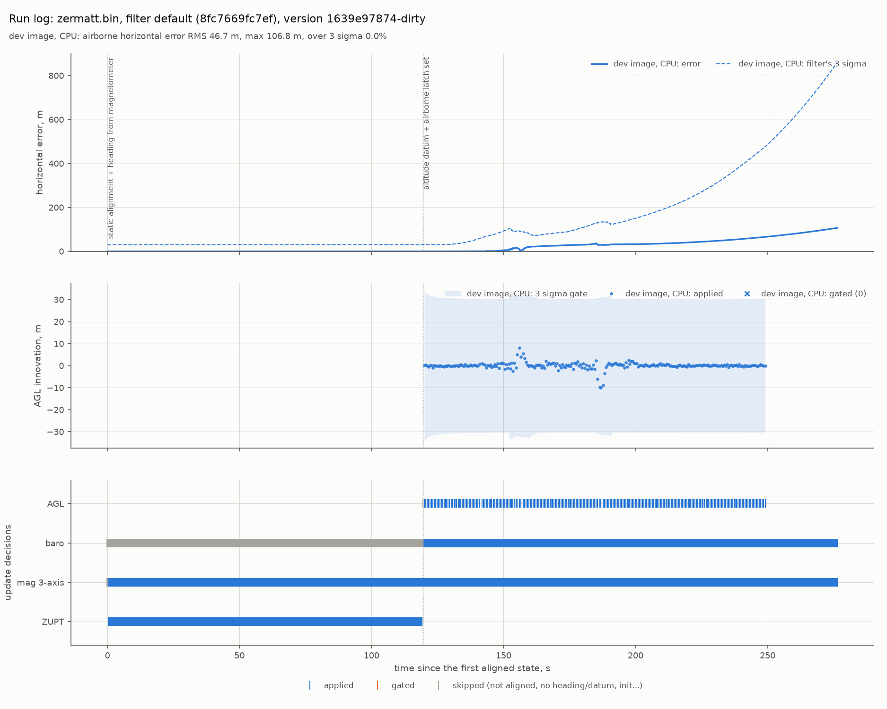

# TEST-031: the dev image (R2.1)

**Question.** R2.1's last open part: pin the simulation toolchain in a Docker dev image,
with a GPU passthrough option, so every machine runs the same simulation. Does the image
hold the pinned versions, and does the whole loop (PX4 + Gazebo + GDN) run in it?

**Answer, short.**
- **`tools/docker_dev.sh build`** builds `gdn-dev`, with these pins (`docker/versions.env`):
  - Ubuntu 24.04 and ROS 2 Jazzy desktop, the base image pinned by digest;
  - Gazebo Harmonic (gz sim 8.15);
  - PX4 v1.16.2 at its commit, with SITL built;
  - the Micro XRCE-DDS Agent v2.4.3 at its commit;
  - `ros_gz_bridge`, the Gazebo Python bindings, and every GDN build dependency.

  14 GB on disk.
- **Decided with the project lead:**
  - Each machine builds the image locally; nothing is published to a registry yet.
  - The tools go in the image and the code is mounted, not copied.
  - CI builds and checks the image only on PRs that change it.
- **`tools/docker_check.sh`, written first,** checks the image: 24 checks on the CPU
  (19 for the toolchain and build, 5 for a headless SITL flight), plus 2 with `--gpu`.
  All pass on the dev PC (RTX 5060 Laptop).
  - The SITL flight: PX4 flies a 0.6 km route over Zermatt and lands, GDN runs in
    shadow mode beside it and writes its run log, all inside the container.
  - The rendered radar altimeter, on the GPU in the container: 26 of 26 points within
    2.5 m of the map, median +0.34 m. This was the open item of Stage A ("still to
    check on the dev PC").
- **Four problems found and fixed on the way,** each only visible by running the whole
  thing:
  - ROS 2's environment hid Gazebo's `sim` command;
  - PX4's pip install fought Ubuntu's numpy;
  - PX4's version script needed NuttX tags that a shallow clone lacks;
  - `sim_fly.py` never exited after landing, and `sim_run.sh` stopped GDN too abruptly
    for its run log to be indexed.



*The run log of the check's SITL flight, inside the image (`plot_run_log.py`).
Parked and aligned until about 120 s, then take-off, a 0.6 km route, and landing by
250 s. GDN's error reaches 107 m, but its 3σ grows much faster: that's the known
multirotor drift (OI-012), not something the image adds.*

## How it's used

```bash
tools/docker_dev.sh build                 # once (and after any change in docker/)
tools/docker_check.sh [--gpu]             # check it
tools/docker_dev.sh shell --gpu --gui     # work in it, with Gazebo and RViz windows
```

- **The workspace is mounted at the same path as on the host.** You edit on the host
  and build and run in the container.
- **The container has its own `build/` and `install/`,** kept in `.docker/` and
  mounted over those paths, so host and container builds never mix. The dev PC's host
  build points at a Python virtual environment the container doesn't have, so sharing
  one build would break both. `log/` is shared, so run logs land where the host sees
  them.
- **The user inside is the host user** (same name, UID and GID, set at build time), so
  files written in the workspace stay the host user's.
- **The network is the host's** (and IPC, for Fast DDS shared memory). ROS 2 topics
  pass between host and container: RViz on the host sees a simulation in the container.
- **`--gpu`** passes the NVIDIA GPU through (`--gpus all`, all driver capabilities, for
  Gazebo's rendered sensors). **`--gui`** shows windows on the host's display (X11, or
  XWayland on a Wayland desktop).
- **The image's name is a hash of what it's built from** (`docker/` and the package
  manifests), so after a change there `docker_dev.sh` asks for a rebuild instead of
  running a stale image.
- **Portainer** (or `docker ps`) shows the running container, its logs and a console.
  It can't show Gazebo or RViz; that's `--gui`, or RViz on the host.

## The check, written first

`tools/docker_check.sh` was written before the image. Its first run failed:
"docker/Dockerfile, docker/versions.env and tools/docker_dev.sh exist". On the finished
image (`test031_data/docker_check_cpu.txt`, `docker_check_gpu.txt`):

| Check | Result |
|---|---|
| the image is built from the current `docker/` files, on the pinned base digest | pass |
| Ubuntu 24.04, ROS 2 Jazzy, Gazebo Harmonic (gz sim 8) | pass |
| PX4 at the pinned commit (v1.16.2), SITL built | pass |
| the XRCE agent at the pinned commit (v2.4.3), installed | pass |
| `ros_gz_bridge` installed, the Gazebo Python bindings import | pass |
| the workspace is the host's, files written there are the host user's, the container's build is separate | pass |
| GDN builds (colcon, Release) and the selftest passes | pass |
| the Zermatt world is generated, and its physics check passes | pass |
| SITL: PX4 over DDS; GDN aligned and set its datum; the route flown and landed; GDN scored; a run log written | pass |
| `--gpu`: the GPU is visible in the container | pass |
| `--gpu`: the rendered radar altimeter agrees with the map (`check_sim_radar.py`) | pass: 26/26 within 2.5 m, median +0.34 m, max 1.36 m (an earlier run: +0.27 m, 1.77 m) |

The CPU check takes about 6 minutes (the build and selftest, then the flight); `--quick`
skips the flight. CI runs the CPU check on PRs that change the image
(`.github/workflows/docker.yml`); its runners have no GPU.

**The SITL flight, in the container, CPU only** (`test031_data/`):
- the radar altimeter against the map at the true position, in flight: mean +0.16 m,
  RMS 0.32 m (rendered on the CPU; headless rendering needs no GPU);
- GDN against truth over the flight: RMS 33.0 m, max 99.1 m in the figure's run
  (`sitl_scorer.log`), and 57.3 m, max 158.4 m in a second run of the same check. SITL
  runs vary with timing. That's the multirotor drift known from Stage A (OI-012); this
  item doesn't change the filter.

## What went wrong on the way

Each of these stopped the image or the loop, and each was found by running it:

| Problem | Cause | Fix |
|---|---|---|
| `gz sim` printed help instead of starting | the ROS image has some of ROS's Gazebo packages but not `gz_sim_vendor`; sourcing ROS sets `GZ_CONFIG_PATH` to ROS's folders only, which hides the system Gazebo's `sim` command | `env.sh` adds `/usr/share/gz` after ROS's folders (also helps any host in the same state) |
| PX4's setup failed: "Cannot uninstall numpy 1.26.4" | PX4's pip install wanted a newer numpy than Ubuntu's, which pip can't remove; replacing it could also break ROS 2's compiled Python | a pip constraints file pins every Python package already installed |
| PX4's build failed in `px_update_git_header.py` | it reads NuttX's release tags, and a shallow submodule clone has none | the tag names are listed from the remote (a few KB) and created on the checked-out commit; the version header is the same as from a full clone |
| the check's flight ran until its 15 minute timeout | `sim_fly.py` never exited after landing, though `sim_run.sh` waits for it | it exits once PX4 has landed and disarmed (`COM_DISARM_LAND`) |
| the SITL run log had no index | `sim_run.sh` sent every process SIGTERM and waited 1 s | GDN is stopped first with SIGINT, its clean shutdown, and given up to 15 s |
| the run log plot spanned 1.8e9 s | in SITL the IMU clock is Unix time, while records from before the filter's clock starts carry t = 0 | `plot_run_log.py` puts those at the run's first time |

**A slow connection.** The first builds on the dev PC's connection (as little as
10 KB/s to GitHub) were cut off part way. Downloads in the build now retry: git over
HTTP/1.1 with a stall timeout (5 attempts), apt and pip with retries. A build that stops
resumes from the last finished step when run again.

## Limits

- **apt packages aren't pinned to exact versions.** The base image is pinned by digest,
  and PX4 and the agent by commit, but Gazebo and the other packages come from apt at
  build time. The versions an image got are recorded in it (`/opt/gdn/packages.txt`).
  Exact pinning would need an apt snapshot mirror.
- **The image is built per user** (name and UID). Another developer builds their own
  from the same files; a shared image for CI waits for R2.9.
- **`--gui` hasn't been checked by this test**, since the check runs headless. The
  windows need a display session on the host.
- **The CI job is new** and runs for the first time on this PR.
- **The image is 14 GB**, most of it the ROS desktop, Gazebo and the PX4 build tree.

## Reproduce

```bash
tools/docker_check.sh                    # fails until the image exists
tools/docker_dev.sh build                # 30 to 60 min on a fast connection
tools/docker_check.sh                    # 24 checks, about 6 min
tools/docker_check.sh --gpu --quick      # the GPU and the radar check, about 1 min
# the figure, from the run log the flight wrote:
python3 tools/plot_run_log.py log/gdn_runs/gdn_<time> --label "dev image, CPU" \
  --out docs/test_reports/test031_sitl_run.png --export docs/test_reports/test031_data/sitl_run
```
