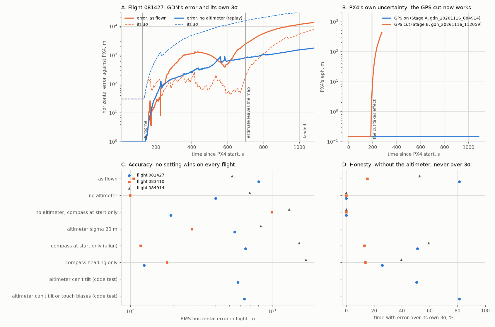

# TEST-032: why GDN runs away on the x500 in SITL (OI-012), and a Stage B GPS cut that works

**Question.** In the dev image, the project lead flew Stage A and Stage B and saw GDN's
path (red in RViz) "hallucinate" towards the end of the flight, kilometres from the true
path (white). Before Phase 2 goes on (R2.2), two questions:
- what is going on?
- is any of it a bug we can fix now?

**Answer, short.**
- **Stage B never cut GPS, and now it does.**
  - The bug: `sim_fly.py` sent PX4's failure injection (`VEHICLE_CMD_INJECT_FAILURE`, GPS off).
    In PX4 1.16 only the MAVLink simulator (Gazebo Classic, jMAVSim) acts on it. Under
    Gazebo Harmonic, PX4's `gz_bridge` passes every GPS reading on.
  - Every Stage B run so far flew on GPS (PX4's eph stayed at 0.2 m).
  - The fix: the cut now sets PX4's `EKF2_GPS_CTRL` to 0. PX4 loses its position within
    about 5 s, eph climbs to 387 m, and it lands blind.
  - `tools/check_gps_cut.py`, written first: it fails on all four runs from before the fix
    and passes on a Stage B run after it.
- **The "hallucination" is the known OI-012 weakness, now explained.** It isn't a fault in
  the altimeter, the IMU data or the simulation. On the x500:
  1. **Nothing measures velocity.** Within a minute of a straight leg, GDN's speed has
     drained from 10 to 2 to 3 m/s, and the error grows to hundreds of metres.
  2. **The filter believes it more than it should.** With altimeter updates on, the error
     is over GDN's own 3σ 15 to 81% of the time.
  3. **Once the estimate is 1 to 2 km off, it leaves the map** (2.8 by 4.0 km), and no altimeter
     update can apply any more. From then on it is IMU and baro only, running away at 20
     to 40 m/s. That's the kilometres at the end.
- **No setting fixes it.** The same three flights were replayed with one change each. Every
  change that wins on one flight loses on another, and the errors range from 25 m to
  1.7 km. The fix stays velocity aiding (Phase 3) plus integrity monitoring (Phase 4), as
  OI-012 already said.
- **Corrected on the way:**
  - The first look said "it drifts by kilometres after landing". It's in flight, after
    the estimate leaves the map; landing adds only the last 30 s.
  - The first single-flight replays suggested "without the altimeter it's more accurate".
    Over three flights that holds for honesty (never over 3σ), not for accuracy.



*A: flight 081427, GDN's error and its own 3σ (log scale). As flown (orange), the error
leaves the 3σ band from about 250 s on. After the estimate leaves the map (about 700 s),
it runs away to 13 km. Replayed without altimeter updates (blue), the error is smaller on
this flight and always inside its 3σ. B: PX4's own horizontal uncertainty, in a Stage A
run (blue) and the Stage B run after the fix (orange, until it lands). C and D: every
variant on all three flights; accuracy (C) and honesty (D).*

## Part 1: the Stage B GPS cut

**What happened.** `GPS_OFF_AT=60 tools/sim_run.sh` logged "GPS failure injected", and
PX4 acknowledged the command. Then nothing changed. In PX4 v1.16.2, `VEHICLE_CMD_INJECT_FAILURE`
for the GPS is acted on in one place, `SimulatorMavlink.cpp`, the simulator interface of
Gazebo Classic and jMAVSim. With Gazebo Harmonic, GPS comes from `gz_bridge`
(`navSatCallback`), which has no failure check. Commander lists the command as "handled
elsewhere" and acknowledges it. So PX4 kept flying on GPS, with eph 0.2 m.

**The check, written first.** `tools/check_gps_cut.py RUN_LOG [--expect lost|kept]` reads
PX4's own estimate from GDN's run log. It looks at the airborne part and asks whether
PX4's horizontal position went invalid or its eph passed 10 m. On the project lead's four
runs of the day, at least one flown with `GPS_OFF_AT=60`, it fails on every one: eph max
0.2 m, never invalid (`test032_data/gps_cut_check.txt`).

**The fix.**
- **`tools/sim_fly.py`:**
  - The cut runs `px4-param set EKF2_GPS_CTRL 0` in the PX4 build that is flying
    (`--px4-dir`, passed by `sim_run.sh`). It doesn't wait for it, so the 10 Hz setpoint
    stream keeps going, and it logs PX4's reply.
  - When PX4 leaves offboard after the cut (its fail-safe), the script stops sending the
    route and waits for PX4 to land and disarm, then exits. Before, it would have tried
    to re-arm.
- **`tools/sim_run.sh`:**
  - It sets `EKF2_GPS_CTRL` back to 7 (PX4's default) at start, since PX4 keeps its
    parameters between runs.
  - `SYS_FAILURE_EN` is no longer set, since nothing uses it now.

**The result** (dev image, CPU, `GPS_OFF_AT=40`, `--legs 1 --leg-len 600`; run log
`gdn_20261116_112059`; `test032_data/stageb_*.log`):

| Time into the route | What happened |
|---|---|
| 40.0 s | GPS cut: `px4-param` replies "EKF2_GPS_CTRL: curr: 7 -> new: 0" 0.1 s later |
| 44 s | PX4 marks its position invalid, leaves offboard ("Failsafe: blind land"), and starts a blind landing |
| 44 to about 130 s | PX4's eph climbs to 387 m while it descends without a position |
| about 134 s | landed and disarmed; `sim_fly.py` exits and the run is scored |

`check_gps_cut.py` now passes on this run, and passes `--expect kept` on a Stage A run.
GDN, scored against Gazebo's truth by the live scorer: RMS 438 m, max 1049 m over the run.
That's the OI-012 drift below; GDN doesn't use GPS either way.

**After a cut, PX4's position is no reference any more.** The live scorer and RViz use
Gazebo's truth, so they're unaffected. `plot_run_log.py` draws the error against PX4's
position only where PX4 marks it valid, so the plot stops at the cut. That's right, but it
means a Stage B run log can't be scored offline yet. Recording Gazebo's truth in the run
log belongs with R2.7 (metrics and reports).

## Part 2: the drift (OI-012)

**The flights.** Three of the project lead's Stage A and B runs in the dev image (rendered radar, GPU). GPS
was on in all three (Part 1), so PX4's position is a valid reference at 0.2 m:

| Run | Flight time | GDN as flown: RMS, max | Over 3σ |
|---|---|---|---|
| `gdn_20261116_081427` | 544 s scored (928 s airborne) | 806 m, 1702 m | 81% |
| `gdn_20261116_083410` | 272 s scored (712 s airborne) | 105 m, 431 m | 15% |
| `gdn_20261116_084914` | 830 s scored (928 s airborne) | 521 m, 1324 m | 53% |

Each flight is scored from GDN's airborne latch to its last applied altimeter update, so
the scored part never includes the off-map runaway, and every variant of a flight is
scored on the same window.

**What's fine.**
- **The altimeter readings:** the rendered radar against the map at the true position is
  0.32 m RMS in flight (TEST-031), and 0.34 to 0.37 m in the Stage B run.
- **The IMU stream:** 100% of the time is covered (12 ms spacing, 12 ms integrals); no
  drops in flight.
- **The bias estimates** stay under 0.03 m/s².
- **The attitude** is within a few degrees of PX4's: roll about 0, pitch 0.5 to 2.6° off.

**What goes wrong, on flight 081427:**

| Time | Error | GDN's 3σ | GDN speed (PX4's) | |
|---|---|---|---|---|
| t+126 s | 0 m | 30 m | 0.1 (0.0) m/s | take-off, airborne latch |
| t+200 s | 22 m | 101 m | 10.0 (10.4) m/s | first leg |
| t+300 s | 433 m | 121 m | 3.0 (10.3) m/s | speed drained, now outside 3σ |
| t+500 s | 1010 m | 70 m | 3.0 (10.7) m/s | |
| t+670 s | 1685 m | 48 m | 15.3 (10.2) m/s | the altimeter updates start failing the gate |
| about t+700 s | 2.4 km | 177 m | 14.7 m/s | estimate off the map: every altimeter reading skipped ("off map") |
| t+800 to t+1054 s | 5.5 → 12.9 km | 1.1 → 6.8 km | 19 to 41 m/s | IMU and baro only |
| t+1054 to t+1085 s | 12.9 → 13.6 km | | 24 m/s | landed (PX4); GDN's latch is one-way, so no zero-velocity updates |

The speed is the first thing to go. Over t+240 to t+300 s, PX4 flies north at 10.4 m/s
while GDN's north speed falls to 2.3 m/s. GDN's own IMU propagation accounts for −4.6 m/s
of that: a slightly wrong pitch turns part of gravity into a forward deceleration. The
altimeter updates account for another −2.6 m/s. Their innovations are 5 to 10 m RMS here,
on terrain that changes by tens of metres per hundred metres. Through the cross-covariances, each update moves velocity,
attitude and position together. With nothing measuring velocity directly, nothing pulls
it back. Meanwhile each applied update shrinks the 3σ, so the filter grows confident
while it drifts.

**The replays.** `gdn_replay` replays a run log through the same code, bit for bit, so a
difference is the change's. Every variant on every flight (`test032_data/scores.csv`; RMS,
then the time over 3σ):

| Variant | 081427 | 083410 | 084914 |
|---|---|---|---|
| as flown | 806 m, 81% | 105 m, 15% | 521 m, 53% |
| no altimeter updates (`r_agl` 1e9) | 399 m, 0% | 99 m, 0% | 695 m, 0% |
| no altimeter, compass at start only | 193 m, 0% | 998 m, 0% | 1321 m, 0% |
| altimeter sigma 20 m, not 10 (`r_agl` 400) | 638 m, 43% | 109 m, 12% | **25 m, 0%** |
| compass at start only (`mag_fusion` align) | 648 m, 51% | 118 m, 13% | 1547 m, 59% |
| compass heading only (`mag_fusion` heading) | **125 m, 26%** | 182 m, 14% | 1726 m, 40% |
| altimeter can't change the attitude (scratch code) | 575 m, 51% | | |
| altimeter can't change the attitude or IMU biases (scratch code) | 637 m, 81% | | |

- **Accuracy is a coin toss.** The same filter on the same kind of flight lands anywhere
  from 25 m to 1.7 km. Every option is best on one flight and bad on another. So don't
  judge a setting on one SITL flight; it needs the MC or many flights.
- **Honesty isn't a coin toss.** With the altimeter off, GDN is never over its 3σ, on all
  three flights. With it on, it is 12 to 81% of the time. It's the altimeter updates that
  make GDN confidently wrong when the velocity is unobserved.
- **`mag_fusion=full` is the same as as flown** on 081427, bit for bit: on these flights,
  the default `auto` mode fuses all three magnetometer axes the whole time.
- **The scratch code tests** zeroed the altimeter's gain on the attitude rows (and on the
  IMU-bias rows) in `Eskf::ApplyAgl`. That helps a little on 081427 but doesn't stop the
  drift, so it wasn't kept, and the filter code is unchanged.
- **One lead to keep:** `r_agl` 400 is the only change that is never clearly worse:
  - 081427: better (806 → 638 m);
  - 083410: the same within noise (105 → 109 m);
  - 084914: much better (521 → 25 m).

  It agrees with OI-009's lead from TEST-028 (a larger `r_agl` on SRTM-like maps). Three
  flights aren't evidence; it needs the MC sweep OI-009 already asks for.

**Landing.** After landing, GDN's one-way airborne latch means no zero-velocity updates,
so a wrong velocity keeps going: 0.7 km in the last 30 s of flight 081427. Small next to
the in-flight runaway, and not fixed here. An IMU-only "sitting still" test can't tell a
hover from being parked. R2.5 brings the flight regime (ground, hover, cruise) from the
autopilot, which is the planned way to re-arm it.

## What this changes

- **Code:** `tools/sim_fly.py` and `tools/sim_run.sh` (the GPS cut), plus
  `tools/check_gps_cut.py` (new). No filter change, so the selftest, the MC and the
  flight001 results are untouched.
- **Docs:**
  - OI-012 gets this diagnosis;
  - `docs/SIMULATION.md`: how the cut works, and why GDN runs away at the end;
  - ROADMAP: Stage B's status, and R2.6's GNSS-loss method.

## Limits

- **Three flights.** They're enough to show the outcome is chaotic, not to rank settings.
- **The scored window ends at the last applied altimeter update,** so the scores leave
  out the off-map runaway; RViz shows it.
- **The Stage B run is one short route,** to show the cut works, not to score GDN.
- **Gazebo truth isn't in the run log,** so Stage B runs can't be scored offline after the
  cut (R2.7).

## Reproduce

```bash
# the check, before and after
python3 tools/check_gps_cut.py log/gdn_runs/gdn_20261116_084914                 # FAIL: GPS never cut
HEADLESS=1 GPS_OFF_AT=40 GDN_FLY_ARGS="--legs 1 --leg-len 600" tools/sim_run.sh  # in the dev image
python3 tools/check_gps_cut.py log/gdn_runs/gdn_<new run>                        # PASS
# the replays (one per variant and flight), e.g.
ros2 run gdn_fusion gdn_replay log/gdn_runs/gdn_20261116_081427 --set=r_agl=1000000000 --out=/tmp/w_noagl
# the figure: from the run logs and replays (see the script's help), or from the committed CSVs
python3 tools/plot_test032.py docs/test_reports/test032_data --out docs/test_reports/test032_oi012.png
```

The run logs live in `log/gdn_runs/` on the dev PC (not in git). The scratch code tests
were a temporary edit of `Eskf::ApplyAgl`, zeroing the gain rows for the attitude (6 to 8)
and, in the second, the IMU biases (9 to 14), built, replayed and reverted. The replay of
081427 matched the log bit for bit again afterwards.
