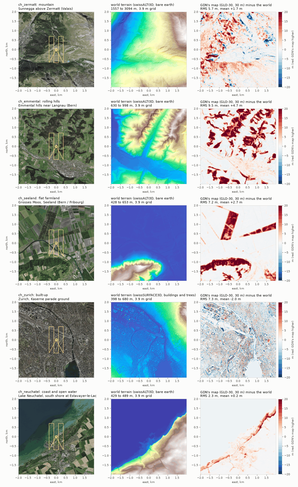

# TEST-033: worlds from real terrain (R2.2)

**Question.** R2.2: build Gazebo worlds from a high-resolution elevation model with the
orthophoto draped on top, for five terrain classes (mountain, rolling hills, flat
farmland, built-up, coast or open water). Each world comes with an onboard GDN map from
a coarser source, so the filter never sees the exact truth terrain. Terrain is a mesh,
checked with `tools/check_sim_radar.py`. Do the worlds stand, and does GDN fly on them?

**Answer, short.**
- **Five 4 by 4 km sites, all in Switzerland** (`sim/sites.yaml`), built by
  `tools/make_site.py` from open data. Decided with the project lead: Switzerland, a 2 m
  photo for now, Copernicus GLO-30 for the onboard map.
  - **World terrain:** swisstopo swissALTI3D at 2 m, or swissSURFACE3D at 0.5 m with
    buildings and trees for Zurich, averaged to a 3.9 m grid.
  - **Photo:** SWISSIMAGE at 2 m, draped on the mesh.
  - **GDN's map:** Copernicus GLO-30 over 10 by 10 km, untouched. It differs from the
    world by 2.3 to 9.5 m RMS, and it's registered to it.
- **`tools/check_site.py`, written first,** checks:
  - the coordinate transform against swisstopo's published example;
  - every downloaded tile against its pinned checksum;
  - the world's terrain against swisstopo, at 400 random points;
  - the onboard map: GLO-30's own pixels, how much it differs from the world, and its
    registration;
  - a level take-off pad, and the built world.

  It failed on all five sites before they existed, and passes on all five now.
- **The physics and radar checks pass on all five,** and on the original Zermatt world.
- **GDN flew a full Stage A route on each site** (`GDN_SITE=... tools/sim_run.sh`, dev
  image, GPU). Each time PX4 flew the 7.9 km route and landed.
  - The radar matched the world in flight to 0.29 to 0.34 m RMS. *Correction
    (TEST-034): these were the adapter's last 10 s report, the landing over the level
    pad. Over the whole flight GDN's altimeter input is metres off the height straight
    below, from the tilt (OI-016); the radar itself is right along its beam.*
  - GDN's own error was 1 to 12 km: the multirotor drift of OI-012 (TEST-032), now on
    five kinds of terrain. That isn't R2.2's to fix.
- **Found on the way:**
  - **Gazebo's radar beam lands about 1 m from where it's aimed (OI-015).** The radar
    check now allows for it, and also fits it, so a misplaced world still fails.
  - **GLO-30 marks pixel centres, not corners.** Reading it the swisstopo way would have
    shifted every onboard map by 15 m.
  - **Three of the five first pads weren't level.** `check_site.py` now suggests the
    nearest level spot.
  - **`sim_run.sh` waited 2 minutes on every run** for something that can't happen
    while parked.



*One row per site (`tools/plot_sites.py`).*
- *Left: the photo draped on the world, with the default route (yellow) and the pad.*
- *Middle: the world's terrain, shaded.*
- *Right: GDN's onboard map minus the world, in one frame. Red is where GLO-30 is higher:
  it's a surface model, so it holds the forests (Emmental, the Seeland strips and Mont
  Vully, Zermatt's tree line) that the bare-earth world doesn't. In Zurich the world has
  the buildings, and GLO-30's 30 m pixels smear them.*

## The sites

| Site | Class | Pad | World terrain | Relief | Onboard map minus world: RMS, mean, 95% | Physics | Radar (26 points) | Flight (7.9 km) |
|---|---|---|---|---|---|---|---|---|
| `ch_zermatt` | mountain | gravel by Sunnegga station, 2243 m | swissALTI3D 2 m | 1557 to 3094 m | 5.7, +1.7, 12.6 m | pass, 29/30 probes, 4 of 4 controls | pass, max 0.88 m | landed; radar in flight 0.33 m RMS |
| `ch_emmental` | rolling hills | meadow by the road, 688 m | swissALTI3D 2 m | 630 to 998 m | 9.5, +4.7, 23.3 m | pass, 30/30, 4 of 4 | pass, max 1.47 m | landed; 0.29 m |
| `ch_seeland` | flat farmland | field, Grosses Moos, 431 m | swissALTI3D 2 m | 428 to 653 m (Mont Vully) | 7.1, +2.7, 19.1 m | pass, 30/30, 1 of 4 | pass, max 0.59 m | landed; 0.32 m |
| `ch_zurich` | built-up | Kaserne parade ground, 409 m | swissSURFACE3D 0.5 m (buildings, trees) | 398 to 680 m | 7.2, −2.0, 14.0 m | pass, 30/30, 4 of 4 | pass, max 3.68 m (at a building edge, slope 3.8) | landed; 0.34 m |
| `ch_neuchatel` | coast and open water | lakeside, 430 m (half the route over the lake) | swissALTI3D 2 m | 429 to 489 m | 2.3, +0.2, 4.3 m | pass, 30/30, 2 of 4 | pass, max 0.90 m | landed; 0.34 m |

- **The physics check** drops 30 probes on the world (pad within 0.2 m, median within
  1 m). It now judges a control (the map shifted or mirrored) only where the map
  actually differs there. On flat farmland a 50 m shift is the same map, so 1 of 4
  controls can tell.
- **The radar check** is in "The radar check" below.
- **Flight** is the Stage A route with GDN in shadow mode. "Radar in flight" is the
  adapter's live check, the radar against the world's terrain at the true position.

## How a site is built (`tools/make_site.py`, `tools/swiss_terrain.py`)

1. **Fetch.**
   - The swisstopo tiles (1 km) come from its STAC catalogue, newest survey per tile, and
     the GLO-30 tiles (1 degree) from the Copernicus bucket on AWS.
   - All are cached in `data/terrain/` (not in git).
   - The first fetch pins each tile (item, file, sha256) in `sim/sites.lock` (in git), so
     a rebuild gets the same data even after swisstopo publishes a newer survey.
   - Downloads retry; the dev PC's link to swisstopo ran at 120 to 300 KB/s. About
     100 MB per site, 400 MB for Zurich's 0.5 m surface model, 700 MB in all.
2. **World terrain.**
   - **The grid:** 1025 by 1025 points, 3.9 m apart, in GDN's own local frame
     (`MapDb`: equirectangular around the pad).
   - **Sampling:** each point is converted to Swiss LV95 coordinates with swisstopo's
     formulas, good to about 1 m; the check reproduces their published example to the
     centimetre. It's then sampled bilinearly from the tiles, box-averaged first to about
     the grid cell (2 by 2 at 2 m, 8 by 8 at 0.5 m).
   - **Output:** `data/maps/<site>_truth.bin`, the same file format as GDN's maps. The
     world, the radar check and the scorer's terrain all come from it.
3. **Onboard map:** GLO-30's own pixels over 10 by 10 km around the pad,
   `data/maps/<site>_glo30.bin`. `sim_run.sh` gives `eskf_node` the pad as its origin
   (`origin_lat`/`origin_lon`, R1.3), so both maps share one frame. The map is larger
   than the world, so an estimate that wanders still has a map under it (TEST-032).
4. **Photo:** SWISSIMAGE 2 m, sampled onto a 2048 by 2048 texture spanning exactly the
   mesh.
5. **World:** `tools/make_sim_world.py` with that truth map, without oversampling:
   - the physics heightmap, and the mesh (with texture coordinates and a material file);
   - for sites, a start camera that shows the whole square.

   It also records the onboard map and origin in `world_info.txt`, plus the site entry
   it was built from. `make_site.py --if-stale` (used by `sim_run.sh` and `view_site.sh`)
   rebuilds only when that entry or the building code changes.

Each world is about 210 MB, mostly the 2 million-triangle mesh, built in about 20 s from
the cache. Gazebo loads it in about 15 s.

## The site check, written first

`tools/check_site.py` failed on all five sites before `make_site.py` existed
(`test033_data/check_site_before.txt`) and passes on all five now
(`check_site_after.txt`). Two of its checks needed thought.

**Registration.** A wrong frame between GDN's map and the world would ruin every result
without being obvious. The check compares the onboard map in place with the same map
shifted by 15 m and 30 m in eight directions: no shift may fit more than 15% better.
- **On Zermatt it fits best in place:** 5.7 m RMS, against 6.7 m for the best shift.
  A finer search finds the best fit 4 m north, within GLO-30's stated geolocation
  accuracy.
- **On Seeland a 30 m shift north fits 11% better.** The only steep ground there is the
  wooded escarpment of Mont Vully and the forest strips, where GLO-30 sees the treetops
  (+20 m) and the world doesn't. The photo and terrain overlay confirm the world itself
  is in place.
- **That's why 15% and not 0%.** A true slip of one cell fits about 2x better (Zermatt:
  11.2 m against 5.7 m).
- **A real half-cell slip was caught earlier,** while writing the reader (from the files' GeoKeys, before this check could run): GLO-30's
  GeoTIFFs mark pixel centres (PixelIsPoint), swisstopo's mark corners (PixelIsArea).
  Reading both the same way would shift every onboard map by half a cell (15 m).
  `read_geotiff` now follows the file's own GeoKey.

**The pad.** The x500 has to start on level ground. The check wants heights within 15 m
of the pad to span under 2 m, and if they don't, it prints the nearest place where they
do. Three of the first five pads failed:

| Site | First pad | Moved to |
|---|---|---|
| Zermatt | a 15 m slope by Sunnegga | the gravel by the station, 115 m away. The first suggestion was the Leisee, a lake, which is level too, so suggestions are checked on the photo. |
| Emmental | a steep meadow between woods (17 m) | a meadow by the road, 123 m away |
| Zurich | beside trees in the barracks courtyard (11 m), then a corner of the parade ground by the building (8 m) | the open parade ground (1.3 m) |

The original Zermatt world (SRTM, the default) can't be one of these sites: its square
runs into Italy, where swisstopo has no data.

## The radar check

`check_sim_radar.py` puts the radar 100 m above 26 random points and compares the range
with the height above the terrain. On Zurich it failed: 23 of 26 within 2.5 m, worst
4.85 m. All three misses were on building edges, where heights change 17 to 21 m
within 8 m (`radar_ch_zurich_original_check.txt`).

**Not the interpolation.** The first idea was that the mesh's two triangles per cell
differ from the map's bilinear surface across a step. So the check now compares with the
mesh itself, read back from the world's heightmap (`make_sim_world.mesh_height`,
unit-checked on a synthetic cell). It still failed: 22 of 26
(`radar_ch_zurich_before_beam_allowance.txt`).

**The beam lands about 1 m from its aim (OI-015).** The range errors were fitted
against the surface slope at each point. A horizontal offset of the beam explains them:

| World | Fitted beam offset | Error RMS, raw → with the offset removed |
|---|---|---|
| original Zermatt | 1.01 m (east −0.52, north −0.87) | 0.52 → 0.29 m |
| `ch_zermatt` | 1.04 m (−0.88, −0.55) | 0.46 → 0.35 m |
| `ch_emmental` | 1.34 m (−1.13, −0.73) | 0.53 → 0.30 m |
| `ch_seeland` | 1.19 m (−0.02, −1.19) | 0.28 → 0.24 m |
| `ch_zurich` | 1.02 m (−0.67, −0.77) | 1.44 → 0.42 m |
| `ch_neuchatel` | 1.17 m (−0.98, −0.63) | 0.34 → 0.34 m |

- **What's left after removing it is the sensor's 0.3 m noise.**
- **It's the sensor, not the worlds:** about the same south-west offset on all six
  worlds, which were built separately (a misplaced world would show its own offset).
- **The cause** is a 0.6 degree pointing offset of Gazebo's single-beam `gpu_lidar`.
- **Where it matters:** it was always there; only on a 20 m building edge does it reach
  metres. In flight it's far below GDN's 10 m altimeter sigma.

**So the check now:**
- **judges each point against the mesh,** allowing 2.5 m plus 1.5 m times the slope
  there;
- **fits the beam offset and fails above 2 m.** That's also the sharpest test for a
  shifted world: on any terrain with slopes, a shift shows up exactly as a larger offset;
- **prints the difference to the map's bilinear surface,** for information;
- **runs in its own Gazebo partition,** so it can run beside a simulation.

All six worlds pass.

## GDN on the sites

Every flight: PX4 flew the default 7.9 km route at about 60 m above the terrain and
landed. GDN ran in shadow mode on its GLO-30 map. Wiring checks:
- **GDN's map and origin:** GDN loaded its GLO-30 map with the pad as origin
  (`gdn.log`: "DEM loaded ... origin").
- **The magnetic reference** was read from the simulated sensor at start-up, since
  Gazebo's field depends on where the world is. Seeland's was 0.8 / 21.9 / −42.5 µT,
  against Zermatt's 0.9 / 22.5 / −41.9.
- **The altitude datum** matched the pad (Zermatt: 2244.3 m against 2243.4 m).
- **The horizontal error** started at 0.0 m and grew smoothly, which rules out a frame
  offset.

| Site | GDN horizontal error, whole run: RMS, max |
|---|---|
| `ch_zermatt` | 12.1 km, 22.9 km |
| `ch_emmental` | 3.0 km, 6.7 km |
| `ch_seeland` | 1.1 km, 4.1 km |
| `ch_zurich` | 5.0 km, 9.6 km |
| `ch_neuchatel` | 2.5 km, 4.6 km |

That's OI-012's runaway (TEST-032): the multirotor's velocity isn't observed, and once
the estimate leaves the map it runs on the IMU alone. These sites only show it on more
terrain. It's Phase 3's to fix (velocity aiding), and R2.7's to score properly.
OI-014 (altitude following the onboard map's error) asked to be re-checked on a real
second DEM; these sites now provide one.

## Also fixed

- **`sim_run.sh` waited 120 s for GDN's altitude datum on every run, and always timed
  out.** Parked, the radar sits under its 0.2 m minimum range, so the datum is set at
  lift-off. It now waits for GDN's alignment instead.
- **`check_sim_world.py`'s controls** are judged only where they can tell (flat ground).
- **`sim_run.sh GDN_SITE=...` reads the magnetic reference from the simulation.** The
  default world keeps its known one.

## Looking at the sites

```bash
tools/docker_dev.sh shell --gpu --gui
tools/view_site.sh --all                     # each site in Gazebo (own partition; nothing flies)
GDN_SITE=ch_zurich tools/sim_run.sh          # fly one, with RViz
python3 tools/plot_sites.py --out sites.png  # the overview figure
```

## Limits

- **Bare earth against a surface model.** Four worlds are bare earth, while GLO-30
  includes trees, so GDN's map is about 20 m high over forests. In reality the radar
  would see the treetops as well. That makes forest map error here larger than real.
  Zurich's world has buildings and trees, as the radar would see them.
- **The 2 m photo is not good enough for visual odometry** (about 0.14 m per pixel from
  60 m). Finer photos for the flown corridor wait for R3.5, as agreed.
- **The lake is the photo on flat terrain at water level.** There's no water surface, so
  no reflections for a camera.
- **Heights:** swisstopo's are LN02, GLO-30's EGM2008. They differ by well under a metre
  here, which is part of the onboard map's error.
- **The LV95 transform is swisstopo's approximation** (about 1 m). Both maps go through
  it, so it doesn't misregister them against each other.
- **Downloads need the network once per site.** The worlds (about 1 GB in all) are
  generated per machine and not in git.
- **The physics check's controls can't tell on flat ground,** by nature (1 or 2 of 4 on
  Seeland and Neuchatel).
- **OI-015** stays open: does the beam offset turn with the sensor's yaw? That matters
  before R2.4 builds more sensors on `gpu_lidar`.

## Data credits

- **World terrain and photos:** © swisstopo (swissALTI3D, swissSURFACE3D, SWISSIMAGE;
  open data).
- **Onboard maps:** Copernicus WorldDEM-30, © DLR e.V. 2010-2014 and © Airbus Defence and
  Space GmbH 2014-2018, provided under COPERNICUS by the European Union and ESA; all
  rights reserved.

## Reproduce

```bash
python3 tools/check_site.py --all            # fails before the sites exist
python3 tools/make_site.py --all             # downloads (cached) and builds; about 1 h on a slow link
python3 tools/check_site.py --all            # passes
# in the dev image (GPU):
for s in ch_zermatt ch_emmental ch_seeland ch_zurich ch_neuchatel; do
  python3 tools/check_sim_world.py --world-dir data/sim/$s
  python3 tools/check_sim_radar.py --world-dir data/sim/$s
  GDN_SITE=$s HEADLESS=1 tools/sim_run.sh
done
python3 tools/plot_sites.py --out docs/test_reports/test033_sites.png
```
