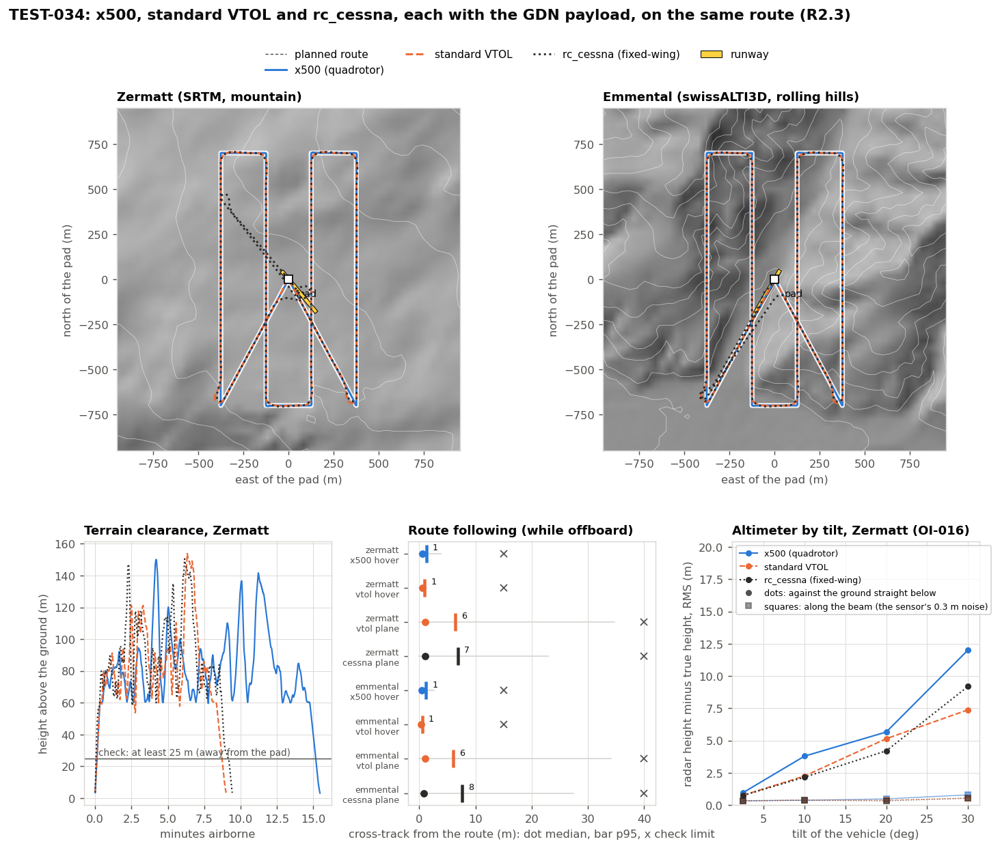

# TEST-034: three vehicles with the GDN payload (R2.3)

**Question.** R2.3: PX4's Gazebo multirotor (x500), standard VTOL and fixed-wing
models, each with a GDN sensor payload attached through an SDF include. Do all three
carry the same payload, and do they fly the Stage A route with GDN alongside? Asked
for on the way by the project lead: a runway for the fixed-wing.

**Answer, short.**
- **One payload, three vehicles.** `sim/models/gdn_payload` holds GDN's sensors (the radar
  altimeter for now; R2.4 adds the rest). `x500_gdn`, `standard_vtol_gdn` and
  `rc_cessna_gdn` are each PX4's own model with the payload included and fixed to the
  body. `tools/sim_vehicles.py` holds the table: model, PX4 airframe (4001, 4004, 4003),
  PX4 settings, how it flies. `GDN_VEHICLE=... tools/sim_run.sh` picks one.
- **Every world has a runway through the pad,** 300 by 20 m, graded into the terrain
  (`make_sim_world.py`). GDN's map doesn't know it.
- **`tools/check_vehicles.py`, written first,** checks:
  - **the models:** the payload included once and fixed to the body, no GDN sensors of
    their own, the matching PX4 airframe, and `gz sdf` resolves them;
  - **a flight:** its phases, where it came down, the whole route, cross-track, terrain
    clearance, and the radar along its beam.

  On main it fails: the x500 carries its own radar, and there is no VTOL or fixed-wing.
- **All three flew the full 7.9 km route on two worlds and pass,** in the dev image on
  the GPU: Zermatt (the Stage A world, mountain) and Emmental (R2.2, rolling hills).
  - **x500:** within 1.3 m of the route (p95); lands within 1 m of the pad.
  - **standard VTOL:** climbs, changes to plane flight in 3 s, flies the route within
    6 m (p95), changes back in 5 s, lands on the pad.
  - **rc_cessna:** PX4's runway take-off, the route within 7 to 8 m, then a PX4 landing
    mission back onto the runway: touchdown on the centreline (0.2 and 0.8 m off). A
    catapult launch is the option and lands on the runway too.
  - **All of them** stayed at least 53 m above the ground on the route.
- **Found on the way:**
  - **PX4 1.16 can't do a VTOL transition in offboard.** Its transition flight task
    publishes the same setpoint topic offboard uses. The plane controller then has no
    valid setpoint and gives no forward thrust; the VTOL hung, sank 20 m and PX4
    aborted (quad-chute). The transitions now happen in Hold, PX4's own mode.
  - **The VTOL's own transition throttle (0.3) was marginal** at Zermatt's altitude.
    One transition in five was aborted; it's 0.6 now.
  - **Landing the cessna took three PX4 details:**
    - no `DO_LAND_START` item (PX4 rejects it in a position frame);
    - `FW_LND_USETER 0` (with no rangefinder PX4 aborted on final approach);
    - the mission uploaded after take-off. Before arming, PX4's home was the previous
      run's, 112 km away, and the plane skipped its approach and circled down beside
      the runway.
  - **GDN's altimeter input is metres off on every vehicle (OI-016).** The radar is
    right along its beam, but the adapter converts the slant range to a height as if
    the ground were flat. Over slopes, tilted:
    - **how much:** 6 to 9.5 m RMS on the x500 (which cruises tilted) and 2 to 5 m on
      the planes, against GDN's 10 m sigma;
    - **earlier reports:** TEST-031 to 033 gave 0.3 m, quoting the last 10 s, which is
      the landing over the level pad;
    - **not tested yet:** whether this feeds OI-012.
  - **`check_sim_radar.py` judged the beam offset where it can't be fitted** (flat
    Neuchatel). It now uses the fit's standard error, and still fails a world shifted
    by 15 m.
- **GDN is not judged here.** It ran in shadow mode on every flight with the
  multirotor's settings (per-airframe profiles are R2.5).



*TEST-034 (`tools/plot_test034.py`, from `test034_data/`).*
- *Top: the true tracks over the two worlds, on the planned route (white), with the
  runway (yellow). The planes fly the corners wide. At the end the cessna flies out to
  its approach point and lands on the runway: from the north-west at Zermatt, from the
  south-west at Emmental.*
- *Bottom left: height above the ground on Zermatt. The x500 flies the route in 15
  minutes, the planes in 9.*
- *Bottom middle: cross-track from the route while `sim_fly.py` steers (not in the
  transitions or the landing): median, 95th percentile and the check's limit.*
- *Bottom right: the altimeter by tilt on Zermatt.*
  - *Squares: the radar against the terrain where its beam lands, the sensor's noise
    at every tilt.*
  - *Dots: the same reading as a height (range times the cosine of the tilt) against
    the height straight below, which is what GDN takes it for (OI-016).*

## The vehicles

| `GDN_VEHICLE` | Model | PX4 airframe | Take-off | Route | End |
|---|---|---|---|---|---|
| `x500` | `x500_gdn` | 4001 `gz_x500` | offboard climb | a setpoint moving at 10 m/s ("carrot") | settles over the pad, lands |
| `standard_vtol` | `standard_vtol_gdn` | 4004 `gz_standard_vtol` | offboard climb, front transition in Hold | as a plane, about 15 m/s | back transition in Hold 350 m out, lands on the pad |
| `rc_cessna` | `rc_cessna_gdn` | 4003 `gz_rc_cessna` | PX4 runway take-off (or catapult) | as a plane, about 15 m/s | PX4 landing mission onto the runway |

**The payload.** `gdn_payload` is a model of its own: one link with the radar altimeter
(a single-beam `gpu_lidar` on `gdn/agl_radar`, 0.2 to 1500 m, 20 Hz, 0.3 m noise).
Each vehicle includes it with its mount pose and fixes it to `base_link`:

```xml
<include>
  <uri>model://gdn_payload</uri>
  <pose relative_to="base_link">0 0 -0.06 0 0 0</pose>
</include>
<joint name="gdn_payload_joint" type="fixed">
  <parent>base_link</parent>
  <child>gdn_payload::gdn_payload_link</child>
</joint>
```

- **Mounts:** 6 cm under the x500's plate and the cessna's fuselage, 3 cm under the
  VTOL's hull. The beam starts at 0.2 m, so the airframe around it can't block it.
- **Truth stays in each vehicle model:** it isn't a sensor the real vehicle carries.
- **The bridge is unchanged:** PX4's models already have the barometer and
  magnetometer GDN uses, under the same names on all three.

**Spawning.** The worlds place the x500. `sim_vehicles.py world` writes a copy for the
run with the chosen vehicle in its place; the cessna faces down the runway.

**PX4 settings** (`sim_vehicles.py`; PX4 resets its parameters when the airframe
changes):
- **all vehicles:** `IMU_INTEG_RATE 100`, `NAV_DLL_ACT 0` and `EKF2_GPS_CTRL 7`, as before;
- **the VTOL:** `VT_F_TRANS_THR 0.6`;
- **the cessna:** `MIS_TAKEOFF_ALT 50`, `FW_LND_USETER 0`, and `RWTO_TKOFF 1` (runway)
  or `FW_LAUN_DETCN_ON 1` (catapult).

## The runway

`make_sim_world.py --runway 300` (the default) grades a 300 by 20 m strip through the
pad, 60 m of it behind the pad:
- **Placement:** the heading and a constant grade of at most 3% are those that need
  the least earthworks; 15 m shoulders blend it into the ground.
- **Drawing:** a grey box with a white centreline, laid 3 cm over the ground, visual
  only (the wheels roll on the heightmap).
- **A coarse map** (Zermatt's 30 m SRTM) is first resampled finer, bilinear, so the
  strip is flat at its own scale. Away from the runway the heightmap is unchanged to
  2 cm (its 16-bit rounding); across the strip it's flat to 2 to 13 cm.
- **Only the world gets it.** The graded terrain is written as the world's own map
  (`world_map.bin`, `world_map=` in `world_info.txt`). That's the ground as built: the
  adapter, the physics and radar checks and `check_vehicles.py` use it. `map=` stays
  the source map, which `check_site.py` checks, and GDN's onboard map is untouched, as
  for a strip built after the survey.

| World | Heading | Grade | Ground moved, at most |
|---|---|---|---|
| Zermatt (default) | 140° | −0.8% | 2.7 m |
| `ch_zermatt` | 130° | −3.0% | 8.8 m |
| `ch_emmental` | 210° | −3.0% | 1.3 m |
| `ch_seeland` | 5° | 0.0% | 0.2 m |
| `ch_zurich` | 315° | +3.0% | 12.6 m (through buildings) |
| `ch_neuchatel` | 315° | −0.2% | 0.4 m |

**The worlds still pass their checks** (`physics_*.txt`, `radar_*.txt`):
- **`check_site.py`:** all five sites;
- **physics drop test:** all six worlds, pad within 0.2 m;
- **radar check:** 26/26 on all six.

## How the planes fly the route

- **As a line.** `sim_fly.py` sends a point 60 m ahead of the plane's place on the route,
  with the route's direction as velocity. PX4's fixed-wing controller treats a position
  with a velocity as a path to follow.
- **Height.** The route's height is limited to a 25% (VTOL) or 17% (cessna) gradient,
  about half of what PX4's climb limits allow at cruise speed (`FW_T_CLMB_MAX` 8 and
  5 m/s at 15 m/s). Climbs start earlier and descents wait; the x500's route is as
  before.

## The cessna: runway take-off and landing

- **Take-off.** The plane faces down the runway. In PX4's Takeoff mode with
  `RWTO_TKOFF 1` it rolls, rotates and climbs out; at 45 m `sim_fly.py` takes over in
  offboard for the route.
- **Landing.** PX4 lands a plane on a runway only from a mission; its Land mode comes
  down wherever the plane is. `sim_fly.py` plans one from the world's runway and
  uploads it over MAVLink (pymavlink, PX4 SITL's onboard link, UDP 14540), using PX4's
  own reference point for the coordinates:
  - **the approach point,** at least 600 m out, 3% under PX4's 8° glide path (its mission
    check rejects a steeper approach), from the runway end whose approach keeps the
    terrain furthest under that path (at least 20 m);
  - **the touchdown point,** 50 m into the runway.

  At the end of the route `sim_fly.py` switches PX4 to Mission. The plane flies out to
  the approach point, turns, glides down, flares and rolls out; PX4 detects the landing
  and disarms.
- **Three things it took** (`landing_before_fixes.txt`):
  - **PX4 rejected `DO_LAND_START`** in a position frame (`MAV_MISSION_UNSUPPORTED`).
    It's not needed: Mission starts at the first item.
  - **PX4 aborted the landing on final approach** and held at 72 m. Its default
    `FW_LND_USETER 1` wants a terrain measurement, and the rc_cessna has no
    rangefinder. With 0 it takes the touchdown point's altitude as the ground, which on
    the graded runway is exact.
  - **The plane circled down beside the runway** (122 m along, 23 m to the side; the
    catapult run 54 m). The mission had been uploaded before take-off, and PX4 checked
    it against a home that was still the previous run's: "First waypoint far away from
    home: 111697m", the distance to the Zermatt pad. The landing then skipped its
    approach and circled down over the touchdown point. Now the mission goes up after
    take-off, and its current item is set to the approach point.
- **The catapult** (`GDN_FW_LAUNCH=catapult`) works as before: Takeoff mode with launch
  detection, and `sim_fly.py` asks Gazebo's ApplyLinkWrench to push the plane forward at
  40 m/s² until it's at 16 m/s (0.43 s here). It lands on the runway the same way
  (`ch_emmental_rc_cessna_catapult_check.txt`, a short route: 142 m along, 0.7 m off).

## The VTOL's transitions

**In offboard (fixed by doing them in Hold).** The first VTOL flights asked for the
front transition in offboard, as `sim_fly.py` flies everything else. PX4 started it and
aborted after 6.6 s (`Quad-chute triggered`). The VTOL then flew the route hovering
(`vtol_transition_in_offboard_check.txt`). PX4's own flight log showed why:
- **No forward motion at all:** ground speed 0.0 to 0.1 m/s through the transition, and
  the pusher off (`actuator_motors` index 4 NaN), with the plane controller's thrust at
  0.
- **The setpoints weren't ours.** `trajectory_setpoint` held no position, only a climb
  rate: PX4's transition flight task publishes that topic itself during a transition,
  the same uORB topic offboard setpoints arrive on. The plane controller reads it in
  offboard, finds no valid position, and gives no thrust.
- **The VTOL sank** from 59.6 to 41.7 m above the pad, and PX4's transition
  altitude-loss check (`VT_QC_T_ALT_LOSS`, 20 m) aborted it.

So `sim_fly.py` switches to Hold for both transitions, sends no setpoints meanwhile
(they'd overwrite Hold's), and goes back to offboard once PX4 reports plane or hover
flight. This is only about offboard: in its own modes PX4 1.16 transitions normally.

**The transition throttle.** In Hold, one transition in five at Zermatt was aborted
too. PX4 aborts a front transition if the airspeed hasn't reached `VT_ARSP_BLEND`
(8 m/s) after the open-loop time (`VT_F_TR_OL_TM` 6 s, scaled for air density to
6.6 s). With the airframe's `VT_F_TRANS_THR 0.3` the pusher got it to 7.7 to 8 m/s by
then; the other transitions took 7 to 8 s and only just made it. With 0.6 the front
transition takes 3 s.

## Landing on the pad

The x500 first came down 10.6 m from the pad: `sim_fly.py` switched to PX4's Land mode
within 5 m of the last route point while still moving, and Land mode comes down where
the vehicle is. It now waits until the vehicle is within 1.5 m and slower than 0.5 m/s:
0.0 to 1.0 m from the pad since (the VTOL 0.3 to 0.4 m).

## The check, written first

`tools/check_vehicles.py`:
- **models** (no simulator needed; the PX4 and `gz sdf` parts where installed): each
  vehicle merges a PX4 model, includes `gdn_payload` exactly once with a fixed joint to
  `base_link`, has no GDN sensor of its own, publishes truth; its PX4 airframe exists
  and simulates the same model; `gz sdf -p` resolves it with the payload, magnetometer
  and barometer.
- **`--run LOG_DIR`**, a flight:
  - **phases** from `fly.log` (the cessna's by its launch), and no fail-safe, failed
    transition, failed upload or missed landing;
  - **where it came down:** the x500 and the VTOL within 10 m of the pad, the cessna on
    the runway (within its length, 5 m of its edges);
  - **the whole route:** every route point (away from the pad) passed within 60 m;
  - **cross-track p95** while `sim_fly.py` steers (PX4 in offboard, not in a
    transition): 15 m hovering, 40 m as a plane;
  - **terrain clearance:**
    - at least 25 m on the route, away from the pad;
    - at least 15 m the rest of the time (transitions, the landing approach), except
      within 200 m of the runway, where a plane comes down;
  - **the radar along its beam:** each range (2 Hz of its 20) against the range the
    truth predicts at the same Gazebo time, casting the beam at the true attitude onto
    the world's terrain; RMS under 1 m over the readings GDN uses (tilt up to the
    adapter's 35°);
  - **GDN's scorer reported.**
- **`--selfcheck`**: the judging on made-up tracks:
  - a good route, half a route, 35 m off, too low;
  - a missing transition, a fail-safe;
  - the cessna's phases by launch, on the runway or not.

**Before:**
- **on main's x500 model** it fails twice: no payload include, and a radar of its own
  (`models_check_on_main.txt`);
- **the VTOL flown with its transitions in offboard** fails its phases;
- **the first runway landings** fail their phases and "came down on the runway"
  (`landing_before_fixes.txt`).

**After:** the models pass in the dev image (`models_check.txt`), and so do all six
flights and the catapult flight.

**The radar test took two tries.**
- **First version:** it compared GDN's AGL input (`/gdn/agl_meas`) with the truth, paired
  by bag arrival time. On a tilting x500 that gave 1.34 m RMS, and shifting the
  pairing by 50 ms moved it to 1.04 or 3.0 m: timing, not the sensor.
- **Now:** the radar scan, recorded in the bag, carries Gazebo's time like the truth, so
  they are compared at the same instant.
- **Beyond 35° of tilt** the beam meets the slopes at a grazing angle, where a tenth of a
  degree of attitude is metres of range. The adapter drops those readings, and so does
  the check.

## Results

All six pass (`*_check.txt`).

| World | Vehicle | Airborne | Route points within | Cross-track p95 (max), hovering | as a plane | Lowest on the route | Radar along its beam | Came down |
|---|---|---|---|---|---|---|---|---|
| Zermatt | x500 | 929 s, 7.9 km | 2 m | 1.3 m (3.9) | | 59.3 m | 0.52 m (1784 readings) | 1.0 m from the pad |
| Zermatt | standard VTOL | 542 s, 7.8 km | 27 m | 0.9 m (0.9) | 6.3 m (34.7) | 53.7 m | 0.36 m (1040) | 0.3 m from the pad |
| Zermatt | rc_cessna | 566 s, 9.3 km | 27 m | | 6.7 m (23.0) | 58.2 m | 0.38 m (1080) | runway, 46 m along, 0.2 m off |
| Emmental | x500 | 1017 s, 7.9 km | 2 m | 1.2 m (2.7) | | 59.4 m | 0.67 m (1944) | 0.0 m from the pad |
| Emmental | standard VTOL | 610 s, 7.8 km | 27 m | 0.5 m (0.6) | 6.1 m (34.2) | 58.2 m | 0.49 m (1181) | 0.4 m from the pad |
| Emmental | rc_cessna | 599 s, 9.0 km | 26 m | | 7.5 m (27.5) | 58.0 m | 0.49 m (1163) | runway, 132 m along, 0.8 m off |

- **The planes' cross-track median is about 1 m;** the p95 and the maxima are the 90°
  corners, flown wide.
- **"Route points within" 26 to 27 m** for the planes is the same: the corner points.
- **Off the route** the cessna's lowest was 28 m on Zermatt and 47 m on Emmental,
  outside the runway zone (the approach's glide path).
- **The cessna lands in the direction with more terrain clearance on the approach:**
  - Zermatt: towards 140°, touchdown just behind the pad (rolled to 46 m);
  - Emmental: towards 30°, against the runway's heading, touchdown 190 m out (rolled
    back to 132 m).

## GDN's altimeter input (OI-016)

The radar is right where its beam lands. GDN, though, gets range times the cosine of the
tilt (`sim_adapter.py`) and takes it as the height straight below. On a slope, tilted,
the beam lands beside that point, on higher or lower ground. By tilt, Zermatt
(`radar_by_tilt.csv`; on Emmental the straight-below column is 1 to 2.8 times as large):

| Tilt | x500: along the beam / straight below | VTOL | cessna |
|---|---|---|---|
| 0 to 5° | 0.33 / 0.97 m | 0.31 / 0.76 m | 0.35 / 0.75 m |
| 5 to 15° | 0.37 / 3.79 m | 0.39 / 2.25 m | 0.38 / 2.16 m |
| 15 to 25° | 0.48 / 5.66 m | 0.38 / 5.14 m | 0.32 / 4.20 m |
| 25 to 35° | 0.79 / 12.01 m | 0.53 / 7.38 m | 0.54 / 9.19 m |

**Who's hit hardest:** the x500. Cruising at 10 m/s it's tilted 15° or more about half
the time, while the planes fly the legs level and bank in the turns.

**What GDN got over whole flights,** against the height straight below (the adapter's
own comparison at each reading, `flights.txt`):

| | Zermatt | Emmental |
|---|---|---|
| x500 | 6.0 m RMS (worst 10 s: 23 m) | 9.5 m (23 m) |
| standard VTOL | 2.2 m (7 m) | 4.6 m (16 m) |
| rc_cessna | 3.0 m (10 m) | 5.1 m (20 m) |

**This corrects TEST-031, TEST-032 and TEST-033,** which gave the altimeter as 0.29 to
0.34 m RMS "in flight". `sim_run.sh` printed the adapter's last three 10 s reports, and
the last is the landing over the level pad; that's what was quoted. Those reports now
carry a correction, and `sim_run.sh` prints the whole flight's figure instead.

**What it means for GDN** isn't measured yet:
- **On average** the error is under GDN's 10 m altimeter sigma, but it's correlated with
  the terrain and the flight, not noise.
- **OI-012's runaway was found on the x500,** where this error is largest, with the
  filter overconfident whenever altimeter updates are on.
- **Next step, in OI-016:** fly the x500 several times with
  `GDN_SIM_ADAPTER_ARGS="-p agl_source:=truth"`, against as flown.
- **The fix** is to predict the measurement along the beam in GDN's TRN update. This
  PR doesn't change GDN.

## GDN on the three vehicles (not judged)

| World | Vehicle | GDN horizontal error, 1 to 5 min: RMS (max) | whole run: RMS (max) |
|---|---|---|---|
| Zermatt (GDN's own map) | x500 | 43 m (109) | 33 m (109) |
| | standard VTOL | 258 m (788) | 2.3 km (4.4) |
| | rc_cessna | 751 m (1524) | 3.2 km (9.3) |
| Emmental (GLO-30 map) | x500 | 555 m (1389) | 7.4 km (15.5) |
| | standard VTOL | 189 m (578) | 4.2 km (11.3) |
| | rc_cessna | 643 m (1272) | 3.9 km (8.2) |

GDN ran with the multirotor's settings on all of them (per-airframe profiles are R2.5).
It mostly runs away once its estimate leaves the map, as in OI-012.

Single flights say little. The x500's 33 m on Zermatt here was 4 km on an earlier flight
of the same route in this test. These flights are the baseline for R2.5 and Phase 3, not
a result.

## Also changed

- **`sim_run.sh`:**
  - records `/gdn/sim/agl_scan` in the bag (the check needs it);
  - prints the whole flight's altimeter figure;
  - passes `GDN_FW_LAUNCH` and the world's info to `sim_fly.py`.
- **`check_sim_radar.py`:**
  - **reads the radar from `gdn_payload`;**
  - **judges the beam offset (OI-015) against its standard error.** On flat Neuchatel
    with the runway it fitted 3.8 m, over the 2 m limit, from errors of only 0.28 m
    RMS. The offset can't be fitted there: a re-run gave 2.1 ± 2.3 m. It now fails only
    if the offset is more than 2 m by over twice its standard error.
  - **still fails a misplaced world:** the Zermatt world shifted 15 m east gives
    14.5 ± 1.0 m and FAIL (`landing_before_fixes.txt`, last entry).
- **`sim_adapter.py`:**
  - **points Gazebo's follow camera at whichever vehicle flies** (`gz_model`);
  - **gives the radar 5 s to start** before falling back to the map (a run warned when
    the first truth message beat the first scan).
- **`sim_fly.py`** gives up after 3 minutes without reaching cruise height, or 5 minutes
  without landing after the landing starts.
- **RViz (`sim/gdn_sim.rviz`)** also shows the terrain as points coloured by height and a
  100 m grid at pad level. There is no lidar point cloud yet: the only simulated sensor
  is the single-beam radar altimeter.
- **CI** runs the model check and the selfcheck; `docker_check.sh` runs the model check
  with PX4 and Gazebo.

## Limits

- **The runway is a graded strip, not a surveyed airfield:**
  - up to 12.6 m of ground moved (Zurich, through buildings);
  - the photo under it still shows what was there;
  - GDN's map doesn't have it (by design).
- **The catapult is a push, not a modelled catapult.** That's fine for navigation.
- **GDN is not tuned for the planes** (R2.5), and its altimeter input is off over slopes
  on every vehicle (OI-016).
- **One flight per vehicle and world.** Enough to show they fly; R2.6 to R2.8 bring the
  repeated, scored scenarios.
- **The planes' corners** take them up to 35 m off the route. The route was planned for a
  multirotor, with 250 m between legs.
- **Only the radar is in the payload** so far; R2.4 adds the Mid-360S, TFmini-S and OAK-D
  Lite to `gdn_payload`, and every vehicle gets them.

## Reproduce

```bash
tools/docker_dev.sh shell --gpu --gui           # or "run --gpu --" for one command
python3 tools/make_site.py --all --if-stale     # rebuilds the sites with their runways
python3 tools/check_vehicles.py                 # the models
python3 tools/check_vehicles.py --selfcheck
GDN_VEHICLE=standard_vtol tools/sim_run.sh      # with windows; HEADLESS=1 for none
GDN_VEHICLE=rc_cessna GDN_SITE=ch_emmental HEADLESS=1 GDN_LOG_DIR=/tmp/fw tools/sim_run.sh
python3 tools/check_vehicles.py --run /tmp/fw
# the figure, from run directories, then from the committed data:
python3 tools/plot_test034.py --export docs/test_reports/test034_data <run dirs...>
python3 tools/plot_test034.py docs/test_reports/test034_data --out docs/test_reports/test034_vehicles.png
```

## Data (`test034_data/`)

- **`<world>_<vehicle>_track.csv`:** the true track at 2 Hz (height above the world's
  terrain, plane or not, following or not).
- **`_route.csv`:** the planned route; **`_check.txt`:** `check_vehicles.py --run`.
- **`<world>_terrain.csv`:** the world's terrain at 40 m, for the figure;
  **`<world>_runway.txt`:** its runway.
- **`radar_by_tilt.csv`:** the altimeter against the terrain along the beam and straight
  below, by tilt.
- **`flights.txt`:** each flight's phases, GDN's scores and the whole-flight altimeter
  input.
- **`models_check.txt`, `models_check_on_main.txt`,
  `vtol_transition_in_offboard_check.txt`, `landing_before_fixes.txt`:** the checks
  after and before.
- **`physics_*.txt`, `radar_*.txt`:** the world checks on the worlds with their runways.
