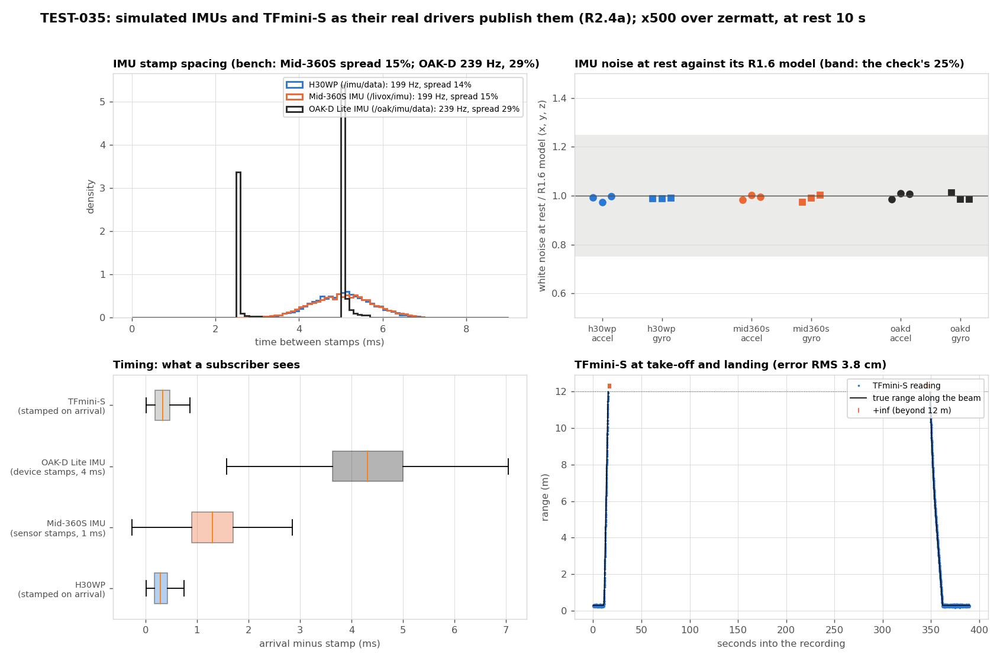

# TEST-035: simulated IMUs and TFmini-S that match the real ones (R2.4a)

**Question.** R2.4, first part (R2.4a, agreed with the project lead: R2.4 in three PRs):
the simulated IMUs (H30WP, the Mid-360S's and the OAK-D Lite's) with their R1.6 errors,
the TFmini-S, and timing (latency, timestamp jitter, dropouts) on each, publishing the
same message types and topic names as the real drivers. Do they?

**Answer, short.**
- **Yes, on all six test flights** (three vehicles, Zermatt and Emmental):
  - **H30WP:** `/imu/data`, 200 Hz, stamped on arrival as its driver does.
  - **Mid-360S IMU:** `/livox/imu`, 200 Hz, acceleration in g, its stamps jittered by
    the measured 15%.
  - **OAK-D Lite IMU:** `/oak/imu/data`, 239 Hz from skipped 394.5 Hz ticks, with the
    measured 29% spread.
  - **TFmini-S:** `/tfmini/range` as `sensor_msgs/Range` (agreed: on the companion, not
    through PX4).
- **How:** the GDN payload carries the four sensors error-free in Gazebo. A new node,
  `sim_sensors`, publishes each as its driver does. It adds the R1.6 errors with
  `gdn::ImuErrorSim` (the Monte Carlo's code), the timing from `config/sim/sensors.yaml`,
  and the TFmini-S's limits and range-dependent noise.
- **The check, `tools/check_sim_sensors.py`, was written first,** and judges each
  sensor against its real driver and the bench logs:
  - topic, type, frame, rate and spacing;
  - gravity in the right units at rest;
  - white noise within 25% of its model (all within 6%);
  - the configured timing and losses;
  - the TFmini-S against the true range: 4.1 to 6.0 cm RMS in flight.

  It failed on main.
- **The timing and range code is unit-checked in the selftest** (TEST-035, five cases).
- **Found on the way: the simulation's truth was 0.24 m below where we said.** It was
  the vehicle model's origin, which PX4's models put 0.24 to 0.246 m below base_link.
  The truth now comes from the payload, in the frame all its sensors are mounted in:
  - **the radar's constant offset against the map went** from about +0.2 m to +0.05 m;
  - **the R2.3 radar check now reads** 0.32 to 0.48 m RMS, from 0.36 to 0.67.



*TEST-035 (`tools/plot_test035.py`, from `test035_data/`; the x500 over Zermatt).*
- *Top left: time between stamps. The H30WP is even, but stamped on arrival, so its
  latency jitter shows (14%). The Mid-360S has jittered sensor stamps (15%, as the
  bench). The OAK-D Lite comes in steps of one or two 2.53 ms ticks (29%, as the bench).*
- *Top right: each IMU's white noise at rest over its R1.6 model, per axis (dots
  accelerometer, squares gyro).*
- *Bottom left: arrival minus stamp, what a subscriber sees. Arrival-stamped sensors sit
  near zero (the stamp already holds the latency); sensor-stamped ones show their
  latency.*
- *Bottom right: the TFmini-S through take-off and landing against the true range along
  its beam, and +inf above 12 m.*

## What each sensor publishes

| Sensor | Topic, type, frame | Rate | Errors | Timing | Measured, or placeholder |
|---|---|---|---|---|---|
| H30WP | `/imu/data`, `sensor_msgs/Imu`, `imu_link` (as `tools/h30wp_node.py`) | 200 Hz, even | `config/imu/h30wp.yaml` (R1.6) | stamped on arrival (the factory output has no sample time); latency 3 ± 0.5 ms | rate and losses measured (TEST-024); latency a placeholder |
| Mid-360S IMU | `/livox/imu`, `sensor_msgs/Imu`, `livox_frame`; acceleration in g (as `livox_ros_driver2`) | 200 Hz | `mid360s.yaml` | sensor stamps, jitter 0.53 ms; latency 1 ms | rate and jitter measured (TEST-025: spread 15%) |
| OAK-D Lite IMU | `/oak/imu/data`, `sensor_msgs/Imu`, `oak_imu_frame` | 394.5 Hz ticks, 65% of steps skip one: 239 Hz | `oakd_lite.yaml` | device stamps; latency 4 ms | tick and skips measured (TEST-025); the frame name to confirm with the driver in Phase 6 |
| TFmini-S | `/tfmini/range`, `sensor_msgs/Range`, `tfmini_link`; infrared, 0.1 to 12 m, 2° | 100 Hz | 3 cm sigma to 6 m, 0.5% of the range beyond; 1 cm steps; +inf beyond 12 m, -inf under 0.1 m | stamped on arrival; latency 5 ms; 0.2% lost | from the datasheet; all placeholders until Phase 6 |

**Placement:** mounts are placeholders until the vehicle profiles (R2.5) hold the real
extrinsics:
- **H30WP:** level, at the payload origin;
- **Mid-360S:** upside down, ready for the lidar in R2.4c;
- **OAK-D Lite:** forward, pitched 30° down;
- **TFmini-S:** pointing straight down.

## How it works

- **The payload** (`sim/models/gdn_payload`) has three Gazebo IMU sensors at 250 Hz (the
  physics rate) and a one-beam `gpu_lidar` for the TFmini-S, all without noise.
  `sim_run.sh` bridges them to ROS.
- **`sim_sensors`** (C++, gdn_fusion; the ROS-free part in `gdn/sim_sensors.hpp`):
  - **Onto each sensor's clock:** each IMU's samples are interpolated onto the sensor's
    own clock: an even 200 Hz, or the OAK-D Lite's tick clock with random skips.
  - **R1.6 errors:** `gdn::ImuErrorSim` adds each IMU's errors (white noise, bias drift,
    a turn-on bias per run), the code the Monte Carlo uses.
  - **The driver's units:** for the Mid-360S, g.
  - **The TFmini-S** reads the latest beam on its own 100 Hz clock, with its limits and
    noise.
  - **Timing, per message:** a latency, a stamp (the sample time plus jitter, or the
    arrival time) and whether it's lost. It's published when it would arrive, in order.
- **The clock.** Gazebo stamps in simulation time. `sim_sensors` maps it to wall time the
  way a driver's clock would: the smallest bridge delay over 2 s, smoothed over 1 s,
  plus 5 ms headroom. The same map serves every sensor, so they're consistent with each
  other.

**Two versions of the clock map.**
- **The first followed the delay floor directly.** Each step in the floor showed as
  stamp jitter (the Mid-360S spread was 22%, not 15%). And a sample's mapped time was
  often already past when its raw message came in, so the bridge's own delay ate the
  configured latency (2.6 ms measured for 1 ms).
- **Smoothing and the headroom fixed both:** 15.0% and 1.3 ms now.

## The check, written first

`tools/check_sim_sensors.py`:
- **static (CI):** each sensor is in `config/sim/sensors.yaml` with the real topic and
  frame, an error-free Gazebo sensor in the payload, its R1.6 model and its units.
  - **on main:** 4 FAIL, no sensors in the payload (`static_check_on_main.txt`);
  - **now:** passes (`static_check.txt`).
- **`--run LOG_DIR`**, from the bag:
  - the real topic and type, frame and rate;
  - the bench's spacing spread (Mid-360S 10 to 20%, OAK-D 20 to 38%);
  - at rest on the pad, gravity in the right units, and each axis's white noise within
    25% of the model's density times √(mean 1/dt);
  - arrival minus stamp as configured (within 2 ms), losses within one point;
  - for the TFmini-S:
    - the Range fields;
    - at rest, its mean within 5 cm of the true range and its sigma within 30% of the
      model, or "too close" (-inf) if it's parked under 0.1 m;
    - +inf beyond 12 m;
    - within 12 m in flight, error RMS under twice the model against the true range
      along its beam.
- **`--selfcheck`** (CI): the statistics on made-up data (stamp jitter to spread, the
  OAK-D skip pattern, uneven white noise, losses, the TFmini-S's sigma).

**The selftest** (`gdn_selftest`, TEST-035, `selftest_test035.txt`) checks
`gdn/sim_sensors.hpp`:
- 250 Hz onto an even 200 Hz clock, exactly;
- the OAK-D tick clock at 239 Hz in one- and two-tick steps;
- latency, stamp jitter, order and losses as set;
- the TFmini-S's limits, noise (3.0 cm at 2 m, 5.0 cm at 10 m) and 1 cm steps;
- the clock map finding the transport delay's floor.

## Results

Six flights (`HEADLESS=1 GDN_VEHICLE=... [GDN_SITE=ch_emmental] tools/sim_run.sh`, short
route, dev image, GPU). Every one passes the sensor check and the R2.3 vehicle check
(`*.sensors.txt`, `*.check.txt`).

| | H30WP | Mid-360S IMU | OAK-D Lite IMU | TFmini-S |
|---|---|---|---|---|
| Rate | 200.0 Hz | 200.0 Hz | 239.2 to 239.3 Hz | 99.8 Hz |
| Spacing spread (bench) | 14% (latency jitter; not measured on the bench) | 15.0% (15%) | 28.9 to 29.0% (29%) | |
| \|a\| at rest (world: 9.8 m/s²) | 9.841 to 9.842 m/s² | 1.0021 to 1.0023 g | 9.757 to 9.764 m/s² | |
| White noise at rest / model (per axis, six flights) | 0.94 to 1.03, all three IMUs | | | sigma 2.7 to 2.9 cm, model 3.0 |
| Arrival minus stamp, median | 0.3 ms (arrival stamps) | 1.3 ms (1 ms set) | 4.3 ms (4 ms set) | 0.3 to 1.7 ms (arrival stamps) |
| Lost | 0.01 to 0.02% | 0.04% | 0% | 0.19 to 0.20% (0.2% set) |
| Against the true range | | | | 4.1 to 6.0 cm RMS in flight within 12 m |

- **The bias at rest** (|a| 0.4% off gravity) is each IMU's turn-on bias: one draw per
  run, 0.05 m/s² sigma (R1.6).
- **The IMUs' 0.01 to 0.04% "lost"** with no losses set are a few longer gaps when the
  machine stalled (an arrival up to 160 ms late in some runs), as a real computer's
  would.
- **The TFmini-S at rest:**
  - on four of the six vehicles and worlds it read 2 cm short of the true range: the
    runway's drawn strip, which it sees (`make_sim_world.py` now lays it 2 cm high, from
    4);
  - on the other two (the VTOL on Emmental, the cessna on Emmental) the vehicle came to
    rest with the sensor 6.7 and 9.2 cm from the ground, and it read "too close" (-inf),
    as the real one does under 0.1 m.

## Found on the way

**The truth was the vehicle model's origin, not base_link.**
- **What it was:** the truth publisher sat in each vehicle model (R2.3), and Gazebo's
  OdometryPublisher gives the model's pose. PX4's models put base_link 0.24 m (x500) and
  0.246 m (standard_vtol, rc_cessna) above that origin (`gz sdf -p` shows the merged
  frame).
- **How it showed:** the TFmini-S read 0.259 m parked where the "true" sensor height was
  0.064 m.
- **The fix:** the truth publisher is now in the payload model and gives the payload
  frame's pose, the frame every payload sensor is mounted in. Gazebo updates a nested
  model's pose correctly: the truth moved up exactly 0.18 m (0.24 less the 6 cm mount).
- **What it changes:**
  - the adapter's radar-against-map mean drops from about +0.2 m to +0.05 m;
  - the R2.3 radar check reads 0.32 to 0.48 m RMS along the beam (TEST-034: 0.36 to
    0.67). TEST-034's conclusions stand;
  - truth for GDN's score is now 6 cm (3 cm on the VTOL) below base_link, not about
    0.24 m.

**The TFmini-S's beam starts at 2 cm.** Gazebo's beam doesn't see anything nearer than
where it starts. With 5 cm, a VTOL parked on its belly gave "no target" (+inf) where the
real sensor says "too close" (-inf). Nothing of the airframe is below the sensor, so the
beam can't hit the vehicle.

**The check's truth is interpolated.** The truth comes at 20 Hz, and at a 3 m/s climb
50 ms is 15 cm, five times the TFmini-S's noise. The first version took the nearest
truth sample and failed three flights at 7 to 12 cm RMS; interpolated, they're 4 to 6
cm.

## Limits

- **Every latency, and the TFmini-S's noise and losses, are placeholders** until Phase 6
  measures them on the vehicle (R6.3 feeds them back here).
- **The H30WP's orientation, magnetometer and temperature** aren't simulated; its
  `orientation` is marked empty.
- **The TFmini-S has no reflectivity:** 12 m on any ground, where the datasheet gives
  about 7 m on dark surfaces.
- **The mounts are placeholders** (R2.5).
- **IMU lever arms:** each IMU is a Gazebo sensor at its own mount, and Gazebo's IMU
  doesn't add the rotation terms of a lever arm (a few cm here).
- **GDN doesn't read these yet.** In SITL it still flies on PX4's IMU (`sensor_combined`);
  LIO, VIO and the rangefinder come in Phases 3 and 4.
- **Only short routes** were flown for this test; the full routes are TEST-034's.

## Reproduce

```bash
tools/docker_dev.sh shell --gpu --gui
colcon build --base-paths src --cmake-args -DCMAKE_BUILD_TYPE=Release
python3 tools/check_sim_sensors.py && python3 tools/check_sim_sensors.py --selfcheck
GDN_ROOT=$PWD ./build/gdn_fusion/gdn_selftest | grep TEST-035
HEADLESS=1 GDN_LOG_DIR=/tmp/s tools/sim_run.sh && python3 tools/check_sim_sensors.py --run /tmp/s
python3 tools/plot_test035.py /tmp/s --export docs/test_reports/test035_data
python3 tools/plot_test035.py docs/test_reports/test035_data --out docs/test_reports/test035_sensors.png
```

## Data (`test035_data/`)

- **`imu_spacing.csv`, `imu_noise_at_rest.csv`, `latency.csv`, `tfmini.csv`:** the
  figure's data, from the x500 over Zermatt (`run.txt`).
- **`<world>_<vehicle>.sensors.txt`, `.check.txt`:** the sensor check and the R2.3
  vehicle check on each of the six flights.
- **`static_check.txt`, `static_check_on_main.txt`:** the static check and selfcheck, and
  the same check on main.
- **`selftest_test035.txt`:** the selftest's TEST-035 lines.
