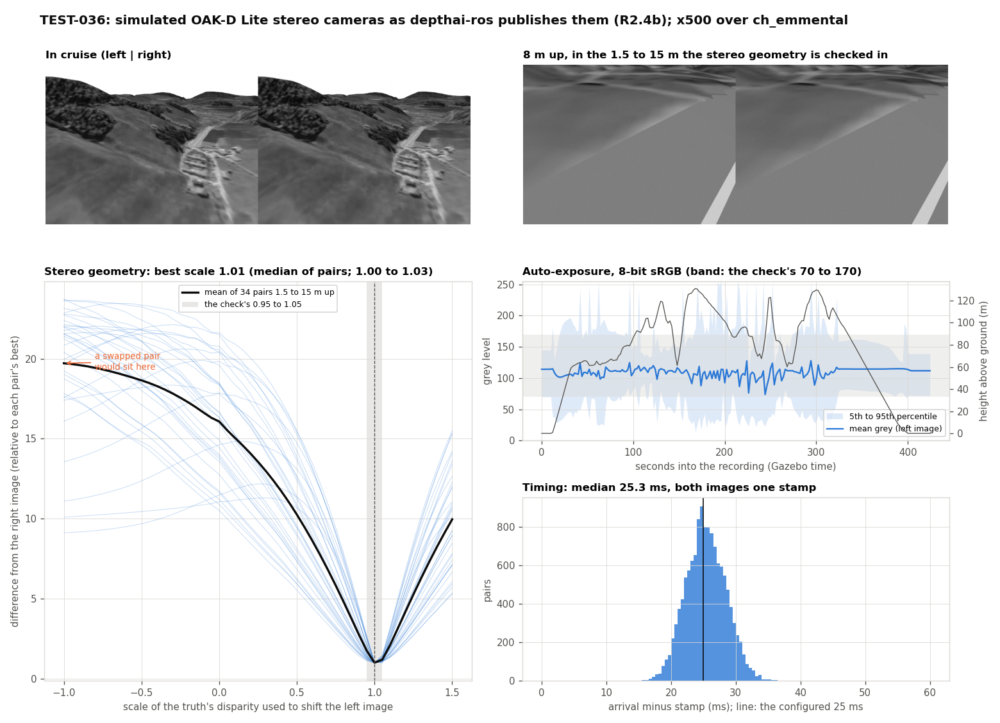

# TEST-036: simulated OAK-D Lite cameras that match the real ones (R2.4b)

**Question.** R2.4, second part (R2.4b; R2.4 in three PRs, agreed): the OAK-D Lite's
two 640 x 480 global-shutter cameras, 7.5 cm apart, 73 degree HFOV, with timing
(latency, timestamp jitter, dropouts), publishing the same message types and topic
names as the real driver. Do they?

**Answer, short.**
- **Yes, on all six test flights** (the x500, standard VTOL and cessna over the
  Emmental and Zermatt sites). As depthai-ros v3 publishes them:
  - `/oak/left/image_raw` and `/oak/right/image_raw`, `sensor_msgs/Image` mono8,
    640 x 480, at 30 Hz (29.92 to 29.95 Hz measured);
  - each with its `camera_info`: the 73 degree pinhole (fx 432.46), no distortion, and
    the right camera's projection holding the 7.5 cm baseline (`Tx = -fx * 0.075`);
  - a synced pair: both images carry one stamp (every image had its partner in five
    flights, 9770 of 9773 in one), and are lost together (0.17 to 0.27% of pairs, set
    0.2%);
  - the configured 25 ms latency (median 25.5 to 25.7 ms on Gazebo's clock).
- **The stereo geometry is proven from the images themselves.** Shifting the left
  image by the truth's disparity reproduces the right one best at a scale of 1.013 to
  1.017 on the five flights that see enough close texture (the check wants 0.95 to
  1.05; a swapped pair gives -1). The sixth, the VTOL over Zermatt, had no low pairs
  that show depth, and gets a note, not a verdict.
- **They look like a camera's images:** auto-exposed (median grey 102 to 112 in
  flight) and with the set read noise (1.97 to 2.02 grey levels, set 2).
- **The check, `tools/check_sim_sensors.py`, was written first;** its new static part
  failed on main (`static_check_on_main.txt`).
- **Found on the way, three things that change R2.4a's sensors:**
  - **Gazebo's grey cameras give linear light,** about three times too dark in 8 bits.
    They now render 16-bit, and `sim_sensors` does what a camera does: exposure, then
    sRGB to 8 bits.
  - **R2.4a's stamps stretched when the simulation ran slow.** They followed the wall
    clock; with the cameras rendering, the simulation runs at 0.90 to 0.91 of real
    time on this laptop, and the IMUs read 183 Hz instead of 200. Stamps now keep
    Gazebo's seconds: 200.0 Hz on every flight.
  - **R2.4a's publishers were best-effort,** which a reliable subscriber (VIO nodes)
    never receives. They're reliable now, as the real drivers'.



*TEST-036 (`tools/plot_test036.py`, from `test036_data/`; the x500 over Emmental).*
- *Top: a pair in cruise and one 8 m up. The terrain is the 2 m orthophoto, so the
  ground is soft; the strip is the runway.*
- *Bottom left: the stereo warp test. For each of 34 pairs 1.5 to 15 m up, how far the
  left image shifted by a scale of the truth's disparity is from the right image. All
  bottom out at 1.00 to 1.03.*
- *Middle right: auto-exposure through the flight, with the height above the ground.*
- *Bottom right: arrival minus stamp of every pair, on Gazebo's clock.*

## What the cameras publish

| | Simulated | Real (depthai-ros v3, OAK-D Lite) |
|---|---|---|
| Topics | `/oak/left/image_raw`, `/oak/right/image_raw`, `/oak/{left,right}/camera_info` | the same (driver name `oak`) |
| Frames | `oak_left_camera_optical_frame`, `oak_right_camera_optical_frame` | the same (its URDF) |
| Image | mono8, 640 x 480 | OV7251: 640 x 480 mono, global shutter |
| Rate | 30 Hz | 30 Hz or more (Phase 6's VIO setup; `vio.yaml` runs 60) |
| Lens | 73 x 58 degree pinhole, no distortion; raw is already rectified | 73 x 58 degrees; factory calibration with distortion |
| Stereo | 7.5 cm, left at +y; one stamp per pair | 7.50 cm on our unit (`tools/oak_check.py`); hardware-synced |
| Exposure | one auto-exposure gain for the pair (mean to mid-grey, 0.2 s), sRGB to 8 bits | the camera's auto-exposure and its processing |
| Noise | read noise 2 grey levels | placeholder until measured |
| Timing | device stamps; 25 +- 3 ms latency; 0.2% of pairs lost | placeholders until R6.3 measures them |

**Placement:** a placeholder until the vehicle profiles (R2.5): either side of the
OAK-D Lite's IMU, pointing as it does (forward, 30 degrees down).

**Recording:** the images are 18 MB/s, 6 GB for one of these flights. `sim_run.sh`
records both `camera_info` topics always (they carry every image's stamp), and the
images only with `GDN_BAG_IMAGES=1`, in a bag of their own.

## How

- **Gazebo:** two error-free `camera` sensors in the payload, 16-bit grey (L16).
- **`sim_sensors`:**
  1. pairs the left and right images Gazebo rendered at the same moment;
  2. gives the pair one timing draw (stamp, latency, lost or not);
  3. measures both images' mean, and moves one exposure gain towards mid-grey;
  4. tone-maps each image: linear light times the gain, sRGB-encoded to 8 bits;
  5. adds read noise;
  6. publishes each image with its `camera_info` when it would arrive.
- **The ROS-free parts are unit-checked** in the selftest (TEST-036, four cases):
  - the intrinsics;
  - the noise;
  - the exposure's time constant and range;
  - the tone map.

## The check

`tools/check_sim_sensors.py`, as for R2.4a, plus:
- **static:**
  - the config's topics and frames are the driver's;
  - the payload has two error-free 16-bit cameras matching the config;
  - they're parallel, 7.5 cm apart with the left at +y;
  - they're on one board with the OAK-D Lite's IMU;
- **`--run`:**
  - both `camera_info` topics with the right intrinsics and baseline;
  - every left image with a right one of the same stamp;
  - 29 to 31 Hz;
  - the configured timing and losses;
  - **with images recorded:**
    - mono8 640 x 480 with the `camera_info`'s stamps;
    - exposed (median mean 70 to 170 grey);
    - the read noise at rest;
    - the stereo geometry.

**The stereo test.** For pairs 1.5 to 15 m up:
1. The truth's disparity at every pixel comes from the left camera's rays cast onto the
   world's terrain from its true pose and mount.
2. The left image is shifted by -1 to 1.5 times that disparity.
3. Pooled over the pairs, the scale that best reproduces the right image must be 0.95
   to 1.05, and fit at least 5% better than no shift.

Which pixels and pairs count:
- **Pixels:** only where the image has texture.
- **Pairs:** only those that show depth at all (their best fit 10% better than no
  shift).
- **Fewer than 5 such pairs:** a note, not a verdict.

The test fails on any of these:
- a swapped pair, which gives -1;
- a wrong baseline or focal length, which gives the ratio (a 10% short baseline gives
  1.1; selfcheck);
- a wrong mount;
- an image stamped at the wrong time.

**Why not a stereo matcher.** OpenCV's semi-global matcher read the disparity 10 to 15%
short on the soft 2 m photo. Shifting with the truth's disparity showed the images
themselves were right (best at 1.00 to 1.05), so the matcher was the problem, and the
test was changed to the shift.

## Results, all six flights

`test036_data/<site>_<vehicle>.sensors.txt` and `.check.txt`, judged by the final
check after the flights (the image bags were kept for it).

| | x500 Emmental | VTOL Emmental | cessna Emmental | x500 Zermatt | VTOL Zermatt | cessna Zermatt |
|---|---|---|---|---|---|---|
| Check | 50 pass | 50 pass | 50 pass | 50 pass | 49 pass, 1 note | 50 pass |
| Real-time factor | 0.905 | 0.909 | 0.911 | 0.903 | 0.909 | 0.908 |
| Camera rate | 29.93 Hz | 29.94 | 29.94 | 29.95 | 29.95 | 29.92 |
| Pairs lost (set 0.2%) | 0.22% | 0.18% | 0.19% | 0.18% | 0.17% | 0.27% |
| Camera latency (median, set 25 ms) | 25.54 ms | 25.52 | 25.55 | 25.69 | 25.57 | 25.58 |
| Median grey in flight | 112 | 106 | 103 | 109 | 105 | 102 |
| Read noise (set 2.02 with rounding) | 2.02 | 2.02 | 1.97 | 2.02 | 2.02 | 1.97 |
| Stereo scale (pairs) | 1.015 (34) | 1.013 (33) | 1.017 (17) | 1.014 (25) | not judged (0 of 7) | 1.017 (15) |
| TFmini-S in flight, RMS | 4.7 cm | 4.4 | 6.0 | 4.4 | 4.4 | 6.7 |
| Radar along the beam (R2.3 check), RMS | 0.40 to 0.63 m over the six | | | | | |

**R2.4a's sensors, on Gazebo's clock now:**
- **Rates:**
  - the H30WP and the Mid-360S at 200.0 Hz;
  - the OAK-D Lite's IMU at 239.2 to 239.3 Hz;
  - the TFmini-S at 99.8 Hz.
- **Spacing spreads:** the Mid-360S 15.0% and the OAK-D 28.9 to 29.0%, as on the bench.
- **White noise at rest:** 0.94 to 1.03 of the R1.6 models (108 axis checks).
- **Arrival minus stamp:**
  - the arrival-stamped H30WP and TFmini-S: 0.31 to 0.38 ms;
  - the Mid-360S: 2.3 to 2.7 ms (set 1);
  - the OAK-D Lite's IMU: 4.6 ms (set 4).

  The extra comes from Gazebo, below.

## Found on the way

- **Gazebo's grey cameras are linear.** The same view rendered as colour (gamma-encoded)
  and as grey read 72 and 21 mean grey in flight.
  - Linear grey is about the 2.4th power of the colour value, so at 8 bits the dark
    half of the image is crushed into a few levels.
  - **Fix:** render 16-bit (it carries real 16-bit detail: about 19,000 levels in a
    frame), then expose and encode as a camera does.
- **The clock (changes R2.4a).**
  - **What happened:** R2.4a mapped Gazebo time to wall time by following the bridge's
    delay. The cameras slow the simulation to 0.90 to 0.91 of real time here, so every
    stamp interval stretched by 1 / real-time factor: at 0.915 the IMUs read 183 Hz,
    each sample's interval 9% longer than the motion it carries, and an IMU integrated
    on those stamps would be 9% off.
  - **Now:** stamps are Gazebo time plus one offset fixed at start-up (logged), and
    latencies run on Gazebo's clock.
  - **The check** turns the bag's receive times into Gazebo time through the raw
    Gazebo IMU stream it now records.
  - **What a subscriber sees:** in a run slower than real time, stamps fall behind
    `now()`. Use the stamps, as with a real driver.
- **Reliable publishers (changes R2.4a).**
  - The real drivers publish reliable (`h30wp_node.py`'s `/imu/data`), but
    `sim_sensors` was best-effort.
  - A reliable subscriber, which is how VINS and OpenVINS subscribe, gets nothing from
    a best-effort publisher.
- **Images in their own bag.** In the same recorder as everything else, 18 MB/s held
  every topic up by about 0.3 s.
- **What Gazebo's physics step does to timing.** Gazebo steps every 4 ms:
  - **A TFmini-S reading** used to go out only when the next beam was rendered, up to
    12 ms late. Now it goes out as Gazebo's time passes it.
  - **An IMU sample interpolated between two physics steps** can only be made once the
    second step arrives. So a latency set under one step comes out up to one step
    longer: about 2.5 ms for the Mid-360S's 1 ms, which is a placeholder.
  - **An arrival-stamped sensor** (the H30WP) is stamped when it can really be
    delivered.
- **The check, on the way to the final version:**
  - the at-rest window now also ends before the vehicle turns (the x500 tilts 0.24
    degrees on the Zermatt pad as its motors spool up, a second before it moves);
  - a TFmini-S parked within 5 cm above its 0.1 m minimum may read "too close": the
    rendered surface it sees and the map differ by a few cm there (12.1 cm by the map
    on the Zermatt pad, -inf as read);
  - images are matched to their `camera_info` by integer nanoseconds. Matching seconds
    rounded to 6 decimals lost a random share, because numpy and Python rounding differ
    in the last digit near 1.8e9 s; that briefly looked like the recorder losing
    images.

## Not in scope, and limits

- **GDN doesn't read the cameras yet** (VIO is R3.5).
- **The 2 m orthophoto is soft:** 0.2 to 0.5 m per camera pixel at 100 to 200 m. Finer
  photos for the flown corridor are R3.5's.
- **Not simulated:**
  - lens distortion, motion blur and vignetting;
  - the sensor's own response curve (sRGB stands in for it);
  - the colour camera;
  - the OAK-D's own depth, rectified-pair and feature-tracker topics.
- **Placeholders until Phase 6 measures them:** latency, losses, read noise and
  exposure behaviour (R6.3).
- **Real-time factor 0.90 to 0.91** with the cameras rendering on this laptop (RTX 5060
  Laptop). PX4 runs in lockstep, so this costs time, not correctness.

## Reproduce

```bash
colcon build --base-paths src --cmake-args -DCMAKE_BUILD_TYPE=Release
GDN_ROOT=$PWD ./build/gdn_fusion/gdn_selftest | grep TEST-036
python3 tools/check_sim_sensors.py && python3 tools/check_sim_sensors.py --selfcheck
HEADLESS=1 GDN_BAG_IMAGES=1 GDN_SITE=ch_emmental GDN_LOG_DIR=/tmp/s \
  GDN_FLY_ARGS="--legs 2 --leg-len 800" tools/sim_run.sh          # dev image, --gpu
python3 tools/check_sim_sensors.py --run /tmp/s
python3 tools/plot_test036.py --export /tmp/t036 /tmp/s && python3 tools/plot_test036.py /tmp/t036 --out t036.png
```
