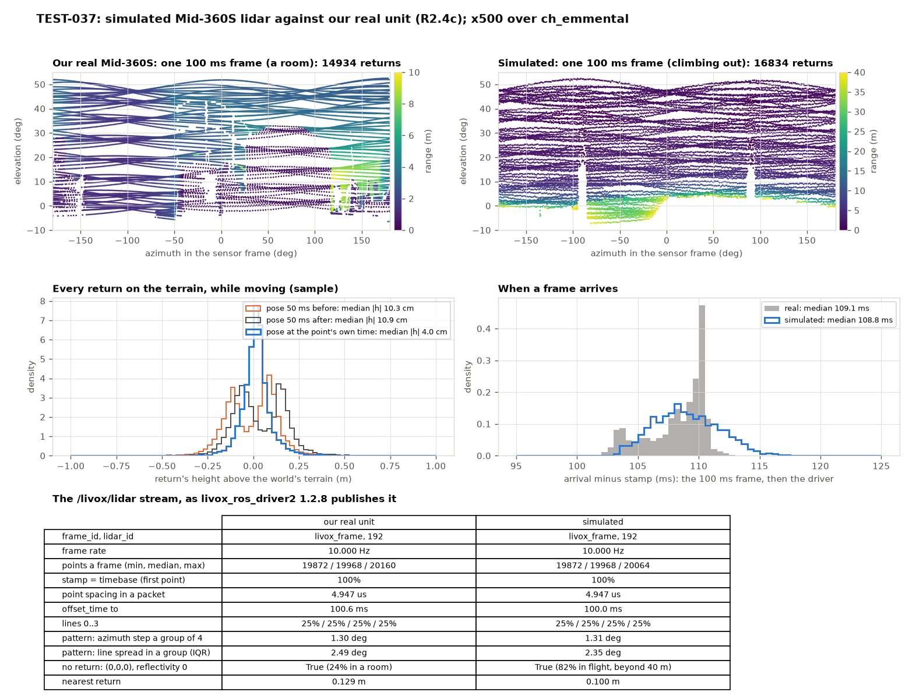

# TEST-037: a simulated Mid-360S lidar that matches our real unit (R2.4c)

**Question.** R2.4, last part (R2.4c, agreed): the Mid-360S lidar, publishing what
`livox_ros_driver2` publishes:
- `livox_ros_driver2/CustomMsg` on `/livox/lidar`, with a messages-only package in the
  dev image;
- 360 by 59 degrees (-7 to 52);
- 40 m on dark ground, 10 Hz;
- a scan pattern like Livox's non-repetitive one;
- with timing.

Does it?

**Answer, short.**
- **Yes, on all six test flights** (the x500, standard VTOL and cessna over Emmental and
  Zermatt), judged against a 69 s recording of our own unit (agreed:
  `docs/test_reports/test037_data/mid360s_real.json`):
  - **the message:** `CustomMsg` on `/livox/lidar`, `livox_frame`, lidar_id 192;
  - **the frames:** 10.000 Hz, 19,872 to 20,064 points (real 19,872 to 20,160);
  - **the point clock:** 96-point packets 4.947 us apart, with header stamp = timebase =
    the first point, as the real unit (100% of frames);
  - **the lines:** 0 to 3, a quarter each;
  - **no return:** published as (0, 0, 0) with reflectivity 0, as the real driver does;
    nothing nearer than 0.1 m;
  - **arrival:** the median 106.8 to 110.9 ms after the stamp, the real 109.1.
- **The scan pattern is Livox's own measured Mid-360 pattern** (agreed: our own
  implementation, not a plugin).
  - **Where it comes from:** `scan_mode/mid360.csv` from Livox-SDK/livox_laser_simulation
    (MIT), fetched and pinned by checksum.
  - **Its fingerprint matches our unit's:** a 1.31 to 1.32 degree azimuth step per group
    of four points (real 1.30), and the four lines spread 2.23 to 2.50 degrees (real
    2.49).
  - **The direction:** the file counts azimuth the other way round from our unit, so
    it's mirrored.
- **Every return is where the world is.** Placed through the true pose at its own time,
  the median height above the world's terrain is 2.7 to 3.3 cm (95% under 17 cm) over
  0.5 to 0.85 million returns per flight.
- **The motion matches the per-point timestamps.** Moving, each point fits the pose at
  its own `offset_time` (3.2 to 3.9 cm) far better than 50 ms either side (8.9 to
  11.1 cm), which is what a LIO's deskewing relies on.
- **The check, `tools/check_sim_sensors.py`, was written first;** its new static part
  failed on main (`static_check_on_main.txt`).



*TEST-037 (`tools/plot_test037.py`, from `test037_data/`; the x500 over Emmental).*
- *Top: one 100 ms frame of our real unit (a room) and one simulated (climbing out),
  in azimuth and elevation. Both show the pattern's crossing curved bands. The white
  gaps in the simulated frame at about +-90 degrees are the x500's landing gear, under
  0.1 m from the sensor: no return.*
- *Middle left: every return's height above the world's terrain while moving (a 2%
  sample), placed from the pose at the point's own time and 50 ms either side.*
- *Middle right: arrival minus stamp of every frame, ours and the real unit's.*
- *Bottom: the stream's numbers side by side.*

## How

- **The message package.** `docker/livox_msgs`:
  - **What it holds:** the driver's own `CustomMsg.msg` and `CustomPoint.msg`
    (driver commit 2144554, MIT), messages only.
  - **Where it's built:** into the dev image (`/opt/livox_msgs`) and in CI.
  - **Kept out of `src/`,** so it can never shadow the real driver on the vehicle. On a
    PC with the real driver, `env.sh` sources `~/ws_livox` instead.
  - **Without the messages,** `gdn_fusion` builds with no lidar and says so.
- **Gazebo.** One error-free `gpu_lidar` at the Mid-360S's IMU (upside down):
  - 720 by 120 rays (0.5 degree) over 360 by -7.2 to 52.2 degrees;
  - rendered 20 times a second, out to 100 m.
- **`sim_sensors`, for every point of the pattern in firing order** (96 per packet,
  4.947 us apart, 208 packets per 100 ms frame, all measured on our unit):
  1. its own direction from Livox's pattern;
  2. the range along it:
     - from the four rays around it (bilinear on a smooth surface, the nearest ray
       across an edge, so no points fly between a near and a far surface);
     - each ray interpolated between the renders before and after the point's own
       time (extrapolated past the latest, so a frame needn't wait);
  3. no return beyond 40 m or nearer than 0.1 m, else 2 cm range and 0.15 degree angle
     noise;
  4. per frame, a `CustomMsg` stamped with its first point, sent 5 ms after the frame
     ends.
- **Selftest** (TEST-037, six cases):
  - the pattern file and its mirroring;
  - the grid, and between rays;
  - the point clock;
  - the range between renders;
  - the returns and their noise.

## The check

`tools/check_sim_sensors.py`, as for R2.4a and b, plus:
- **static:**
  - the config's topic and frame;
  - an error-free `gpu_lidar` whose rays match the config's grid;
  - at the Mid-360S's IMU;
  - the pattern file pinned by checksum;
  - the real unit's reference numbers present;
- **`--run`, against the reference** (`--livox-reference BAG OUT` makes it from a
  recording of the real unit; the same statistics code runs on both):
  - frame and lidar_id;
  - 10 Hz;
  - points a frame within the real unit's range;
  - stamp = timebase, the point spacing and the `offset_time` span;
  - the line shares;
  - the no-return encoding;
  - the pattern's fingerprint, on frames returning at least half their points;
  - the arrival time;
  - no frames lost;
  - every return on the terrain;
  - each point fitting the pose at its own time best.

The bag holds tens of millions of points per flight, so the check reads `CustomMsg`
from its bytes with numpy, which matches rclpy's deserializer point for point.

## Results, all six flights

`test037_data/<site>_<vehicle>.sensors.txt` and `.check.txt`, judged by the final check.
Every flight passes 58 checks, with one note: images weren't recorded, so the camera
image checks didn't run.

| | x500 Emmental | VTOL Emmental | cessna Emmental | x500 Zermatt | VTOL Zermatt | cessna Zermatt |
|---|---|---|---|---|---|---|
| Real-time factor | 0.936 | 0.959 | 0.936 | 0.924 | 1.000 | 0.998 |
| Points a frame | 19872 to 20064 | same | same | same | same | same |
| Pattern: azimuth step, line spread (deg; real 1.30, 2.49) | 1.31, 2.35 | 1.31, 2.44 | 1.31, 2.50 | 1.31, 2.34 | 1.32, 2.23 | 1.31, 2.39 |
| Arrival minus stamp, median (real 109.1 ms) | 108.8 | 109.9 | 109.7 | 110.9 | 106.8 | 108.4 |
| Returns on the terrain: median, 95% (m) | 0.030, 0.164 | 0.033, 0.170 | 0.031, 0.148 | 0.027, 0.131 | 0.029, 0.134 | 0.031, 0.164 |
| Moving: at its time / 50 ms before / after (m) | 0.039 / 0.104 / 0.108 | 0.038 / 0.100 / 0.102 | 0.032 / 0.109 / 0.089 | 0.036 / 0.102 / 0.106 | 0.036 / 0.097 / 0.101 | 0.034 / 0.111 / 0.095 |
| No return in flight (beyond 40 m) | 82% | 89% | 85% | 83% | 82% | 77% |

- **R2.4a and b's sensors still pass on every flight:**
  - the IMUs, TFmini-S and camera timing on Gazebo's clock;
  - cameras at 29.93 to 29.95 Hz;
  - the R2.3 radar check: 0.41 to 0.68 m RMS along the beam.
- **Above about 40 m the Mid-360S sees little:** 77 to 89% of points come back empty
  over a flight, as our unit would.

## Found on the way

- **The real unit, measured** (`mid360s_real.json`):
  - **Packets:** 96 points 4.947 us apart, 19,872 to 20,160 points a frame.
  - **Stamp:** the header stamp is the first point's (= timebase).
  - **Arrival:** 109 ms after the stamp.
  - **No return:** sent as (0, 0, 0) with reflectivity 0 (24% in a room); the nearest
    return was 0.13 m.

  The datasheet says none of this.
- **Livox's pattern file counts azimuth the other way** from our unit: the file steps
  -1.32 degrees per group, our unit +1.30. It's mirrored.
- **Snapping each point to the nearest Gazebo ray flattened the pattern.** Livox's curved
  bands came out as flat stripes (line spread 2.34 against 2.49 degrees, directions
  0.25 degree off). Points now keep their own direction, ranged between the rays.
- **A frame used to wait for a Gazebo render after its end,** which renders on 4 ms
  physics steps put up to 50 ms later (arrival 157 ms). The last points are now
  extrapolated from the two latest renders, and the frame goes out as Gazebo's time
  passes its end.
- **The driver latency is 5 ms, not 9.**
  - **Why:** the real 109 ms was measured in a bag, so it includes getting a 400 kB
    message into it. The simulation's own recording adds that again: about 2 ms on
    "performance", 4 to 6 ms on "balanced", 8 ms on battery.
  - **The check:** it allows the lidar's arrival 4 ms, against 2 ms for small messages,
    whose way into the bag varies by about 0.5 ms.
- **The host's state matters for timing checks.** Two flights ran on battery (power-save,
  real-time factor 0.81) and failed only the checks that time messages through the
  recorder; they were flown again on mains. A viewer subscribed to `/livox/lidar`
  (`tools/livox_view.py`) adds load the same way.
- **The check's IMU timing now expects Gazebo's step.** An IMU sample is interpolated
  between two Gazebo samples 4 ms apart and goes out once the second is in (R2.4b). So
  a latency under 2 ms comes out as about 2 ms (the Mid-360S's 1 ms: 2.3 to 3.0 ms).
  The check expected the configured 1 ms and failed one flight by 0.01 ms.
- **Viewing.** RViz can't show `CustomMsg`; `tools/livox_view.py` republishes it as
  PointCloud2 on `/livox/points`, for the simulation and the real driver alike.

## Not in scope, and limits

- **GDN doesn't read the lidar yet** (LIO is Phase 3).
- **Reflectivity:** Gazebo has none, so every return gets one value (40), and the range
  doesn't depend on reflectivity (40 m for all).
- **Not simulated:** tags, multiple returns, dust, rain and sunlight.
- **The real pattern in flight** is checked on real bags in Phase 6. Our reference is
  from a room: frame, clock, lines and pattern don't depend on the scene, but the share
  of no-returns does.
- **Mount:** at the Mid-360S's IMU, upside down. The real extrinsics are R2.5's.
- **Resolution:** the rays are 0.5 degree apart. Ranges between them are interpolated,
  so detail finer than about 0.5 degree (9 cm at 10 m) is smoothed.

## Reproduce

```bash
tools/docker_dev.sh build          # the dev image, with the Livox messages
colcon build --base-paths src --cmake-args -DCMAKE_BUILD_TYPE=Release
GDN_ROOT=$PWD ./build/gdn_fusion/gdn_selftest | grep TEST-037
python3 tools/check_sim_sensors.py && python3 tools/check_sim_sensors.py --selfcheck
HEADLESS=1 GDN_SITE=ch_emmental GDN_LOG_DIR=/tmp/s GDN_FLY_ARGS="--legs 2 --leg-len 800" tools/sim_run.sh   # --gpu
python3 tools/check_sim_sensors.py --run /tmp/s
# the reference, from a recording of the real unit (ros2 bag record /livox/lidar):
python3 tools/check_sim_sensors.py --livox-reference REAL_BAG docs/test_reports/test037_data/mid360s_real.json
```
