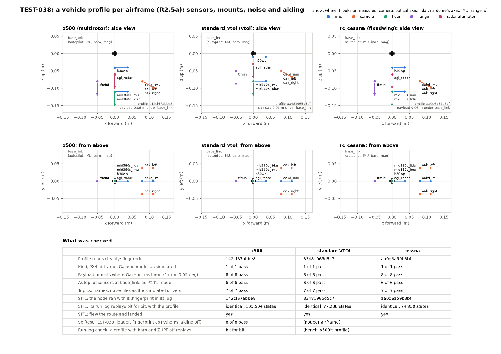

# TEST-038: a vehicle profile per airframe (R2.5a)

**Question.** R2.5, first part (R2.5a, agreed): one file per airframe describing what GDN
runs with there:
- the filter settings, as a filter config file plus overrides (agreed);
- which aiding GDN uses;
- every sensor with its driver topic, frame, noise model and mount, the profile being
  the source of truth for the mounts (agreed).

The node loads one by parameter, and all three simulated airframes have one. Does it
hold together, and does it match the simulation?

**Answer, short.**
- **Yes.** `config/vehicles/x500.yaml`, `standard_vtol.yaml` and `rc_cessna.yaml` each
  describe 11 sensors, from the autopilot's IMU, barometer and magnetometer to the
  Mid-360S lidar and the OAK-D Lite cameras.
- **Every mount is where Gazebo has it,** 0.00 mm and 0.000 deg off, through that
  airframe's own payload mount (6 cm under `base_link` on the x500 and the cessna, 3 cm
  on the VTOL).
  - **Cameras:** their optical frames included.
  - **The autopilot's own sensors:** where PX4's models have them.
- **The profiles agree with the simulated drivers:** the same topics, frames and IMU
  noise files as `config/sim/sensors.yaml`.
- **The node runs with the profile in SITL.** On one flight per airframe it logged the
  profile's fingerprint, the same one `tools/check_profiles.py` computes from the file.
  Each run log replayed bit for bit, with the profile:
  - x500: 105,504 states;
  - standard VTOL: 77,288 states;
  - cessna: 74,930 states.
- **Aiding can be switched off per airframe,** and is logged as "not used":
  - **In the selftest:** the barometer, the magnetometer, the terrain altimeter and
    zero-velocity updates, each alone or all together.
  - **In the bench run:** the barometer and zero-velocity updates; that run replays bit
    for bit too.
- **Nothing changes for GDN yet:** all three profiles name the same filter settings and
  switch every aiding on. That run is identical, state for state, to a run with no
  profile. Rules per flight regime are R2.5b; tuning per airframe waits for evidence.
- **The check, `tools/check_profiles.py`, was written first;** it failed on main, where
  no profile exists (`check_on_main.txt`).



*TEST-038 (`tools/plot_test038.py`, from the profiles and `test038_data/`).*
- *Top: each airframe's sensors from its profile, from the side and from above, with the
  direction each looks or measures along (arrows):*
  - *a camera's optical axis;*
  - *the lidar's dome axis (pointing down: the Mid-360S is mounted upside down);*
  - *a range sensor's beam;*
  - *an IMU's x axis.*

  *`base_link` (the cross) is the autopilot's frame. All mounts are placeholders until
  R6.4.*
- *Bottom: what the static check, the SITL flights, the selftest and the run-log check
  found.*

## How

- **The profile.** `config/vehicles/<airframe>.yaml`, flat `key: value` like the filter
  configuration. The C++ loader (`gdn/vehicle_profile.hpp`) and the Python reader
  (`tools/vehicle_profile.py`) refuse the same mistakes:
  - unknown keys, keys given twice, missing keys;
  - bad numbers, an unknown kind of vehicle or sensor;
  - two sensors feeding one GDN input;
  - aiding switched on without its sensor.

  Both give the same fingerprint over every value: comments, order and spacing don't
  count, any value does. It holds:
  - **identity:** kind, PX4 airframe, Gazebo model;
  - **filter:** `filter_config` and optional `filter.<key>` overrides;
  - **aiding:** `aiding.agl / .baro / .mag / .zupt`;
  - **one block per sensor:** kind, topic, `frame_id`, `mount_xyz_m`, `mount_rpy_deg`,
    `mount_source` (placeholder or measured), `gdn_input` (which GDN input it feeds, if
    any), and optionally its noise file and the Gazebo sensor it is in simulation.
- **Mounts.** The pose of the sensor's `frame_id` (what its driver stamps messages with)
  in the airframe's `base_link`:
  - **Axes:** ROS convention, x forward, y left, z up.
  - **Angles:** roll, pitch and yaw in degrees about the fixed axes, as in SDF and URDF.

  The check compares them with Gazebo directly. GDN converts them to its own
  forward-right-down frame when Phase 3's LIO and VIO use them.
- **The node.** `-p vehicle_profile:=config/vehicles/x500.yaml`:
  - **Settings, in order:** the profile's filter file, then its overrides, then any
    `-p KEY:=VALUE`. The filter fingerprint still covers the final values (R1.10).
  - **Aiding:** `gdn::NavCore` skips what the profile switches off, recorded in the run
    log as "not used".
    - **Barometer off:** not even its first reading is used.
    - **Magnetometer off:** it still gives the initial heading, since GDN has no other
      source of heading yet.
    - **AGL off:** no terrain updates, and so no altitude datum.
  - **The run log:** gets the profile as its second message, and `gdn_replay` applies
    it. Logs from before R2.5a have none and replay with all aiding on, as they ran.
  - **Without the parameter:** everything is on, as before (the bench and the CI
    baselines).
- **SITL.** `tools/sim_run.sh` passes the flown vehicle's profile (`GDN_PROFILE` picks
  another) and writes it into `run_info.txt`.

## The check

`tools/check_profiles.py` (static, in CI) for every vehicle `tools/sim_vehicles.py` flies:
- **The profile:** exists, reads cleanly, and names that vehicle's kind, PX4 airframe and
  Gazebo model.
- **Payload sensors:** each is in the profile once, and its mount matches Gazebo's within
  1 mm and 0.05 deg. That means composing the airframe's payload mount
  (`sim/models/<model>/model.sdf`) with the sensor's pose (`sim/models/gdn_payload`),
  plus the optical frame for a camera.
- **The autopilot's sensors:** at `base_link`'s origin, unrotated, and where PX4's model
  has them when PX4 is installed. PX4's includes are followed: the x500 keeps its
  sensors in `x500_base`.
- **The simulated drivers:** every driver topic in `config/sim/sensors.yaml` is in the
  profile with the same frame and, for an IMU, the same noise file.

`--selfcheck` plants each mistake the reader must refuse, and checks the pose
arithmetic:
- a rotation round trip, exact to 1.5e-14 deg;
- a camera pitched 30 deg down looks 30 deg down;
- 1.5 mm and 0.1 deg off are caught.

Selftest TEST-038 (8 cases):
- **Loading:** every file in `config/vehicles/` loads with its filter config.
- **Refusals:** each mistake.
- **Fingerprint:** the same as the Python reader's for the same text (`d50f83eda51b`).
- **Overrides:** applied on top of the file.
- **Aiding:** switched off is "not used", one at a time and all together; all on is the
  run without a profile, state for state.

`tools/log_check.sh` (CI) adds a bench run with the x500's profile, barometer and
zero-velocity updates off:
- the node reports that aiding;
- its log carries the profile;
- it replays bit for bit.

## Results

| | x500 | standard VTOL | cessna |
|---|---|---|---|
| Profile fingerprint (file, and the node's log in SITL) | 142cf67abbe8 | 83481965d5c7 | aa0d6a59b3bf |
| Payload mounts against Gazebo (1 mm, 0.05 deg) | 8 of 8, 0.00 mm, 0.000 deg | same | same |
| Autopilot sensors at `base_link`, as PX4's model | 6 of 6 | 6 of 6 | 6 of 6 |
| Topics, frames, noise files as the simulated drivers | 7 of 7 | 7 of 7 | 7 of 7 |
| SITL over Emmental: flew and landed | yes | yes (both transitions) | yes (runway) |
| SITL: run log replayed with the profile | identical, 105,504 states | identical, 77,288 | identical, 74,930 |
| GDN's horizontal error, whole flight (RMS, for reference) | 1361 m | 816 m | 331 m |

- **The selftest passes,** with all 8 TEST-038 cases, as do the run-log check
  (`log_check.txt`) and every code-quality gate (format, warnings, cppcheck, clang-tidy,
  sanitizers).
- **GDN's errors are OI-012's,** not a result of this item. Every aiding is on, as
  before. These flights show the profiles in use, not navigation.

Data: `test038_data/`:
- `check_profiles.txt` and `check_on_main.txt`;
- `sitl_<airframe>.txt`: the node's profile line, the flight, the scorer and the replay;
- `selftest_test038.txt` and `log_check.txt`.

## Found on the way

- **PX4's x500 model holds no sensors of its own;** its `x500_base` does. The check first
  reported the x500's autopilot sensors missing; it now follows PX4's includes.
- **An exact-match test needs a stable angle.** `acos` of a rotation's cosine read
  1.7e-6 deg for two identical rotations; the check uses atan2 of its sine and cosine
  (1.5e-14 deg).
- **`replay_scorer.py` can crash on shutdown** ("the given context is not valid") after
  printing its summary, as on the cessna's flight. The summary is complete; the crash is
  in its ROS shutdown, unrelated to profiles.

## Not in scope, and limits

- **The mounts are placeholders,** what the simulation has; R6.4 measures the real ones
  and sets `mount_source: measured`.
- **GDN doesn't use the mounts yet.** Its inputs are already in the body frame (PX4's IMU)
  or tilt-corrected (the altimeter). LIO and VIO use them in Phase 3.
- **The profiles don't tune anything:** the same filter settings and every aiding on, on
  all three airframes. R2.5b brings the flight regime from PX4 (ground, hover,
  transition, cruise) and its rules; per-airframe tuning needs SITL and Monte Carlo
  evidence.
- **The Monte Carlo doesn't read profiles;** it runs the filter directly, as before.
- **The radar altimeter is the simulation's,** since the real long-range altimeter isn't
  chosen (R8.4).

## Reproduce

```bash
python3 tools/check_profiles.py && python3 tools/check_profiles.py --selfcheck
python3 tools/vehicle_profile.py config/vehicles/x500.yaml        # read one, with its fingerprint
colcon build --base-paths src --cmake-args -DCMAKE_BUILD_TYPE=Release
GDN_ROOT=$PWD ./build/gdn_fusion/gdn_selftest | grep TEST-038
tools/log_check.sh
# SITL (dev image, --gpu): each airframe with its profile, then replay its run log
HEADLESS=1 GDN_VEHICLE=standard_vtol GDN_SITE=ch_emmental GDN_LOG_DIR=log/t038_vtol \
  GDN_FLY_ARGS="--legs 2 --leg-len 800" tools/sim_run.sh
ros2 run gdn_fusion gdn_replay log/gdn_runs/gdn_...                 # IDENTICAL, with the profile
python3 tools/plot_test038.py --out docs/test_reports/test038_profiles.png
```
