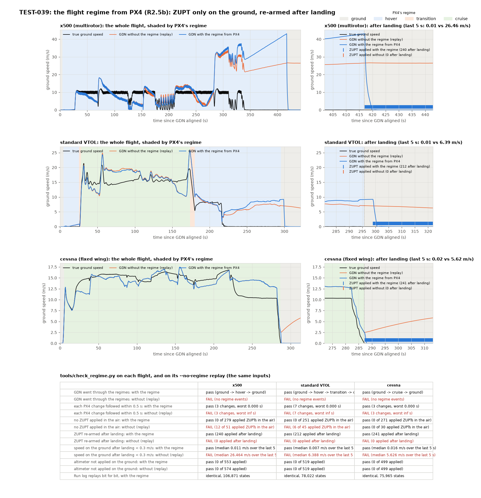

# TEST-039: the flight regime from PX4 (R2.5b)

**Question.** R2.5, second part (R2.5b, agreed): the flight regime (ground, hover,
transition, cruise) comes from the autopilot. The vehicle profile's rules say which
aiding each regime allows, as on/off rules with no noise tuning (agreed). GDN's one-way
airborne latch should give way to ZUPT that resumes after landing (R1.2's follow-up,
OI-012). Does GDN follow PX4's regime, and do the rules hold in flight?

**Answer, short.**
- **Yes, on one flight per airframe over Emmental.** GDN followed every one of PX4's
  regime changes in the same instant:
  - x500: ground, hover, ground;
  - standard VTOL: ground, hover, transition, cruise, transition, hover, ground;
  - cessna: ground, cruise, ground.
- **Zero-velocity updates only on the ground:** none applied in the air on any flight.
- **Re-armed after landing.** Each flight applied 212 to 241 zero-velocity updates after
  landing, and GDN's speed parked after landing was 0.011, 0.007 and 0.016 m/s (truth:
  zero).
- **The same inputs without the regime** (`gdn_replay --no-regime`, GDN as it ran before
  R2.5b), on the same three flights:
  - zero-velocity updates in the air: 12 (x500) and 6 (VTOL);
  - none after landing;
  - GDN still moving while parked: 26.5 m/s (x500), 6.4 m/s (VTOL), 5.6 m/s (cessna).
- **The altimeter is off on the ground,** per the profiles' rule; none applied.
- **Every run log replays bit for bit, with the regime:** 106,871, 78,022 and 75,965
  states.
- **What it doesn't fix:** in flight GDN still runs away on the multirotor (OI-012). The
  regime fixes the ground, not that: the x500's estimate reached 43 m/s with the regime
  and 26 m/s without, against a true 10.
- **The check, `tools/check_regime.py`, was written first;** it failed on R2.5a's three
  flights, where GDN didn't get PX4's regime (`check_on_main.txt`).



*TEST-039 (`tools/plot_test039.py`, from `test039_data/`).*
- *Per airframe, left: the whole flight shaded by PX4's regime:*
  - *black: the true ground speed;*
  - *blue: GDN's, with the regime;*
  - *orange: the replay of the same inputs without it.*
- *Right: the time after landing, close up, with each applied zero-velocity update. With
  the regime, GDN's speed drops to zero at touchdown and stays there; without it, ZUPT
  never comes back and the estimate keeps moving.*
- *Bottom: the check on each flight and on its replay without the regime.*

## How

- **The regime** (`gdn/flight_regime.hpp`), from PX4's `vehicle_land_detected` (`landed`,
  the detector's last stage) and `vehicle_status` (arming state, vehicle type, VTOL
  transition):

  | Regime | When |
  |---|---|
  | ground | landed or disarmed |
  | transition | in a VTOL transition |
  | cruise | airborne as a fixed wing |
  | hover | airborne on rotors |

  Until both messages have arrived, or with no autopilot (the bench), it's unknown.
- **The node** subscribes to both, logs them as inputs, and passes them to
  `gdn::NavCore`.
  - **Events:** each change is one ("regime: hover -> ground at t=... (PX4: ...)").
  - **State flags:** the regime is also in each state's flags (bits 4-6).
  - **Replay:** `gdn_replay` feeds the logged messages, so a run replays bit for bit.
    `--no-regime` replays the same inputs without them, as GDN ran before (a what-if).
- **The rules** (vehicle profile schema 2, `regime.<regime>.agl / .baro / .mag` for each
  regime and `regime.ground.zupt`, all required):
  - **How they combine:** an aiding is used when the profile's `aiding.*` switch is on and
    the current regime's rule allows it.
  - **ZUPT is the ground's alone:** a ZUPT rule for a flying regime is refused, since
    velocity is never zero in flight.
  - **All three profiles:** the altimeter off on the ground, where it reads under its
    minimum range, and everything else on.
  - **Schema 1 profiles (R2.5a)** read with these defaults. Their logs have no regime
    input, so they replay as they ran.
- **ZUPT.**
  - **With a regime:** only on the ground, when the IMU is still. In flight there's
    none, however still the IMU looks: a steady hover reads as parked to an IMU, as does
    the gentle climb in the selftest.
  - **At every landing** (PX4: landed, after flying), `GroundMonitor::Rearm` takes the
    still-reference from the filter's current attitude, so a vehicle landed at another
    tilt still reads as still, and clears the latch.
  - **Without a regime:** the IMU and its one-way latch decide, as before.
- **`sim_run.sh`** records PX4's land detector in the bag too.

## The check

`tools/check_regime.py --run LOG` reads a flight's GDN run log:
- **Inputs:** PX4's land detector and status are in it.
- **Regimes:** GDN went through this kind of vehicle's regimes, each PX4 change followed
  within 0.5 s.
- **ZUPT:** none applied while PX4 says airborne, and some applied after landing.
- **Speed:** GDN's median speed over the last 5 s on the ground is under 0.3 m/s.
- **Altimeter:** none applied on the ground.

`--px4-from` judges a `--no-regime` replay against the flight's own PX4 regime.

Two details of the check came from the x500's first run:
- **Before alignment:** GDN's clock reads 0 until static alignment, so its first
  "ground" is stamped t=0 and matches PX4's first regime.
- **A tie with PX4's change:** PX4 stamps its message with the IMU cycle's time, and GDN
  processes that IMU sample just before the message. An update at exactly the instant of
  a change belongs to the regime before.

`--selfcheck` covers:
- the regime table;
- take-off, landing and VTOL tracks;
- both details above;
- a whole made-up run passing, and one with a ZUPT in flight failing.

Selftest TEST-039 (7 cases):
- **PX4's fields:** the regime from them.
- **Profile rules:** read; ZUPT in flight, a missing rule and rules in a schema 1 file
  refused.
- **A synthetic flight that lands on a 2 deg slope:**

  | | With the regime | Without |
  |---|---|---|
  | ZUPT after landing | 238 | 0 |
  | ZUPT in the air | 0 | |
  | Final speed | 0.000 m/s | 0.166 m/s |

- **The altimeter:** not used on the ground, applied in the air.
- **A gentle climb an IMU reads as still:** no ZUPT with the regime, 45 without.
- **Without PX4 input:** the regime stays unknown.

## Results

| | x500 | standard VTOL | cessna |
|---|---|---|---|
| PX4's regime changes, GDN's worst lag | 3, 0.000 s | 7, 0.000 s | 3, 0.000 s |
| ZUPT applied in the air: with / without the regime | 0 of 279 / 12 of 51 | 0 of 251 / 6 of 45 | 0 of 271 / 0 of 30 |
| ZUPT applied after landing: with / without | 240 / 0 | 212 / 0 | 241 / 0 |
| GDN's speed parked after landing (last 5 s, truth 0): with / without | 0.011 / 26.464 m/s | 0.007 / 6.388 m/s | 0.016 / 5.626 m/s |
| Altimeter applied on the ground | 0 of 553 | 0 of 519 | 0 of 499 |
| Run log replayed with the regime | identical, 106,871 states | identical, 78,022 | identical, 75,965 |
| GDN's horizontal error, whole flight (RMS, for reference) | 1194 m | 223 m | 94 m |

- **The cessna had no ZUPT in the air even without the regime.** It accelerates down the
  runway, which sets the IMU's latch at once. The rotorcraft lift off gently enough for
  the IMU to read "still" for the first moments.
- **Without the regime, the altimeter wasn't applied on the ground either.** The radar
  reads under its minimum range when parked, so the rule only makes that explicit.
- **The other checks pass:**
  - the run-log check (`log_check.txt`, including R2.5a's profile run);
  - the profiles check;
  - every code-quality gate (format, warnings as errors, cppcheck, clang-tidy,
    sanitizers);
  - the selftest (`selftest_test039.txt`).

Data in `test039_data/`:
- `sitl_<airframe>.txt`: the node's regime events, the flight, the scorer, the check on
  the flight and on its `--no-regime` replay, and the replay results;
- per airframe: GDN's states and ZUPT times with and without the regime, PX4's regime
  track, and the true ground speed (CSV);
- `check_on_main.txt`, `selftest_test039.txt` and `log_check.txt`.

## Not in scope, and limits

- **The in-flight runaway is untouched.** On the multirotor GDN still drifts to
  kilometres (OI-012). Flights with and without the regime diverge in the air: their
  starts differ by the take-off ZUPTs, and on a filter this sensitive the gap grows. One
  flight can't rank them (OI-012).
- **No noise or tuning per regime** (agreed): the rules only switch aiding on and off.
- **The Monte Carlo has no autopilot,** so it runs without a regime, as before.
- **PX4's land detector decides "landed".** A fixed-wing still rolling slowly after
  touchdown could read as landed. GDN's IMU stillness test still has to agree before a
  ZUPT, so a constant-speed roll would be the remaining risk; real-flight logs (Phase 6)
  will show whether it matters.
- **A vehicle re-parked at a different tilt before take-off** still reads as moving
  until it lands once. Only a landing re-arms ZUPT.

## Reproduce

```bash
python3 tools/check_regime.py --selfcheck && python3 tools/check_profiles.py
colcon build --base-paths src --cmake-args -DCMAKE_BUILD_TYPE=Release
GDN_ROOT=$PWD ./build/gdn_fusion/gdn_selftest | grep TEST-039
# SITL (dev image, --gpu), per airframe:
HEADLESS=1 GDN_VEHICLE=standard_vtol GDN_SITE=ch_emmental GDN_LOG_DIR=log/t039_vtol \
  GDN_FLY_ARGS="--legs 2 --leg-len 800" tools/sim_run.sh
python3 tools/check_regime.py --run log/t039_vtol
RUN=$(grep -o "run log: [^ ]*" log/t039_vtol/gdn.log | cut -d' ' -f3)
ros2 run gdn_fusion gdn_replay $RUN                                    # IDENTICAL
ros2 run gdn_fusion gdn_replay $RUN --no-regime --out=log/t039_vtol.noregime
python3 tools/check_regime.py --log log/t039_vtol.noregime --vehicle standard_vtol --px4-from $RUN
python3 tools/plot_test039.py docs/test_reports/test039_data --export log     # (the batch's dirs)
python3 tools/plot_test039.py --out docs/test_reports/test039_regime.png
```
