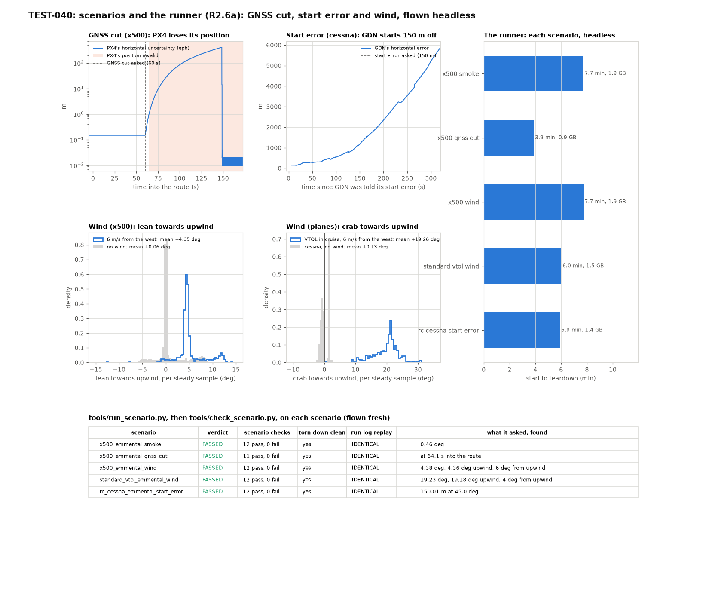

# TEST-040: scenarios and the runner (R2.6a)

**Question.** R2.6, first part (R2.6a, agreed): a scenario is a file naming one SITL
flight. A runner flies it headless, records everything, tears down cleanly and says
whether it did what was asked: the SITL counterpart of `bench.sh`. The file names:
- vehicle, world, route, height and speed;
- when GNSS is lost (here a cut);
- a start error for GDN;
- a steady wind.

The runner wraps `tools/sim_run.sh` (agreed). Spoofing, sensor faults and lighting are
R2.6b. Does each scenario do what it says?

**Answer, short.**
- **Yes, all five scenarios, flown fresh by `tools/run_scenario.py`:**
  - **x500 smoke:** no loss, no wind.
  - **x500 GNSS cut:** PX4 lost its position 64.1 s into the route; the cut was asked at
    60 s, and PX4 takes about 4 s to give up.
  - **x500 in a 6 m/s west wind:** it leaned 4.4 deg upwind to hold its track; over the
    whole route without wind, 0.46 deg.
  - **VTOL in the same wind:** it crabbed 19.2 deg upwind in cruise, about asin(6/17)
    for its airspeed. The wings' own model feels the wind.
  - **cessna with a start error:** GDN started 150.01 m from the truth at 45.0 deg, as
    asked (150 m at 45 deg).
- **Each run:**
  - torn down clean, with nothing of the simulation left running;
  - bag and run log written (0.9 to 1.9 GB);
  - its run log replays bit for bit, the start error included;
  - finished in 4 to 8 minutes.
- **The check, `tools/check_scenario.py`, was written first.** Judging R2.5b's flights
  against the scenarios, it found the 4 things they didn't do (`check_on_main.txt`):
  - no wind in the world;
  - no lean into one;
  - GNSS never lost;
  - GDN started at the truth instead of 150 m off.
- **What the start error shows about GDN:** from 150 m it never found itself on the map,
  and its error grew to 5.7 km. That's the known limit, not a runner fault: in the Monte
  Carlo, 150 m start errors fail in half the flights or more (R1.7) until R4.1's
  acquisition. The runner can now reproduce it in SITL; R2.7 will score such runs.



*TEST-040 (`tools/plot_test040.py`, from `test040_data/`).*
- *Top:*
  - *the GNSS cut: PX4's horizontal uncertainty, the asked cut dashed;*
  - *the start error: GDN's distance from the truth from the moment it's told 150 m;*
  - *the runner's time and recording per scenario.*
- *Middle: the wind, per steady route sample:*
  - *the x500's lean towards upwind, with and without wind;*
  - *the VTOL's crab in wind against the cessna's without.*
- *Bottom: the runner and the check on each scenario.*

## How

- **The scenario file** (`config/scenarios/<name>.yaml`, format and reader in
  `tools/scenario.py`):
  - **What it names:**
    - `vehicle`, `world`;
    - `route`: legs, leg length, spacing, clearance over the terrain, speed, launch;
    - `gnss`: `none`, or `cut` with `at_s` into the route;
    - `start_error`: distance and bearing;
    - `wind`: speed, and where it blows from;
    - `limits.timeout_s`.
  - **Checking:** every key is checked, unknown and missing ones are errors, and values
    must be in range. The pattern must stay within 1,800 m of the pad, since the worlds
    are 4 km across.
  - **Commands:** `--list` lists the scenarios; `--check` reads them all, as CI does.
- **The runner** (`tools/run_scenario.py`):
  1. **Setup:** a run directory with a copy of the scenario.
  2. **The flight:** `tools/sim_run.sh` with the scenario's settings, headless, in its own
     process group, under the time limit (past it: Ctrl+C so `sim_run.sh` tears down,
     then kill).
  3. **Teardown:** no simulation process may be left; anything found is stopped and the
     run fails.
  4. **The recording:** the bag and GDN's run log, which must replay bit for bit
     (`gdn_replay`).
  5. **The verdict:** `tools/check_scenario.py`.

  `result.json` holds each step; the exit code says whether all passed.
- **The GNSS cut:** Stage B's (`GPS_OFF_AT`: PX4's `EKF2_GPS_CTRL` 0).
- **The start error** (`GDN_START_ERROR`; node parameters `start_error_north_m` and
  `start_error_east_m`):
  - **When:** once GDN's heading is aligned, its position moves by that much.
  - **Uncertainty:** it's told sigma = max(distance, 10 m) per axis, as
    `mc_campaign --start-error`.
  - **Replay:** the run log carries it (`gdn_msgs/StartError`, after `RunInfo`), so
    `gdn_replay` applies it.
- **Wind** (`GDN_WIND`, `tools/sim_wind.py`). PX4 doesn't load Gazebo's wind system and
  its models don't take part, so the run's own copies are changed:
  - **The world:** gets `<wind>`, which Gazebo's lift-drag model reads. The cessna's and
    the VTOL's wings fly through moving air.
  - **The x500:** has no aero model. The run's server config loads Gazebo's wind effects,
    and a copy of PX4's `x500_base` has `enable_wind` on its body. Gazebo then pushes it
    with `mass x 0.1/s x (wind - velocity)`, a linear drag.

## The check

`tools/check_scenario.py --run RUN` (with `--scenario FILE` for any `sim_run.sh`
directory):
- **The run:** the vehicle and world are the scenario's, and PX4 landed within the time
  limit.
- **The route:** its planned length within 1% of the legs, leg length and spacing asked,
  and never lower than the clearance over the terrain.
- **GNSS** (PX4's own estimate in GDN's run log, airborne only):
  - with a cut: lost no earlier than asked and within 30 s of it;
  - without one: never lost.
- **The start error:** once heading is aligned, GDN is the asked distance (1 m) and
  bearing (2 deg) from the truth; with none, within 5 m.
- **Wind:** the world carries it (and, on the x500, the wind effects system). The
  vehicle answers on steady route flight:
  - **x500:** the thrust axis, minus the lean its own acceleration explains, at least
    1.5 deg upwind.
  - **Planes:** the nose at least 5 deg upwind of the track.
  - **Without wind:** at most 1 and 3 deg, judged only when the whole route was flown.
    Rotor drag leans a multirotor along its travel, so only legs that cancel give a
    fair "no wind" number.
- **The recording, replay and teardown,** from `result.json`.

`--selfcheck` tests the geometry on made-up data:
- the lawnmower's length;
- bearings and angle differences;
- the thrust axis and heading from a quaternion;
- a 2 deg lean found in a made-up run.

Selftest TEST-040 (2 cases):
- **Asked:** GDN moves exactly 100 m north and 50 m east at heading alignment, told
  sigma 111.8 m.
- **Not asked:** nothing moves; a 5 m error is told the 10 m floor.

## Results

| Scenario | Verdict | What it asked, found | Run | Recording |
|---|---|---|---|---|
| x500_emmental_smoke | passed | no wind: 0.46 deg lean over the route | 7.7 min | 1.9 GB, replays identically |
| x500_emmental_gnss_cut | passed | PX4 lost GPS 64.1 s into the route (asked 60 s) | 3.9 min | 0.9 GB, identical |
| x500_emmental_wind | passed | 4.38 deg lean, 6 deg from upwind | 7.7 min | 1.9 GB, identical |
| standard_vtol_emmental_wind | passed | 19.23 deg crab, 4 deg from upwind | 6.0 min | 1.5 GB, identical |
| rc_cessna_emmental_start_error | passed | GDN 150.01 m off at 45.0 deg; no wind: 0.15 deg crab | 5.9 min | 1.4 GB, identical |

- **Every run:** all scenario checks passed, it was torn down clean, and its run log
  replays bit for bit.
- **The gates:** the run-log check, the selftest, and every code-quality gate (format,
  warnings as errors, cppcheck, clang-tidy, sanitizers) pass.
- **GDN's own errors** on these flights are R2.7's to score. The 150 m start error ran
  away to 5.7 km (2.6 km RMS), as the Monte Carlo predicts for that start error.

Data in `test040_data/`, per scenario:
- `result.json`, `check.txt`, `scenario.yaml`;
- PX4's eph (the cut), GDN's error (the start error), and the lean or crab per sample.

Also `check_on_main.txt`, `selftest_test040.txt` and `log_check.txt`.

## Found on the way

- **PX4 1.16 has no wind in Gazebo.** It doesn't load Gazebo's wind system, and its
  models don't opt in. Gazebo's lift-drag model does read the world's wind, which is
  enough for the planes. The x500 has no aero model and needs the wind system's drag.
- **A no-wind lean test needs a whole route.** The x500's own rotor drag leans it 4.6
  deg along its travel at 10 m/s; legs flown both ways cancel it. Before a GNSS cut,
  only one direction has been flown, so "no wind" isn't judged there.
- **The x500 has a small lean of its own,** about 0.5 deg, the same way every leg.
  Hence the 1 deg limit without wind and the 1.5 deg needed with it.
- **The first check counted pre-take-off GPS samples,** while PX4's position was still
  settling, as "lost". Like `check_gps_cut.py`, it now judges only the airborne part.
- **The wind limits were set from a first set of flights,** then judged on a fresh set
  (the results above): 4.38 against 4.36 deg, 19.23 against 19.33 deg. The simulation
  repeats closely.

## Not in scope, and limits

- **R2.6b:** GNSS spoofing (agreed: MAVLink `GPS_INPUT`), sensor faults on GDN's inputs
  (agreed), lighting.
- **Scoring GDN** on each run (CEP, integrity, time to acquire) is R2.7; the scenario
  matrix is R2.8.
- **The x500's wind is a drag approximation,** not airflow. The VTOL's hover phases feel
  no wind; its cruise does, through its wings.
- **Steady wind only:** no gusts or turbulence yet. Gazebo's wind system can add noise,
  for a later scenario field.

## Reproduce

```bash
python3 tools/scenario.py --check && python3 tools/check_scenario.py --selfcheck
colcon build --base-paths src --cmake-args -DCMAKE_BUILD_TYPE=Release
GDN_ROOT=$PWD ./build/gdn_fusion/gdn_selftest | grep TEST-040
tools/docker_dev.sh run --gpu -- tools/run_scenario.py config/scenarios/*.yaml --out log/r26a/final
tools/docker_dev.sh run -- python3 tools/plot_test040.py docs/test_reports/test040_data --export log/r26a/final
python3 tools/plot_test040.py --out docs/test_reports/test040_scenarios.png
```
