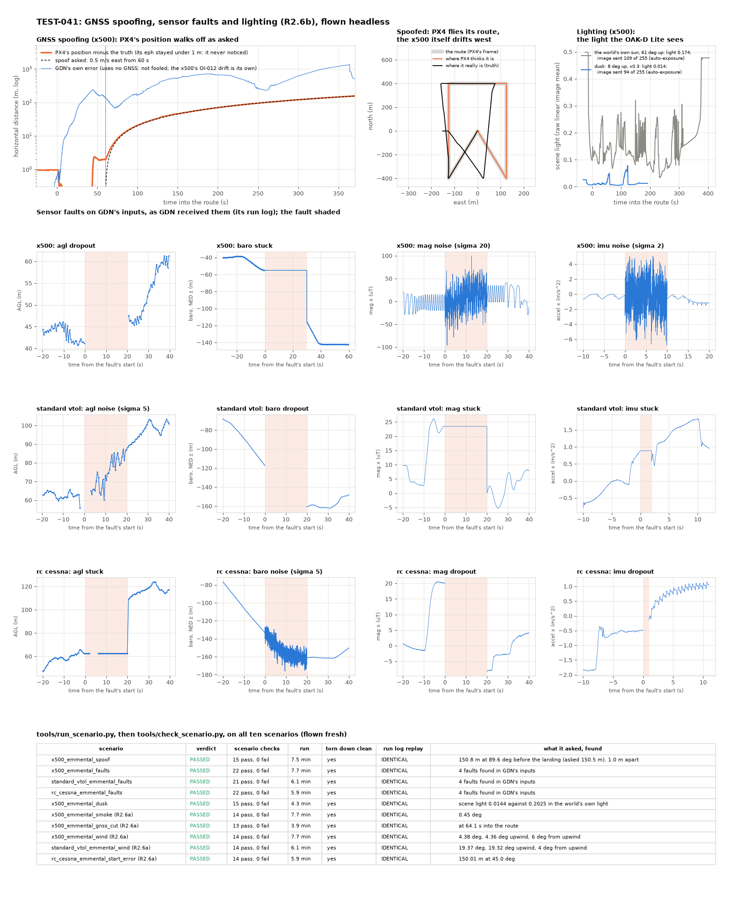

# TEST-041: GNSS spoofing, sensor faults and lighting (R2.6b)

**Question.** R2.6, second part (R2.6b, agreed). A scenario file can now also name:
- slow GNSS spoofing drift (agreed: through MAVLink, replacing Gazebo's GPS);
- sensor faults on GDN's inputs (agreed): dropouts, stuck values and noise bursts on the
  altimeter, baro, magnetometer and IMU;
- lighting: the sun's direction and strength.

Does each one do what the scenario says? And, as before, does every run record, replay
and tear down cleanly?

**Answer, short.**
- **Yes. All ten scenarios passed,** flown fresh by `tools/run_scenario.py`: the five new
  ones and R2.6a's five again.
- **Spoofing (x500):**
  - **What was asked:** from 60 s into the route, PX4's GPS walked off east at 0.5 m/s.
  - **What PX4 did:** its position followed. Before the landing it was 150.8 m at 89.6 deg
    from the truth, against 150.5 m at 90 deg asked.
  - **It never noticed:** its position stayed valid, eph under 1 m. Flying its spoofed
    route, the x500 itself drifted 150 m west.
  - **GDN** uses no GNSS, so it isn't fooled.
- **Sensor faults:** twelve, four per airframe, so every sensor met every kind.
  - **Each was switched on within 0.04 s of the time asked.**
  - **Each shows in GDN's own record of its inputs (the run log):**
    - a dropout's window empty;
    - a stuck value constant at the last reading before it;
    - a noise burst near its sigma: 19.6 uT asked 20, 2.01 m/s^2 asked 2, 4.79 m asked 5.
      The altimeter's measured 3.5 m against 5 asked, from only 33 readings at 2 Hz.
  - **The IMU relay** in front of GDN passed 100% of PX4's IMU samples outside the
    faults.
- **Lighting (x500):** at dusk (sun 8 deg up, 0.3 of the light) the left camera saw
  0.0144 of full scale. It saw 0.2025 in the world's own light on the same route: 7%.
  Its auto-exposure still sent images at 94 of 255 against 108.
- **What the faults show about GDN (OI-017, new):**
  - **It has no fault detection of its own.** It applied every stuck baro and altimeter
    reading.
  - **A 30 s stuck baro locked GDN's baro out for good:**
    - when the real readings came back 71 m off, its gate rejected every one to the end;
    - its vertical then ran free;
    - its horizontal error reached 18 km, against 1.6 km without faults.
  - **A 1 s IMU dropout was skipped,** not propagated.
- **The check was written first.** Judging R2.6a's flights from main against the new
  scenarios, it found what they lacked (`check_on_main.txt`):
  - PX4's position never walked off (1.0 m at the landing, 157 m asked);
  - no fault was ever switched on;
  - the world had its own sun, and no camera light was recorded.



*TEST-041 (`tools/plot_test041.py`, from `test041_data/`).*
- *Top:*
  - *the spoof: PX4's position minus the truth against the asked offset, and GDN's own
    error;*
  - *the tracks: the route, where PX4 thinks it is, where it is;*
  - *the light the OAK-D Lite saw in the world's own light and at dusk.*
- *Middle: each fault in GDN's inputs as it received them, the fault shaded (dropouts
  drawn as gaps).*
- *Bottom: the runner and the check on all ten scenarios.*

## How

- **The scenario file** (`tools/scenario.py`; the new keys are optional, so R2.6a's
  files read unchanged):
  - **`gnss`:** `loss: spoof` with `at_s`, `rate_mps` and `bearing_deg`;
  - **`faults`:** a list, each with sensor, kind, `at_s`, `duration_s`, and for noise
    `sigma` (and `sigma_gyro` for the IMU). Overlapping faults on one sensor are refused;
  - **`lighting`:** `sun_elevation_deg`, `sun_azimuth_deg`, `intensity`.
- **The clock:** all three count from the route's start, as the GNSS cut does.
  `sim_fly.py` now publishes it once on `/gdn/sim/route_start` (reliable, transient
  local).
- **Spoofing** (`GDN_SPOOF="at_s rate bearing"`, `tools/sim_spoof.py`):
  - **The relay:** reads Gazebo's own GPS (the navsat sensor PX4's `gz_bridge` reads,
    through gz-transport) and sends each fix to PX4 as MAVLink `HIL_GPS`, at 30 Hz, with
    the accuracy `gz_bridge` reports.
  - **PX4's settings:** set at its boot (`PX4_PARAM_*`) on every run, both ways, since
    PX4 keeps its parameters between runs:
    - `MAV_USEHILGPS` 1, so it takes `HIL_GPS` outside HIL mode;
    - `SIM_GPS_USED` 0, so its own Gazebo GPS has no fix, and PX4 picks the receiver
      with the best fix.
  - **The spoof:** from `at_s`, the reported position walks off at `rate` towards
    `bearing`, and the reported velocity carries the same drift. Position and velocity
    agree, so the innovations stay small.
  - **Why not `GPS_INPUT`, as agreed:** the trial found PX4 1.16 has no handler for it.
    It takes `HIL_GPS` only, and only from its own system id. The approach is the same:
    a MAVLink GPS replacing Gazebo's.
- **Sensor faults** (`GDN_FAULTS`, `tools/sim_faults.py`):
  - **Where:** the adapter applies them to what it publishes for GDN: the altimeter,
    baro and magnetometer.
  - **The IMU:** an IMU fault relays PX4's `/fmu/out/sensor_combined` through the adapter
    (`/gdn/sim/imu_relay`), and `eskf_node` is remapped to it. GDN's run log still names
    the input `/fmu/out/sensor_combined`, so replays are unchanged.
  - **The kinds:** dropout publishes nothing; stuck repeats the last value before it;
    noise adds Gaussian noise.
  - **PX4 flies on its own sensors,** untouched.
  - **The record:** each fault's start and end, by the schedule, goes out on
    `/gdn/sim/fault` and into the bag.
- **Lighting** (`GDN_LIGHTING`, `tools/sim_light.py`):
  - **The world:** the run's copy gets the sun's direction, and its diffuse and
    specular light, the ambient and the sky are scaled by the intensity.
  - **The measure:** the adapter publishes `/gdn/sim/scene_light`, the mean of the left
    camera's raw linear Gazebo image. It also publishes `/gdn/sim/image_brightness`, the
    image the simulated camera sends after its auto-exposure (R2.4b).

## The check

`tools/check_scenario.py` (R2.6a's checks, plus):
- **Spoofing:** PX4's position minus the truth, from its own estimate in GDN's run log.
  The frames' constant offset is taken out, as found before the spoof.
  - **Before the spoof:** within 3 m.
  - **Before the landing:** within 5 m or 10% of the asked offset, and 10 deg of its
    bearing.
  - **Noted:** whether PX4 noticed.
- **Faults,** each one:
  - **Switched on:** the adapter's event within 1 s of the time asked.
  - **In GDN's inputs (its run log):**
    - a dropout's window empty, with samples on both sides;
    - a stuck value constant and equal to the last one before, varying outside;
    - a noise burst at least 0.6 of its sigma and twice the sensor's own noise.

    The noise is a robust estimate from first differences.
  - **An IMU relay:** passed at least 98% of PX4's samples on outside its dropouts.
  - **Without faults:** none switched on.
- **Lighting:**
  - **The world:** the run's world has the sun asked, or the world's own.
  - **The light:** the camera's scene light at most ref x (1 - 0.5 (1 - k)) for
    intensity k. The reference is 0.2025: the x500 over Emmental, world's own light, the
    dusk route, from the first flights.

`--selfcheck` adds made-up series:
- a 20 s dropout, a stuck value and a sigma 2 noise burst, each found where it is, and
  not where it isn't;
- a spoof's offset found against the truth, with a 30 m frame offset taken out.

`tools/sim_faults.py --selfcheck` tests the fault logic and its string form. CI runs
both.

## Results

| Scenario | Asked | Found | Run |
|---|---|---|---|
| x500_emmental_spoof | GPS walks off east at 0.5 m/s from 60 s | 150.8 m at 89.6 deg before the landing (asked 150.5 m); within 2.4 m of the truth before; PX4 never noticed | 7.5 min |
| x500_emmental_faults | agl dropout, baro stuck, mag noise 20 uT, IMU noise 2 m/s^2 | each on within 0.03 s and in GDN's inputs; IMU relay 100% | 7.7 min |
| standard_vtol_emmental_faults | agl noise 5 m, baro dropout, mag stuck, IMU stuck 2 s | each on within 0.03 s and in GDN's inputs; IMU relay 100% | 6.1 min |
| rc_cessna_emmental_faults | agl stuck, baro noise 5 m, mag dropout, IMU dropout 1 s | each on within 0.04 s and in GDN's inputs; IMU relay 100% | 5.9 min |
| x500_emmental_dusk | sun 8 deg up at 250 deg, x0.3 | world's sun as asked; scene light 0.0144 (0.2025 in the world's own); image 94 of 255 | 4.3 min |
| R2.6a's five | as TEST-040 | GNSS lost at 64.1 s; lean 4.38 deg; crab 19.37 deg; start 150.01 m at 45.0 deg | 3.9 to 7.7 min |

- **Every run:** all checks passed, it was torn down clean, and its run log replays bit
  for bit.
- **No C++ changed,** so GDN's code-quality gates are as R2.6a's.

### What GDN did with the faults

From its own update decisions and events (`test041_data/gdn_response.txt`):

| Fault | GDN |
|---|---|
| altimeter dropout 20 s (x500) | no updates, resumed after |
| altimeter stuck 20 s (cessna) | applied all 32 stuck readings |
| altimeter noise 5 m (VTOL) | applied all 33 |
| baro stuck 30 s (x500) | applied all 1500; then gated every real reading to the end of the flight (15,196): its vertical ran free and the error reached 18 km (1.6 km without faults) |
| baro noise 5 m (cessna) | applied 959 of 1000 |
| baro dropout 20 s (VTOL) | no updates, resumed after |
| mag noise 20 uT (x500) | gated 1331 of 2000, applied 667 |
| mag stuck 20 s (VTOL) | gated 1593 of 2000, applied 407 |
| mag dropout 20 s (cessna) | no updates, resumed after |
| IMU noise 2 m/s^2, 0.05 rad/s (x500) | no event |
| IMU stuck 2 s (VTOL) | no event |
| IMU dropout 1 s (cessna) | "IMU sample dropped: dt 1.008 s": the second skipped, not propagated |

That's OI-017 (new). GDN has no fault detection of its own, no recovery from a run of
gate rejections, and skips an IMU gap over 0.25 s. R4.x's integrity work is where
it's fixed; these scenarios are how it'll be judged. The whole-run errors are R2.7's
to score, and on the x500 they're mostly OI-012's own drift.

Data in `test041_data/`:
- per scenario: `result.json`, `check.txt`, `scenario.yaml`;
- the spoof: `x500_emmental_spoof_spoof.csv` (PX4's offset, the asked offset, GDN's
  error, tracks) and its `route.csv`;
- the faults: `*_fault_<sensor>.csv` (GDN's input around each fault);
- the light: `*_light.csv`;
- `gdn_response.txt`, `check_on_main.txt`, `selfchecks.txt`,
  `first_vtol_faults_check_fail.txt`.

## Found on the way

- **PX4 1.16 has no MAVLink `GPS_INPUT` handler.** The trial flight found it; `HIL_GPS`
  with `MAV_USEHILGPS` does the same job.
- **PX4 keeps its parameters between runs.** `MAV_USEHILGPS` and `SIM_GPS_USED` are set
  at every boot, both ways, so a spoof run doesn't leave the next run without Gazebo's
  GPS.
- **The simulated camera's auto-exposure hides the light.** The image sent went from
  108 to 94 of 255 at 0.3 of the light. The scene light is the measure; the image isn't.
- **A fault's start was first tied to the sensor's samples.** The VTOL's altimeter was
  silent 30 to 32.8 s into the route, just after its front transition, so the "on"
  event came 2.8 s late and the first batch's check failed
  (`first_vtol_faults_check_fail.txt`). Events now follow the schedule (20 Hz). The
  VTOL faults scenario, and then the x500's and the cessna's, were flown again with
  that, and those are the results above.
- **The VTOL's route window starts at its front transition** (R2.6a's wind check).
  Spoof and fault times count from the route's start, so they now use
  `/gdn/sim/route_start`.

## Not in scope, and limits

- **R2.7 / R2.8:** scoring GDN per run; the scenario matrix.
- **The spoof is one kind:** a steady walk-off with matching velocity. Jumps,
  accelerating drift and time spoofing are further scenario fields.
- **The faults are on GDN's inputs,** not on the simulated drivers or on PX4's own
  sensors (agreed).
- **Lighting changes only what the cameras see.** GDN uses no camera until Phase 3, and
  there's no shadow or time-of-day model beyond the sun's direction and strength. The
  reference light is one vehicle, world and route.

## Reproduce

```bash
python3 tools/scenario.py --check && python3 tools/check_scenario.py --selfcheck && python3 tools/sim_faults.py --selfcheck
tools/docker_dev.sh run --gpu -- tools/run_scenario.py config/scenarios/*.yaml --out log/r26b/final
tools/docker_dev.sh run -- python3 tools/plot_test041.py docs/test_reports/test041_data --export log/r26b/final
python3 tools/plot_test041.py docs/test_reports/test041_data --out docs/test_reports/test041_faults_spoofing.png
```
