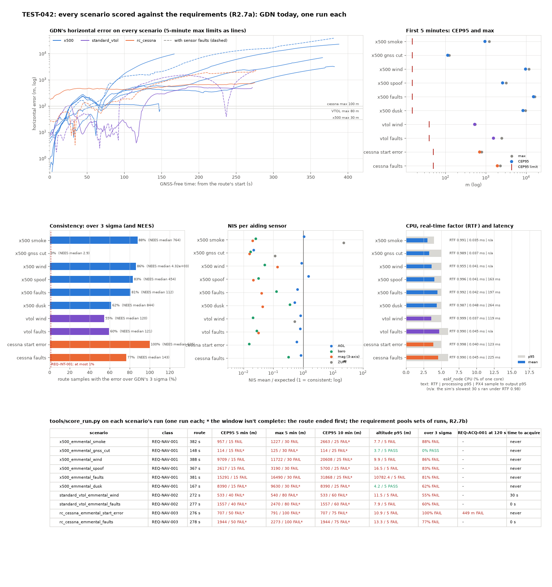
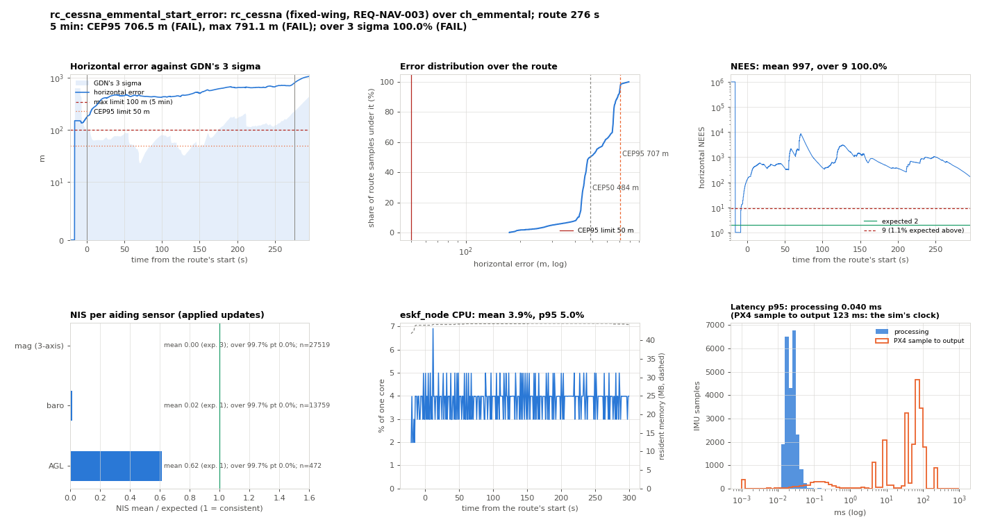

# TEST-042: every SITL run scored against the requirements (R2.7a)

**Question.** R2.7, first part (R2.7a, agreed): from each run, compute:
- CEP50 and CEP95, the maximum error, and the error against the requirement;
- NEES and NIS;
- time to acquire;
- CPU and latency.

Write a short report per run with plots. Where does GDN stand today on the ten R2.6
scenarios? (Integrity rates and the comparison against an accepted baseline are R2.7b,
agreed.)

**Answer, short.**
- **The scorer:** `tools/score_run.py` now scores every run `tools/run_scenario.py`
  flies. It writes `metrics.json`, `report.md` and `report.png` into the run directory.
  - **Checked on made-up data with known answers:** CEP50 and CEP95 of a circular
    Gaussian within 0.02 m and 0.01 m; NEES of honest errors 1.998, against 2; NIS 0.997,
    against 1.
  - **Cross-checked on real runs:** its whole-route maximum matched the runs' own
    `replay_scorer` to within a metre where both cover the same span (2273 against
    2274 m, 125 against 124 m).
- **GDN fails every accuracy requirement on all ten flights,** as expected before
  Phase 3:
  - **The x500:** a 5-minute CEP95 of 114 m to 15 km, against 15 m.
  - **The VTOL:** 533 m and 1.6 km, against 40 m.
  - **The cessna:** 707 m and 1.9 km, against 50 m.

  This is OI-012's drift, now on one scale for every scenario. The cessna's 150 m start
  wasn't acquired: 449 m at 120 s, against 100 m (REQ-ACQ-001).
- **Consistency fails too:** 55 to 100% of samples over GDN's own 3 sigma, against at
  most 1%. The exception is the short x500 GNSS-cut flight, at 0% with a NEES median
  of 2.9.
- **New, OI-018:** GDN's baro and magnetometer innovations are 5 to 30 times smaller
  than it predicts (NIS 0.001 to 0.36 of expected). On the long flights the altimeter's
  is about right (0.5 to 1.5), so the baro and magnetometer noise settings look too
  large.
- **The cost is small:**
  - `eskf_node` used 3.0 to 4.7% of one core on average (6% at p95), and at most 48 MB;
  - it processes an IMU sample in 0.035 to 0.048 ms at p95.
- **Found on the way:** on battery in power-saver mode, Gazebo ran at 0.86 of real
  time. PX4's clock, which is Gazebo's, then kept falling out of sync with the PC's:
  - its timestamps jumped, and GDN dropped IMU samples;
  - the latency from PX4's sample measured the drift, not a latency.

  Every run's score now states the real-time factor; these flights ran at 0.955 to
  0.999.



*TEST-042 (`tools/plot_test042.py`, from `test042_data/`).*
- *Top:*
  - *GDN's horizontal error on every scenario, from the route's start, with each class's
    5-minute max limit;*
  - *the first five minutes' CEP95 and max against the CEP95 limit.*
- *Middle:*
  - *consistency: the share of samples over GDN's 3 sigma, and the NEES median;*
  - *the NIS per aiding sensor against its expected value;*
  - *CPU, with the real-time factor and the latency per run.*
- *Bottom: the scorecard.*

Each run also gets its own one-page report. An example, the cessna's 150 m start error
(`test042_example_report.png`):



## How

`tools/score_run.py RUN_DIR`. `tools/run_scenario.py` calls it after its check, and it
can be run again on any run. The definitions are those of `docs/requirements.md` and
`mc_campaign`, so SITL and the Monte Carlo score alike.
- **The clock (agreed):** GNSS-free time counts from the route's start, the clock of
  the scenario's cuts, spoofing and faults. GDN uses no GNSS in SITL at all. The windows
  are the first 300 and 600 s, cut at the landing; a window cut short is marked.
- **Accuracy:**
  - **What:** GDN's position from its run log (its state after every input, taken at
    10 Hz), against Gazebo's true pose in the bag. CEP50, CEP95 and max per window.
  - **The limits:** the vehicle class's REQ-NAV limits, read from the requirements
    document by `score_requirements.read_limits`: x500 multirotor REQ-NAV-001, VTOL
    quadplane REQ-NAV-002, cessna fixed-wing REQ-NAV-003.
  - **Altitude:** p95 for REQ-NAV-010, GDN's NED down against the adapter's truth. Both
    start from the pad's map height and agreed within 0.2 m on the pad.
- **Consistency:**
  - **Over 3 sigma (REQ-INT-001):** the error over 3 x sqrt(P_nn + P_ee), as
    `mc_campaign`.
  - **NEES:** the 2-D err' P^-1 err, from the north-east covariance in the run log
    (expect a mean of 2, and 1.1% over 9).
  - **NIS:** per aiding sensor, from GDN's own records of its applied updates, against
    the innovation's dimension, plus the share over the chi-square 99.7% point.
- **Time to acquire:** until the error stays under the class's 5-minute max limit for
  30 s. REQ-ACQ-001 (the error 120 s into the route) is judged when the scenario asks a
  start error.
- **CPU and memory:** the runner samples `eskf_node`'s `/proc` once a second while the
  run flies (`cpu.csv`).
- **Latency, from GDN's run log, per IMU sample:**
  - **processing** (state written minus input received, both on the PC's clock): the
    headline;
  - **PX4 sample to output:** a diagnostic only in SITL (see "Found on the way").
- **The real-time factor:** Gazebo's time against the wall clock, from the truth's
  stamps and the bag's receive times, over 30 s windows.
- **The map condition (REQ-DB-002):** the Emmental site runs GDN on GLO-30 against a
  swisstopo world, an independent map, so these scores count. The old Zermatt world
  would only be a regression check.
- **The report:** `report.md` (the scorecard and every measure) and `report.png` (six
  panels), per run.

`--selfcheck` (CI) tests the metrics on made-up data with known answers:
- CEP50 and CEP95 of a circular Gaussian (11.79 and 24.47 m, against 11.77 and 24.48);
- NEES of honest 2-D errors: mean 1.998, 1.09% over 9;
- a covariance that isn't positive definite gives infinite NEES;
- the windows, cut at the landing;
- time to acquire, and "never";
- NIS of honest 1-D innovations: mean 0.997, 0.28% over the 99.7% point.

## Results

Ten scenarios flown fresh on mains power, one run each. Each cell gives the measure,
with its limit in brackets. A star means the route ended before 5 minutes, so the
window isn't complete.

| Scenario | Route | CEP95, 5 min | Max, 5 min | Altitude p95 | Over 3 sigma | CPU mean / p95 | Processing p95 | RTF |
|---|---|---|---|---|---|---|---|---|
| x500_emmental_smoke | 382 s | 957 m (15) | 1227 m (30) | 7.7 m (5) | 88% (1) | 3.0% / 4% | 0.035 ms | 0.991 |
| x500_emmental_gnss_cut | 148 s | 114 m* (15) | 125 m* (30) | 3.7 m (5) | 0% (1) | 3.3% / 5% | 0.037 ms | 0.989 |
| x500_emmental_wind | 388 s | 9709 m (15) | 11722 m (30) | 9.9 m (5) | 86% (1) | 3.6% / 5% | 0.041 ms | 0.955 |
| x500_emmental_spoof | 367 s | 2617 m (15) | 3190 m (30) | 16.5 m (5) | 83% (1) | 4.0% / 5% | 0.041 ms | 0.996 |
| x500_emmental_faults | 381 s | 15291 m (15) | 16490 m (30) | 10782.4 m (5) | 81% (1) | 4.5% / 5% | 0.042 ms | 0.992 |
| x500_emmental_dusk | 167 s | 8390 m* (15) | 9630 m* (30) | 4.2 m (5) | 62% (1) | 4.3% / 5% | 0.048 ms | 0.987 |
| standard_vtol_emmental_wind | 272 s | 533 m* (40) | 540 m* (80) | 11.5 m (5) | 55% (1) | 3.6% / 5% | 0.037 ms | 0.999 |
| standard_vtol_emmental_faults | 277 s | 1557 m* (40) | 2470 m* (80) | 7.9 m (5) | 60% (1) | 4.7% / 6% | 0.045 ms | 0.990 |
| rc_cessna_emmental_start_error | 276 s | 707 m* (50) | 791 m* (100) | 10.9 m (5) | 100% (1) | 3.9% / 5% | 0.040 ms | 0.998 |
| rc_cessna_emmental_faults | 278 s | 1944 m* (50) | 2273 m* (100) | 13.3 m (5) | 77% (1) | 4.6% / 6% | 0.045 ms | 0.990 |

- **Scenario checks:** all ten passed. The spoof passed after the re-check described
  below.
- **Each run:** torn down clean, and its run log replays bit for bit.
- **Accuracy:** no run meets any REQ-NAV limit, so GDN fails on all three classes. The
  x500's own spread is wide: on the same route, the smoke flight scored 957 m and the
  wind flight 9.7 km. That's why R2.7b's baseline needs several runs per scenario.
- **Altitude:** two short flights meet REQ-NAV-010 (3.7 and 4.2 m). The x500 faults
  flight's 10.8 km is OI-017's stuck-baro lockout.
- **Acquisition:** the cessna's 150 m start error grew to 449 m at 120 s (REQ-ACQ-001
  needs 100 m) and was never acquired.
- **NIS:** see OI-018 (new). In short:
  - the baro and 3-axis magnetometer at 0.001 to 0.36 of expected;
  - the altimeter at 0.5 to 1.5, except on the short GNSS-cut flight (0.02, every sensor
    low there: a large predicted state uncertainty early on);
  - the ZUPT 23 to 24 after landing where GDN had drifted.
- **CPU and memory:** 3.0 to 4.7% of one core on average, 6% at p95, and 13% at worst
  (the VTOL faults flight). At most 48 MB.
- **Processing:** 0.035 to 0.048 ms per IMU sample at p95, and 2.2 ms at worst. GDN
  isn't the bottleneck.

Data in `test042_data/`, per scenario:
- `metrics.json`, `report.md`, `result.json`, `cpu.csv`;
- `error.csv`: GDN's horizontal error and 3 sigma at 1 Hz from the route's start.

## Found on the way

- **Power matters to SITL timing.** A first batch, flown on battery in power-saver mode
  (CPU at about 830 MHz), ran Gazebo at 0.86 of real time.
  - **The clock:** PX4's clock is Gazebo's, synced to the PC's over uXRCE-DDS, so it
    fell behind and re-synced 13 to 31 times per flight. On a quiet PC it was about 1.
  - **The damage:** its timestamps jumped, GDN dropped IMU samples (25 on one flight),
    and the "PX4 sample to output" latency measured the drift.
  - **What was done:** that batch was stopped and flown again on mains power, in
    Performance mode. Each run's score now gives its real-time factor, and marks
    PX4-clocked timing unreliable when any 30 s window is under 0.98.
  - **Even then:** at a real-time factor of 0.998, the PX4-clocked latency spread from
    1 us to 300 ms. In SITL it's a diagnostic; the real transport latency is measured on
    the hardware (R6.3).
- **Touchdown jolts PX4's estimator.** On the x500, PX4's eph went over 10 m for the
  1.3 s between touchdown and "landed and disarmed". That failed the "PX4 kept GPS
  throughout" check on a no-loss flight. The airborne window now ends at touchdown,
  taken from PX4's land detector, which came 2 to 3.6 s before "landed and disarmed" on
  all three aircraft.
- **PX4's position is now timed by when GDN received it.** The spoof check compared
  PX4's position, timed by PX4's own stamp, with the truth, timed by receive time. At a
  real-time factor under 1 the stamp lags: at 10 m/s, 0.3 s is 3 m. The spoof flight
  read 3.94 m before the spoof, failing the 3 m limit.
  - **The fix:** PX4's position now uses the run log's receive time. That flight and
    R2.6b's both read 2.37 m, which is PX4's own estimator error.
  - **The record:** the run keeps both verdicts (`check_at_run.txt`, and a `rechecked`
    note in `result.json`).

## Not in scope, and limits

- **R2.7b:**
  - the accepted baseline (agreed: a committed file and an explicit accept, several
    runs per scenario);
  - pooled scoring over sets of runs (the requirement's CEP95 and 99% rule);
  - the integrity rates, REQ-INT-002 and 003 (agreed: a labelled proxy until R4.4).
- **One run per scenario.** The scorer's multi-run form prints a pooled line, but the
  requirement's verdict needs the sets R2.7b will fly.
- **The REQ-NAV-001 profile is "5 to 40 m above ground".** The x500 scenarios fly 40 to
  90 m. The limits are provisional anyway.

## Reproduce

```bash
python3 tools/score_run.py --selfcheck
tools/docker_dev.sh run --gpu -- tools/run_scenario.py config/scenarios/*.yaml --out log/r27a/final2   # mains power
tools/docker_dev.sh run -- python3 tools/plot_test042.py docs/test_reports/test042_data --export log/r27a/final2
python3 tools/plot_test042.py docs/test_reports/test042_data --out docs/test_reports/test042_scores.png
```
