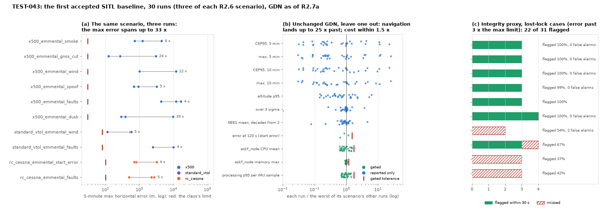

# TEST-043: the first accepted SITL baseline, and integrity rates (R2.7b)

**Question.** R2.7, second part (R2.7b, agreed):
- score sets of runs the way the requirements count (CEP95 over every sample, the max
  rule over flights);
- score the integrity rates, REQ-INT-002 and 003, with a labelled proxy until R4.4;
- compare each set against the last accepted baseline, kept in a committed file that
  changes only by an explicit accept, with several runs per scenario.

Where does GDN stand on three runs of each R2.6 scenario, and what can a SITL baseline
catch?

**Answer, short.**
- **The tools:**
  - **`tools/score_set.py` (new)** pools runs per scenario, compares them with
    `config/baselines/sitl.json`, and writes `set.md`, `set.json` and `set.png`;
    `--accept` changes the baseline.
  - **`tools/score_run.py`** now scores the integrity proxy and keeps each run's samples
    (`series.npz`).
  - **`tools/run_scenario.py --runs N`** flies the list N times and scores the set.
  - **Self-checked in CI** on made-up runs: pooled CEP95, the max rule, the integrity
    cases, the comparison, and that accept refuses failed or too few runs.
- **The baseline, 30 runs:** R2.7a's run of each scenario and two more, 148 minutes of
  route. All 30 passed their scenario check, replayed bit for bit and tore down clean.
- **GDN fails every requirement on every scenario, now pooled:**
  - **Accuracy:** 5-minute CEP95 from 556 m (VTOL, wind) to 13 km (x500, faults); none
    of the 30 flights stayed under its max limit.
  - **Consistency:** 28 to 100% of samples over 3 sigma, against 1%.
  - **Altitude:** p95 7.8 m to 41 m against 5 m, and 7 km with the stuck baro (OI-017).
  - **Acquisition:** the cessna's 150 m start wasn't acquired in any run (450 to 705 m
    at 120 s).
- **Integrity, by the proxy:**
  - **Lost lock:** 22 of 31 cases flagged within 30 s (71%, against 99%). The x500's 16
    are flagged only because GDN's 3 sigma is over the x500's 30 m limit from the route's
    start. On the VTOL and the cessna, 3 of 12.
  - **The misses are "confident and wrong":** when the error passed 240 to 300 m, GDN's
    3 sigma was 37 to 92 m.
  - **False alarms:** 2 in 1.44 h of nominal flight, about 14 per 10 h against 1. Both
    were on the VTOL wind flights.
- **What the baseline can catch, measured (leave one out, unchanged GDN):**
  - **Navigation:** one scenario's three runs span up to 33 x in the 5-minute max (about 5 x
    for the median scenario). A run lands up to 25 x past the worst of the other two. So
    no tolerance a few runs can support would tell a regression from the spread: the
    navigation, consistency and integrity metrics are **reported, not gated**.
  - **Cost:** within 1.5 x across sessions (memory within 1.06 x). These are **gated**:
    CPU, memory, processing time, and the error at 120 s from a start error, with
    tolerances above the spread. Comparing the accepted set with itself gives 0 of 31
    worse.
  - **Until GDN's drift is bounded** (OI-012, Phase 3), the navigation regression guard
    stays the Monte Carlo in CI, which is repeatable.



*TEST-043 (`tools/plot_test043.py`, from `test043_data/`).*
- *(a) The 5-minute max error of each run, per scenario, with the class's limit (red),
  and each scenario's spread, max over min.*
- *(b) Leave one out: each run against the worst of its scenario's other two, per
  metric. Above 1 means past every other run. Red marks are the gated metrics'
  tolerances.*
- *(c) The integrity proxy: lost-lock cases flagged within 30 s, and missed, per
  scenario; the median share of the flight flagged; false alarms on nominal flights.*

## How

- **The set:** the ten R2.6 scenarios, three runs each:
  - R2.7a's runs (`log/r27a/final2`, 26 November, morning), re-scored with this code;
  - two more of each (`tools/run_scenario.py config/scenarios/*.yaml --runs 2`, the same
    afternoon, 13:17 to 15:30 UTC, about 2 h 15 min).

  The scenario files and GDN were the same throughout. Both sessions ran on mains power
  with the performance profile, with no viewers open.
- **Pooling (`tools/score_set.py`), per scenario:**
  - CEP95 over every sample of the set's flights in each window;
  - the max rule as the number of flights never over the max limit;
  - over 3 sigma and the altitude p95 over every sample;
  - REQ-ACQ-001 as the flights under the limit at 120 s.
- **The integrity proxy (`tools/score_run.py`, agreed until R4.4):**
  - **The flag:** GDN "flags" while 3 x its horizontal sigma is over the class's 5-minute
    max limit (x500 30 m, VTOL 80 m, cessna 100 m).
  - **A lost-lock case (REQ-INT-002):** the error passes 3 x that limit, having been
    under the limit since the last case. It's detected if the flag is on within 30 s. A
    case the flight ends too soon after isn't judged.
  - **A false alarm (REQ-INT-003):** a flagged spell (gaps under 10 s merged) in which
    the error never passes the limit.
  - **Nominal flights:** no sensor faults and no start error. GDN uses no GNSS, so GNSS
    cuts and spoofing are nominal to it.
- **The baseline (`config/baselines/sitl.json`):**
  - **Contents:** each accepted run's metrics per scenario (13 metrics), the scenario
    file's hash, and when and at which commit it was accepted.
  - **The comparison:** a new set's median per metric against the baseline's runs.
  - **Accepting:** `--accept` refuses a run that failed its scenario check, fewer than
    three runs of a scenario, or runs of different scenario files.
- **Calibrating the comparison:**
  - **The method:** leave one out over the 30 runs. Each run is compared, unchanged,
    against the other two of its scenario. That is how far an unchanged GDN lands from a
    baseline.
  - **The first rule:** gate every metric at 10% past the worst baseline run. It called
    18 of the 30 unchanged runs WORSE somewhere.
  - **Alternatives tried:** gating at 2 x the worst run still called 10 of 30 WORSE.
    A sign test across the ten scenarios, one new run each, didn't catch a 3 x
    regression in horizontal error.
  - **Hence the split:** gated where the spread is small, reported elsewhere.

## Results

**Pooled against the requirements** (`test043_data/set.md`):

| Scenario | 5-min CEP95 | Flights under the max | Over 3 sigma | Altitude p95 |
|---|---|---|---|---|
| x500 smoke | 3273 m of 15 | 0 of 3 | 81.2% | 33.9 m |
| x500 GNSS cut | 1863 m of 15 | 0 of 3 | 27.7% | 14.1 m |
| x500 wind | 6429 m of 15 | 0 of 3 | 82.5% | 23.7 m |
| x500 spoof | 2300 m of 15 | 0 of 3 | 81.9% | 39.2 m |
| x500 faults | 13105 m of 15 | 0 of 3 | 80.0% | 7133 m (stuck baro, OI-017) |
| x500 dusk | 6121 m of 15 | 0 of 3 | 59.4% | 7.8 m |
| VTOL wind | 556 m of 40 | 0 of 3 | 58.7% | 10.8 m |
| VTOL faults | 7980 m of 40 | 0 of 3 | 71.7% | 40.8 m |
| cessna start error | 2377 m of 50 | 0 of 3 | 100.0% | 11.2 m |
| cessna faults | 2075 m of 50 | 0 of 3 | 70.6% | 20.0 m |

Every limit fails: REQ-NAV-001 to 003, REQ-NAV-010 at 5 m, and REQ-INT-001 at 1%. No
route is 10 minutes long (the longest flies 6.5 minutes from the route's start), so the
10-minute figures are those of shorter flights. REQ-ACQ-001: 0 of 3 cessna flights under
100 m at 120 s, a median of 604 m.

**Integrity (proxy):**

| Scenario | Cases flagged within 30 s | False alarms (nominal) | Flagged (median run) |
|---|---|---|---|
| x500, all six | 19 of 19 | 0 in 71 min | 99 to 100% |
| VTOL wind | 0 of 2 | 2 in 14 min | 54% |
| VTOL faults | 3 of 4 | (not nominal) | 67% |
| cessna start error | 0 of 3 | (not nominal) | 37% |
| cessna faults | 0 of 3 | (not nominal) | 42% |
| **all** | **22 of 31 (71%)** | **2 in 1.44 h** | |

- **The x500 is always flagged:** GDN's 3 sigma is already 49 to 65 m at the route's
  start, against a 30 m limit, and it only grows. Each case is "detected" at 0 s, so the x500's
  detection rate says nothing yet.
- **Each miss is GDN overconfident by 3 to 7 x:** its 3 sigma was 37 to 92 m when the
  error passed 240 to 300 m, and stayed under the limit for the next 30 s.
- **The cessna start-error flights:**
  - **The start:** GDN starts flagged (3 sigma 450 m, from its 150 m start sigma).
  - **The lock:** within 14 to 26 s its 3 sigma is down to 50 to 66 m while it is still
    300 m off. That is a confident lock on the wrong place: REQ-INT-002's very case.
- **Both false alarms are on the VTOL wind flights.** The flag came on while the error
  was 11 and 24 m and went off before the error passed 80 m. In one of the two flights the
  error passed 240 m 35 s later, unflagged.
- **1.44 h of nominal flight can't show a rate of 1 per 10 h.** It can show that 14 per
  10 h is far over it.

**Run-to-run spread (leave one out, unchanged GDN; `test043_data/loo.csv`):**

| Metric | Median x the worst other run | Max | Gated tolerance |
|---|---|---|---|
| CEP95, 5 min | 0.30 | 22.9 | reported |
| max, 5 min | 0.28 | 25.3 | reported |
| altitude p95 | 0.62 | 6.2 | reported |
| over 3 sigma | 0.97 | 3.7 | reported |
| NEES mean, decades from 2 | 0.88 | 4.5 | reported |
| error at 120 s (start error) | 0.86 | 1.17 | 1.5 x |
| eskf_node CPU mean | 0.83 | 1.50 | 1.75 x |
| eskf_node memory max | 0.99 | 1.06 | 1.2 x |
| processing p95 per IMU sample | 0.88 | 1.42 | 1.75 x |

- **Navigation:** the same flight's 5-minute max error spans 4 to 33 x across its three
  runs (figure, a). The x500 GNSS-cut flight ran 125 m, 270 m and 3.0 km.
- **Cost:**
  - **It moves with the session.** The morning session ran `eskf_node` at 3.0 to 4.7%
    of one core and 0.035 to 0.048 ms p95; the afternoon at 2.7 to 3.1% and 0.031 to
    0.036 ms, with the same code.
  - **Hence the tolerances.** They sit above that, so a gated WORSE means a change of
    about 2 x.
- **The comparison works end to end.** The accepted set compared with itself gives 31
  gated comparisons within, and all 90 reported ones among the baseline's runs.

## Found on the way

- **About a third of the runs ran slower than real time, even on mains power.**
  - **The numbers:** 9 of the 30 (8 of the afternoon's 20, and one of the morning's)
    ran at 0.933 to 0.955 of real time; the rest at 0.987 to 1.000. Every run logged 1 to
    28 PX4 "time jump" re-syncs.
  - **No sign it drives the error:** the slow runs are the worst of their scenario in 5
    cases, the best in 3 and in the middle once. The two 10 km VTOL-faults flights ran
    at 0.939 and 1.000.
  - **The cause isn't known:** both sessions were on the charger with the performance
    profile, with no viewers open. Each run's report states its real-time factor, and the
    processing latency is on the host's clock, so it's unaffected.
- **My first integrity proxy over-counted false alarms:** 11 in 0.48 h, on R2.7a's runs.
  - **The x500:** it starts flagged (above), and each flight counted one at t = 0, though
    its error then grew to kilometres.
  - **The VTOL:** its flag chattered at the threshold, four onsets in 10 s.
  - **The fix:** a false alarm is now a flagged spell, with gaps under 10 s merged, in
    which the error never passes the limit. A warning that comes true isn't false.
    Self-checked.

## Not in scope, and limits

- **The integrity numbers are a proxy.** GDN has no integrity status yet (R4.4). The
  x500's 100% detection is the proxy's, from GDN's large starting sigma, not GDN
  detecting anything.
- **Three runs per scenario can't show a 99% rule.** That needs a hundred flights and
  more (R2.8's matrix and R5.5's qualification). Here they were all over the limit
  anyway.
- **The baseline can't gate navigation yet.** A worse GDN would show in the report's
  "x the worst" column, but SITL needs bounded drift (Phase 3) or many more runs before
  a navigation tolerance means anything. Re-calibrate the gates from the spread table
  when the baseline is next accepted.
- **The baseline's run directories are local** (`log/` isn't committed). Each run's
  `metrics.json` and the set's report are in `test043_data/`.

## Reproduce

```bash
python3 tools/score_run.py --selfcheck && python3 tools/score_set.py --selfcheck
tools/docker_dev.sh run --gpu -- tools/run_scenario.py config/scenarios/*.yaml --runs 2 --out log/r27b/batch   # mains power
tools/docker_dev.sh run -- bash -c 'source install/setup.bash && python3 tools/score_run.py log/r27a/final2/*/*/'
python3 tools/score_set.py log/r27a/final2 log/r27b/batch --out log/r27b/set30 --accept --note "..."
python3 tools/plot_test043.py --export docs/test_reports/test043_data log/r27a/final2 log/r27b/batch
python3 tools/plot_test043.py docs/test_reports/test043_data --out docs/test_reports/test043_baseline.png
```
