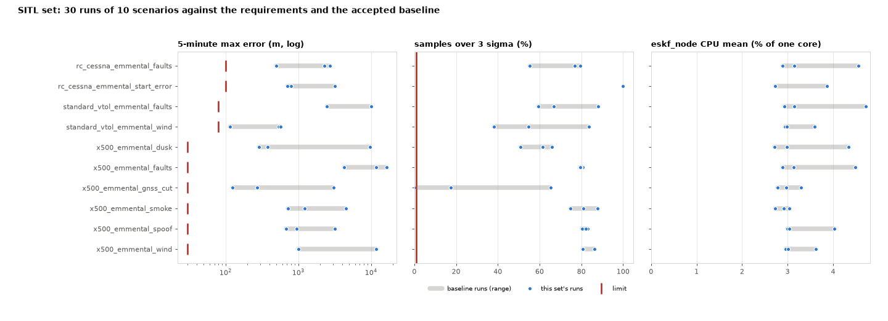

# SITL set: scores and the baseline

30 runs of 10 scenarios, pooled per scenario as the requirements count. Run directories are listed in set.json.

## Against the requirements

| Scenario | Runs | 5 min CEP95 (pooled) | 5 min flights never over the max | 10 min CEP95 | over 3 sigma (REQ-INT-001) | altitude p95 (REQ-NAV-010) |
|---|---|---|---|---|---|---|
| rc_cessna_emmental_faults (REQ-NAV-003) | 3 (14 min) | 2075.3 m of 50: FAIL | 0 of 3 under 100 m: FAIL | 2075.3 m of 75 (0 of 3 complete) | 70.65% of 1: FAIL | 20.0 m of 5: FAIL |
| rc_cessna_emmental_start_error (REQ-NAV-003) | 3 (14 min) | 2377.4 m of 50: FAIL | 0 of 3 under 100 m: FAIL | 2377.4 m of 75 (0 of 3 complete) | 100.00% of 1: FAIL | 11.2 m of 5: FAIL |
| standard_vtol_emmental_faults (REQ-NAV-002) | 3 (14 min) | 7979.7 m of 40: FAIL | 0 of 3 under 80 m: FAIL | 7979.7 m of 60 (0 of 3 complete) | 71.72% of 1: FAIL | 40.8 m of 5: FAIL |
| standard_vtol_emmental_wind (REQ-NAV-002) | 3 (14 min) | 555.6 m of 40: FAIL | 0 of 3 under 80 m: FAIL | 555.6 m of 60 (0 of 3 complete) | 58.75% of 1: FAIL | 10.8 m of 5: FAIL |
| x500_emmental_dusk (REQ-NAV-001) | 3 (8 min) | 6121.4 m of 15: FAIL | 0 of 3 under 30 m: FAIL | 6121.4 m of 25 (0 of 3 complete) | 59.40% of 1: FAIL | 7.8 m of 5: FAIL |
| x500_emmental_faults (REQ-NAV-001) | 3 (19 min) | 13104.5 m of 15: FAIL | 0 of 3 under 30 m: FAIL | 22018.6 m of 25 (0 of 3 complete) | 79.95% of 1: FAIL | 7133.3 m of 5: FAIL |
| x500_emmental_gnss_cut (REQ-NAV-001) | 3 (7 min) | 1863.4 m of 15: FAIL | 0 of 3 under 30 m: FAIL | 1863.4 m of 25 (0 of 3 complete) | 27.69% of 1: FAIL | 14.1 m of 5: FAIL |
| x500_emmental_smoke (REQ-NAV-001) | 3 (19 min) | 3272.6 m of 15: FAIL | 0 of 3 under 30 m: FAIL | 5443.4 m of 25 (0 of 3 complete) | 81.19% of 1: FAIL | 33.9 m of 5: FAIL |
| x500_emmental_spoof (REQ-NAV-001) | 3 (18 min) | 2299.7 m of 15: FAIL | 0 of 3 under 30 m: FAIL | 3585.8 m of 25 (0 of 3 complete) | 81.89% of 1: FAIL | 39.2 m of 5: FAIL |
| x500_emmental_wind (REQ-NAV-001) | 3 (19 min) | 6429.1 m of 15: FAIL | 0 of 3 under 30 m: FAIL | 15754.8 m of 25 (0 of 3 complete) | 82.53% of 1: FAIL | 23.7 m of 5: FAIL |

The max rule asks 99% of flights; a few flights can only show all of them under, or not.

- **REQ-ACQ-001, rc_cessna_emmental_start_error:** 0 of 3 flights under 100 m at 120 s (median 603.5 m).

## Integrity (proxy until R4.4)

GDN "flags" while 3 x its sigma is over the class's 5-minute max limit. A lost-lock case is the error passing 3 x that limit; it's detected if flagged within 30 s. False alarms count on nominal flights (no sensor faults, no start error).

| Scenario | Lost-lock cases flagged in 30 s (REQ-INT-002, 99%) | False alarms, nominal (REQ-INT-003, 1 per 10 h) | Time flagged (median run) |
|---|---|---|---|
| rc_cessna_emmental_faults | 0 of 3 | not nominal | 41.6% |
| rc_cessna_emmental_start_error | 0 of 3 | not nominal | 37.1% |
| standard_vtol_emmental_faults | 3 of 4 | not nominal | 66.6% |
| standard_vtol_emmental_wind | 0 of 2 | 2 in 14 min | 53.8% |
| x500_emmental_dusk | 4 of 4 | 0 in 8 min | 100.0% |
| x500_emmental_faults | 3 of 3 | not nominal | 100.0% |
| x500_emmental_gnss_cut | 3 of 3 | 0 in 7 min | 100.0% |
| x500_emmental_smoke | 3 of 3 | 0 in 19 min | 100.0% |
| x500_emmental_spoof | 3 of 3 | 0 in 18 min | 98.6% |
| x500_emmental_wind | 3 of 3 | 0 in 19 min | 100.0% |
| **all** | **22 of 31 (71.0%)** | **2 in 1.44 h (13.9 per 10 h)** | |

## Cost

| Scenario | eskf_node CPU mean (worst run) | memory max | processing p95 | slowest 30 s real-time factor |
|---|---|---|---|---|
| rc_cessna_emmental_faults | 4.6% of one core | 46.8 MB | 0.045 ms | 0.932 |
| rc_cessna_emmental_start_error | 3.9% of one core | 45.5 MB | 0.040 ms | 0.932 |
| standard_vtol_emmental_faults | 4.7% of one core | 46.0 MB | 0.045 ms | 0.934 |
| standard_vtol_emmental_wind | 3.6% of one core | 46.9 MB | 0.037 ms | 0.996 |
| x500_emmental_dusk | 4.3% of one core | 47.2 MB | 0.048 ms | 0.931 |
| x500_emmental_faults | 4.5% of one core | 46.9 MB | 0.042 ms | 0.925 |
| x500_emmental_gnss_cut | 3.3% of one core | 45.7 MB | 0.037 ms | 0.935 |
| x500_emmental_smoke | 3.0% of one core | 45.2 MB | 0.036 ms | 0.928 |
| x500_emmental_spoof | 4.0% of one core | 47.5 MB | 0.041 ms | 0.993 |
| x500_emmental_wind | 3.6% of one core | 45.3 MB | 0.041 ms | 0.929 |

## Against the baseline (config/baselines/sitl.json)

Gated (31 comparisons): **0 worse**, 0 better, 31 within the tolerance.

| Scenario | Metric | Baseline runs (best to worst) | This set (median) | x the worst | Verdict |
|---|---|---|---|---|---|
| rc_cessna_emmental_faults | eskf_node CPU mean | 2.9 to 4.6 % core (3) | 3.1 % core (3) | 0.69 | within |
| rc_cessna_emmental_faults | eskf_node memory max | 43.5 to 46.8 MB (3) | 45.2 MB (3) | 0.97 | within |
| rc_cessna_emmental_faults | processing p95 per IMU sample | 0.031 to 0.045 ms (3) | 0.032 ms (3) | 0.72 | within |
| rc_cessna_emmental_start_error | error at 120 s (start error) | 449.3 to 705.2 m (3) | 603.5 m (3) | 0.86 | within |
| rc_cessna_emmental_start_error | eskf_node CPU mean | 2.7 to 3.9 % core (3) | 2.7 % core (3) | 0.71 | within |
| rc_cessna_emmental_start_error | eskf_node memory max | 44.2 to 45.5 MB (3) | 44.6 MB (3) | 0.98 | within |
| rc_cessna_emmental_start_error | processing p95 per IMU sample | 0.034 to 0.040 ms (3) | 0.035 ms (3) | 0.87 | within |
| standard_vtol_emmental_faults | eskf_node CPU mean | 2.9 to 4.7 % core (3) | 3.1 % core (3) | 0.67 | within |
| standard_vtol_emmental_faults | eskf_node memory max | 45.4 to 46.0 MB (3) | 45.5 MB (3) | 0.99 | within |
| standard_vtol_emmental_faults | processing p95 per IMU sample | 0.031 to 0.045 ms (3) | 0.031 ms (3) | 0.71 | within |
| standard_vtol_emmental_wind | eskf_node CPU mean | 2.9 to 3.6 % core (3) | 3.0 % core (3) | 0.83 | within |
| standard_vtol_emmental_wind | eskf_node memory max | 43.7 to 46.9 MB (3) | 44.1 MB (3) | 0.94 | within |
| standard_vtol_emmental_wind | processing p95 per IMU sample | 0.033 to 0.037 ms (3) | 0.034 ms (3) | 0.90 | within |
| x500_emmental_dusk | eskf_node CPU mean | 2.7 to 4.3 % core (3) | 3.0 % core (3) | 0.69 | within |
| x500_emmental_dusk | eskf_node memory max | 45.0 to 47.2 MB (3) | 45.3 MB (3) | 0.96 | within |
| x500_emmental_dusk | processing p95 per IMU sample | 0.034 to 0.048 ms (3) | 0.036 ms (3) | 0.75 | within |
| x500_emmental_faults | eskf_node CPU mean | 2.9 to 4.5 % core (3) | 3.1 % core (3) | 0.70 | within |
| x500_emmental_faults | eskf_node memory max | 45.1 to 46.9 MB (3) | 45.4 MB (3) | 0.97 | within |
| x500_emmental_faults | processing p95 per IMU sample | 0.031 to 0.042 ms (3) | 0.032 ms (3) | 0.76 | within |
| x500_emmental_gnss_cut | eskf_node CPU mean | 2.8 to 3.3 % core (3) | 3.0 % core (3) | 0.90 | within |
| x500_emmental_gnss_cut | eskf_node memory max | 45.3 to 45.7 MB (3) | 45.3 MB (3) | 0.99 | within |
| x500_emmental_gnss_cut | processing p95 per IMU sample | 0.033 to 0.037 ms (3) | 0.035 ms (3) | 0.94 | within |
| x500_emmental_smoke | eskf_node CPU mean | 2.7 to 3.0 % core (3) | 2.9 % core (3) | 0.96 | within |
| x500_emmental_smoke | eskf_node memory max | 44.4 to 45.2 MB (3) | 44.6 MB (3) | 0.99 | within |
| x500_emmental_smoke | processing p95 per IMU sample | 0.033 to 0.036 ms (3) | 0.035 ms (3) | 0.97 | within |
| x500_emmental_spoof | eskf_node CPU mean | 3.0 to 4.0 % core (3) | 3.0 % core (3) | 0.75 | within |
| x500_emmental_spoof | eskf_node memory max | 43.2 to 47.5 MB (3) | 45.6 MB (3) | 0.96 | within |
| x500_emmental_spoof | processing p95 per IMU sample | 0.033 to 0.041 ms (3) | 0.034 ms (3) | 0.84 | within |
| x500_emmental_wind | eskf_node CPU mean | 3.0 to 3.6 % core (3) | 3.0 % core (3) | 0.83 | within |
| x500_emmental_wind | eskf_node memory max | 42.8 to 45.3 MB (3) | 45.3 MB (3) | 1.00 | within |
| x500_emmental_wind | processing p95 per IMU sample | 0.034 to 0.041 ms (3) | 0.036 ms (3) | 0.88 | within |

Reported, not gated (SITL's run-to-run spread is wider than a regression could show, until GDN's drift is bounded):

| Scenario | Metric | Baseline runs (best to worst) | This set (median) | x the worst | Where |
|---|---|---|---|---|---|
| rc_cessna_emmental_faults | CEP95, 5 min | 474.5 to 2509.5 m (3) | 1943.5 m (3) | 0.77 | among |
| rc_cessna_emmental_faults | max, 5 min | 501.3 to 2715.8 m (3) | 2273.5 m (3) | 0.84 | among |
| rc_cessna_emmental_faults | CEP95, 10 min | 474.5 to 2509.5 m (3) | 1943.5 m (3) | 0.77 | among |
| rc_cessna_emmental_faults | max, 10 min | 501.3 to 2715.8 m (3) | 2273.5 m (3) | 0.84 | among |
| rc_cessna_emmental_faults | altitude p95 | 12.3 to 20.6 m (3) | 13.3 m (3) | 0.65 | among |
| rc_cessna_emmental_faults | over 3 sigma | 55.2 to 79.5 % (3) | 76.7 % (3) | 0.96 | among |
| rc_cessna_emmental_faults | NEES mean, decades from 2 | 2.197 to 3.057 (3) | 2.681 (3) | 0.88 | among |
| rc_cessna_emmental_faults | lost lock flagged (proxy) | 0.0 to 0.0 % (3) | 0.0 % (3) | n/a | among |
| rc_cessna_emmental_faults | false alarms (proxy) | 0.0 to 1.0 (3) | 1.0 (3) | 1.00 | among |
| rc_cessna_emmental_start_error | CEP95, 5 min | 658.2 to 2842.6 m (3) | 706.5 m (3) | 0.25 | among |
| rc_cessna_emmental_start_error | max, 5 min | 705.2 to 3171.3 m (3) | 791.1 m (3) | 0.25 | among |
| rc_cessna_emmental_start_error | CEP95, 10 min | 658.2 to 2842.6 m (3) | 706.5 m (3) | 0.25 | among |
| rc_cessna_emmental_start_error | max, 10 min | 705.2 to 3171.3 m (3) | 791.1 m (3) | 0.25 | among |
| rc_cessna_emmental_start_error | altitude p95 | 8.0 to 14.7 m (3) | 10.9 m (3) | 0.74 | among |
| rc_cessna_emmental_start_error | over 3 sigma | 100.0 to 100.0 % (3) | 100.0 % (3) | 1.00 | among |
| rc_cessna_emmental_start_error | NEES mean, decades from 2 | 2.698 to 2.967 (3) | 2.957 (3) | 1.00 | among |
| rc_cessna_emmental_start_error | lost lock flagged (proxy) | 0.0 to 0.0 % (3) | 0.0 % (3) | n/a | among |
| rc_cessna_emmental_start_error | false alarms (proxy) | 0.0 to 0.0 (3) | 0.0 (3) | n/a | among |
| standard_vtol_emmental_faults | CEP95, 5 min | 1557.2 to 8675.5 m (3) | 8597.6 m (3) | 0.99 | among |
| standard_vtol_emmental_faults | max, 5 min | 2470.1 to 10050.3 m (3) | 9995.6 m (3) | 0.99 | among |
| standard_vtol_emmental_faults | CEP95, 10 min | 1557.2 to 8675.5 m (3) | 8597.6 m (3) | 0.99 | among |
| standard_vtol_emmental_faults | max, 10 min | 2470.1 to 10050.3 m (3) | 9995.6 m (3) | 0.99 | among |
| standard_vtol_emmental_faults | altitude p95 | 5.8 to 41.0 m (3) | 7.9 m (3) | 0.19 | among |
| standard_vtol_emmental_faults | over 3 sigma | 59.5 to 88.2 % (3) | 66.7 % (3) | 0.76 | among |
| standard_vtol_emmental_faults | NEES mean, decades from 2 | 2.771 to 3.981 (3) | 3.129 (3) | 0.79 | among |
| standard_vtol_emmental_faults | lost lock flagged (proxy) | 100.0 to 0.0 % (3) | 100.0 % (3) | n/a | among |
| standard_vtol_emmental_faults | false alarms (proxy) | 0.0 to 2.0 (3) | 0.0 (3) | 0.00 | among |
| standard_vtol_emmental_wind | CEP95, 5 min | 110.3 to 564.0 m (3) | 532.7 m (3) | 0.94 | among |
| standard_vtol_emmental_wind | max, 5 min | 114.5 to 570.4 m (3) | 539.9 m (3) | 0.95 | among |
| standard_vtol_emmental_wind | CEP95, 10 min | 110.3 to 564.0 m (3) | 532.7 m (3) | 0.94 | among |
| standard_vtol_emmental_wind | max, 10 min | 114.5 to 570.4 m (3) | 539.9 m (3) | 0.95 | among |
| standard_vtol_emmental_wind | altitude p95 | 3.5 to 11.5 m (3) | 5.2 m (3) | 0.45 | among |
| standard_vtol_emmental_wind | over 3 sigma | 38.2 to 83.5 % (3) | 54.6 % (3) | 0.65 | among |
| standard_vtol_emmental_wind | NEES mean, decades from 2 | 1.190 to 2.279 (3) | 1.955 (3) | 0.86 | among |
| standard_vtol_emmental_wind | lost lock flagged (proxy) | 0.0 to 0.0 % (2) | 0.0 % (3) | n/a | among |
| standard_vtol_emmental_wind | false alarms (proxy) | 0.0 to 1.0 (3) | 1.0 (3) | 1.00 | among |
| x500_emmental_dusk | CEP95, 5 min | 266.0 to 8390.4 m (3) | 367.0 m (3) | 0.04 | among |
| x500_emmental_dusk | max, 5 min | 290.2 to 9629.9 m (3) | 380.9 m (3) | 0.04 | among |
| x500_emmental_dusk | CEP95, 10 min | 266.0 to 8390.4 m (3) | 367.0 m (3) | 0.04 | among |
| x500_emmental_dusk | max, 10 min | 290.2 to 9629.9 m (3) | 380.9 m (3) | 0.04 | among |
| x500_emmental_dusk | altitude p95 | 4.2 to 9.8 m (3) | 8.1 m (3) | 0.83 | among |
| x500_emmental_dusk | over 3 sigma | 50.9 to 65.8 % (3) | 61.6 % (3) | 0.94 | among |
| x500_emmental_dusk | NEES mean, decades from 2 | 1.790 to 2.939 (3) | 1.907 (3) | 0.65 | among |
| x500_emmental_dusk | lost lock flagged (proxy) | 100.0 to 100.0 % (3) | 100.0 % (3) | 1.00 | among |
| x500_emmental_dusk | false alarms (proxy) | 0.0 to 0.0 (3) | 0.0 (3) | n/a | among |
| x500_emmental_faults | CEP95, 5 min | 3816.7 to 15290.6 m (3) | 10425.7 m (3) | 0.68 | among |
| x500_emmental_faults | max, 5 min | 4290.2 to 16489.5 m (3) | 11871.5 m (3) | 0.72 | among |
| x500_emmental_faults | CEP95, 10 min | 3862.5 to 31867.9 m (3) | 18248.4 m (3) | 0.57 | among |
| x500_emmental_faults | max, 10 min | 4290.2 to 38489.5 m (3) | 20480.8 m (3) | 0.53 | among |
| x500_emmental_faults | altitude p95 | 1573.9 to 10782.4 m (3) | 1730.6 m (3) | 0.16 | among |
| x500_emmental_faults | over 3 sigma | 79.4 to 80.8 % (3) | 79.7 % (3) | 0.99 | among |
| x500_emmental_faults | NEES mean, decades from 2 | 1.986 to 2.316 (3) | 2.249 (3) | 0.97 | among |
| x500_emmental_faults | lost lock flagged (proxy) | 100.0 to 100.0 % (3) | 100.0 % (3) | 1.00 | among |
| x500_emmental_faults | false alarms (proxy) | 0.0 to 0.0 (3) | 0.0 (3) | n/a | among |
| x500_emmental_gnss_cut | CEP95, 5 min | 114.4 to 2599.9 m (3) | 238.6 m (3) | 0.09 | among |
| x500_emmental_gnss_cut | max, 5 min | 124.6 to 3030.1 m (3) | 269.8 m (3) | 0.09 | among |
| x500_emmental_gnss_cut | CEP95, 10 min | 114.4 to 2599.9 m (3) | 238.6 m (3) | 0.09 | among |
| x500_emmental_gnss_cut | max, 10 min | 124.6 to 3030.1 m (3) | 269.8 m (3) | 0.09 | among |
| x500_emmental_gnss_cut | altitude p95 | 3.7 to 14.2 m (3) | 6.3 m (3) | 0.45 | among |
| x500_emmental_gnss_cut | over 3 sigma | 0.0 to 65.2 % (3) | 17.5 % (3) | 0.27 | among |
| x500_emmental_gnss_cut | NEES mean, decades from 2 | 0.239 to 3.065 (3) | 0.675 (3) | 0.22 | among |
| x500_emmental_gnss_cut | lost lock flagged (proxy) | 100.0 to 100.0 % (3) | 100.0 % (3) | 1.00 | among |
| x500_emmental_gnss_cut | false alarms (proxy) | 0.0 to 0.0 (3) | 0.0 (3) | n/a | among |
| x500_emmental_smoke | CEP95, 5 min | 641.9 to 4052.1 m (3) | 956.9 m (3) | 0.24 | among |
| x500_emmental_smoke | max, 5 min | 727.4 to 4490.4 m (3) | 1227.2 m (3) | 0.27 | among |
| x500_emmental_smoke | CEP95, 10 min | 1858.4 to 6366.8 m (3) | 2662.7 m (3) | 0.42 | among |
| x500_emmental_smoke | max, 10 min | 2238.9 to 6751.4 m (3) | 3264.0 m (3) | 0.48 | among |
| x500_emmental_smoke | altitude p95 | 7.7 to 34.0 m (3) | 24.2 m (3) | 0.71 | among |
| x500_emmental_smoke | over 3 sigma | 74.8 to 87.9 % (3) | 81.0 % (3) | 0.92 | among |
| x500_emmental_smoke | NEES mean, decades from 2 | 2.623 to 3.053 (3) | 2.999 (3) | 0.98 | among |
| x500_emmental_smoke | lost lock flagged (proxy) | 100.0 to 100.0 % (3) | 100.0 % (3) | 1.00 | among |
| x500_emmental_smoke | false alarms (proxy) | 0.0 to 0.0 (3) | 0.0 (3) | n/a | among |
| x500_emmental_spoof | CEP95, 5 min | 545.5 to 2617.3 m (3) | 902.9 m (3) | 0.34 | among |
| x500_emmental_spoof | max, 5 min | 685.8 to 3189.9 m (3) | 940.3 m (3) | 0.29 | among |
| x500_emmental_spoof | CEP95, 10 min | 899.9 to 5700.2 m (3) | 1243.1 m (3) | 0.22 | among |
| x500_emmental_spoof | max, 10 min | 940.3 to 6996.1 m (3) | 1503.7 m (3) | 0.21 | among |
| x500_emmental_spoof | altitude p95 | 16.5 to 44.4 m (3) | 23.7 m (3) | 0.53 | among |
| x500_emmental_spoof | over 3 sigma | 80.5 to 83.2 % (3) | 82.0 % (3) | 0.99 | among |
| x500_emmental_spoof | NEES mean, decades from 2 | 2.571 to 3.503 (3) | 2.799 (3) | 0.80 | among |
| x500_emmental_spoof | lost lock flagged (proxy) | 100.0 to 100.0 % (3) | 100.0 % (3) | 1.00 | among |
| x500_emmental_spoof | false alarms (proxy) | 0.0 to 0.0 (3) | 0.0 (3) | n/a | among |
| x500_emmental_wind | CEP95, 5 min | 822.6 to 9708.5 m (3) | 863.8 m (3) | 0.09 | among |
| x500_emmental_wind | max, 5 min | 994.7 to 11721.6 m (3) | 1001.8 m (3) | 0.09 | among |
| x500_emmental_wind | CEP95, 10 min | 1828.7 to 20608.3 m (3) | 2190.0 m (3) | 0.11 | among |
| x500_emmental_wind | max, 10 min | 2100.1 to 22778.3 m (3) | 2703.4 m (3) | 0.12 | among |
| x500_emmental_wind | altitude p95 | 9.9 to 23.7 m (3) | 18.2 m (3) | 0.77 | among |
| x500_emmental_wind | over 3 sigma | 80.6 to 86.3 % (3) | 80.7 % (3) | 0.94 | among |
| x500_emmental_wind | NEES mean, decades from 2 | 2.710 to 3.515 (3) | 3.086 (3) | 0.88 | among |
| x500_emmental_wind | lost lock flagged (proxy) | 100.0 to 100.0 % (3) | 100.0 % (3) | 1.00 | among |
| x500_emmental_wind | false alarms (proxy) | 0.0 to 0.0 (3) | 0.0 (3) | n/a | among |

## Run-to-run spread (leave one out)

Each run against the worst of its scenario's other runs in this set: how far an unchanged GDN lands past a baseline of the others. A gated metric's tolerance has to sit above it.

| Metric | Comparisons | Past the worst | Median x the worst | Max x the worst | Tolerance |
|---|---|---|---|---|---|
| CEP95, 5 min | 30 | 10 | 0.30 | 22.86 | reported |
| max, 5 min | 30 | 10 | 0.28 | 25.28 | reported |
| CEP95, 10 min | 30 | 10 | 0.36 | 22.86 | reported |
| max, 10 min | 30 | 10 | 0.41 | 25.28 | reported |
| altitude p95 | 30 | 10 | 0.62 | 6.23 | reported |
| over 3 sigma | 30 | 9 | 0.97 | 3.72 | reported |
| NEES mean, decades from 2 | 30 | 10 | 0.88 | 4.54 | reported |
| lost lock flagged (proxy) | 20 | 0 | 1.00 | 1.00 | reported |
| false alarms (proxy) | 8 | 0 | 0.50 | 1.00 | reported |
| error at 120 s (start error) | 3 | 1 | 0.86 | 1.17 | 1.50 x (gated) |
| eskf_node CPU mean | 30 | 10 | 0.83 | 1.50 | 1.75 x (gated) |
| eskf_node memory max | 30 | 9 | 0.99 | 1.06 | 1.20 x (gated) |
| processing p95 per IMU sample | 30 | 10 | 0.88 | 1.42 | 1.75 x (gated) |
